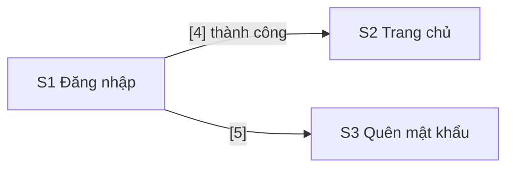

# SPEC: agent-roster

> **Module:** `agent-roster`, xem capability map trong [SPEC.md](SPEC.md). **Phụ thuộc:** `sdlc-contract`; dùng hook, script và cấu hình của `tracker-integration` và `quality-gates` (mục 2.11). **Được dùng bởi:** `dev-workflow`, `release-workflow`, `project-scaffold`, và `ci-agents` ở Cấp 2.
>
> **Trạng thái:** đã duyệt ngày 2026-10-30, sửa theo kết quả T1 cùng ngày (mục 2.12); plan ở [tasks/plan.md](tasks/plan.md). **Nguồn thảo luận:** [misc/brainstorm-discussion.md](misc/brainstorm-discussion.md), Phiên 13 · Lượt 1–6 và Phiên 14 · Lượt 1–2.

## 1. Mục tiêu

Mỗi vai trò agent của hợp đồng có một subagent của Claude Code biết rõ việc của mình: đầu vào, đầu ra, tool, skill, model và effort. Sau module này:

- Mười agent nằm ở `kit/.claude/agents/<role>.md`, sinh từ `agents/roster.yaml`, prompt viết tay của từng vai trò và hợp đồng. Hợp đồng đổi thì agent đổi theo.
- Mọi agent và phiên chính của bạn nạp chung một file quy ước, `kit/.claude/rules/ai-orchestrator.md`, cũng sinh từ hợp đồng.
- Hợp đồng có thêm artifact `design`: luồng màn hình bằng Mermaid; bố cục bằng ASCII có đánh số, hoặc bằng ảnh export từ Figma khi màn hình đã có thiết kế; hành vi bằng YAML. Một script kiểm file này cùng ảnh đi kèm, và CI chạy script đó.
- Báo cáo QA có thêm trạng thái NOT TESTED.
- `qa` lái trình duyệt bằng `playwright-cli`; `fe-dev` xem trang đang code bằng Chrome DevTools MCP.
- 16 skill được chép vào kit, ghim theo commit, giữ giấy phép: 13 skill của agent-skills và ba skill từ registry. Mỗi dự án khai thêm skill theo stack trong `.ai-orchestrator/roster.local.yaml`.
- Agent chạy làm phiên chính qua script `ao-agent.mjs`, để có đủ skill, effort và giới hạn lượt như khi chạy làm subagent.
- Hook `gh-guard` giới hạn file mỗi vai trò được ghi, và không cho vai trò chỉ đọc đổi bản checkout.
- Mười agent chạy thật trên `ao-pilot` qua một Epic nhỏ, mỗi lượt chạy có số đo; `fe-dev` được so ở `high` và `max`.

**Ngoài phạm vi:**

- Lúc nào gọi agent nào, nối các bước thành lệnh, khi nào nâng effort: `dev-workflow`.
- Luồng PR cho tài liệu (SPEC, design, plan): `dev-workflow`. Module này chỉ cho `ba`, `ux`, `sa` commit lên nhánh được giao.
- Pipeline E2E, regression và deploy thật; cách `qa` lấy đúng commit đã deploy; ai commit báo cáo regression lên nhánh release; cách đưa ảnh bằng chứng của `qa` lên Jira hoặc CI: `release-workflow`.
- Agent tự lấy thiết kế từ Figma: Figma MCP cho `ux` và `fe-dev`, script gọi REST API của Figma để render ảnh đúng phiên bản đã duyệt, agent dùng tài khoản Figma nào, bật tắt theo dự án. Phần này thành module riêng sau `agent-roster`, tên tạm `figma-integration` (bạn chọn ngày 2026-10-30). Ở module này, bạn export ảnh từ Figma.
- Cấu hình stack Next.js + NestJS, cài Playwright vào dự án, script đồng bộ kit: `project-scaffold`. Bản chép kit vẫn làm tay, qua PR.
- Số liệu cần lịch sử của nhiều item (cycle time, thời gian chờ release, thời gian chờ bạn): `orchestrator-cli` ở Cấp 2.
- Agent chạy trong GitHub Actions: `ci-agents` ở Cấp 2.

## 2. Thiết kế

### 2.1 Agent được sinh, không viết tay

| Nguồn | Nội dung |
|---|---|
| `agents/roster.yaml` | Model, effort, tool, quyền Jira, quyền git, file được ghi và skill nạp sẵn của từng vai trò; nguồn và commit của các skill chép vào kit |
| `agents/prompts/<role>.md` | Cách làm việc của vai trò, viết tay bằng tiếng Anh |
| `agents/rules.md` | Phần viết tay của file quy ước chung (mục 2.6) |
| Hợp đồng và cấu hình của kit | Stage, artifact và template, transition kèm tên trên Jira, App GitHub, đường dẫn được bảo vệ, tên trong trường Agent |

`scripts/render-agents.mjs` ghép các nguồn thành `kit/.claude/agents/<role>.md` và `kit/.claude/rules/ai-orchestrator.md`. `npm run agents:check` chạy trong CI của kit và đỏ khi file sinh ra cũ hơn nguồn, như `render:check`. Comment HTML trong prompt bị bỏ khi ghép, nên ghi chú nguồn trong prompt không tốn token.

Mỗi file agent gồm ba phần:

1. **Frontmatter:** `name` trùng id vai trò (hook lấy vai trò từ `agent_type`), `description`, `tools`, `model`, `effort`, `skills`, và `maxTurns` (mục 2.2). Claude Code chỉ áp `skills`, `effort` và `maxTurns` khi agent chạy làm subagent; khi agent chạy làm phiên chính, `ao-agent.mjs` truyền chúng bằng cờ của `claude` (mục 2.5). Không dùng `permissionMode`, vì trường này bị bỏ qua khi phiên ở chế độ auto. Không dùng `memory`: trạng thái nằm ở Jira, Git và ledger, còn trí nhớ riêng làm kết quả khó đoán. Không dùng `hooks`: hook nằm trong settings của dự án.
2. **Phần hợp đồng, sinh tự động:** vai trò và tên trong trường Agent; stage tham gia, đầu vào, đầu ra, điều kiện qua; artifact phải tạo, template và chỗ lưu; transition được làm; App GitHub và lệnh `ao-pr.mjs` được dùng; file được ghi.
3. **Phần viết tay:** cách làm việc, chỗ hợp đồng thắng mặc định của skill, khi nào dừng.

Trong dự án, `node .ai-orchestrator/scripts/render-agents.mjs --project .` sinh lại vào `.claude/` của dự án: gộp skill khai trong `.ai-orchestrator/roster.local.yaml` (mục 2.7) và điền key của space từ `AO_JIRA_SPACE` trong `.claude/settings.json`. Bản trong kit để `<KEY>`.

### 2.2 Model và effort

| Vai trò | Model | Effort |
|---|---|---|
| `security` | Opus | `max` |
| `ba`, `sa`, `reviewer` | Opus | `xhigh` |
| `fe-dev`, `be-dev`, `qa`, `devops` | Opus | `high` |
| `ux` | Sonnet | `xhigh` |
| `pm` | Sonnet | `medium` |

- Frontmatter ghi alias (`opus`, `sonnet`), nên agent dùng bản Opus, Sonnet mà Claude Code đang trỏ tới.
- Khi agent chạy làm subagent, effort trong frontmatter thắng setting của phiên (máy bạn đang đặt Opus và Sonnet ở `xhigh`). Khi agent chạy làm phiên chính, frontmatter bị bỏ qua, nên `ao-agent.mjs` truyền `--effort` theo roster (T1). Ở cả hai cách, biến môi trường `CLAUDE_CODE_EFFORT_LEVEL` thắng, nên chạy lại một agent với `CLAUDE_CODE_EFFORT_LEVEL=xhigh` là cách nâng effort cho một item khó hoặc bị trả về lần hai. Khi nào nâng là việc của `dev-workflow`; module này kiểm cách đó chạy được.
- `maxTurns` đặt sau kiểm thật: gấp đôi số lượt cao nhất đo được của vai trò, làm tròn lên hàng chục. Giới hạn này chặn agent chạy vòng tròn và đốt usage. Khi agent chạy làm phiên chính bằng `-p`, `ao-agent.mjs` truyền giới hạn này bằng `--max-turns`.

**Phép so `high` với `max` cho `fe-dev`** (bạn yêu cầu ngày 2026-10-30):

- Một Task nhỏ cho code của `ao-pilot`, checklist 4–5 mục, có trường hợp biên mà yêu cầu không nêu. Task có trên `DEMO` chỉ để lấy mã cho nhánh và commit. Claude ghi trước danh sách trường hợp biên dùng để chấm.
- `fe-dev` làm Task đó hai lần, cùng commit gốc, cùng yêu cầu, mỗi lần trên một nhánh local: lần 1 ở `high` (mức của roster), lần 2 với `CLAUDE_CODE_EFFORT_LEVEL=max`. Lần 2 vì vậy kiểm luôn cách nâng effort. Cả hai lần không push, không mở PR, không gọi Jira, để đầu vào giống hệt nhau.
- `reviewer` review hai diff mà không biết diff nào ở mức nào.
- So: token vào và ra, chi phí quy đổi theo giá API, thời gian, số lượt; test có pass không; số mục checklist và trường hợp biên làm được; finding của `reviewer` theo mức.
- Mỗi mức chỉ chạy một lần, và kết quả của LLM dao động giữa các lần chạy, nên phép so chỉ cho một hình dung. Bạn chọn mức ở checkpoint; nếu `max` không rõ ràng tốt hơn thì giữ `high`.

### 2.3 Tool, quyền và skill theo vai trò

| Vai trò | Skill nạp sẵn | Tool thêm | Ghi được | Git | App | Jira |
|---|---|---|---|---|---|---|
| `pm` | Không | Bash, Write | `.ai/**` | Đọc | Không | Đọc |
| `ba` | `spec-driven-development`, `interview-me` | Bash, Edit, Write | `docs/specs/**`, `CHANGELOG.md`, `.ai/**` | Ghi | `ao-dev` | Đọc, tạo, sửa, comment |
| `ux` | `frontend-ui-engineering` | Bash, Edit, Write | `docs/specs/**`, `.ai/**` | Ghi | Không | Đọc |
| `sa` | `planning-and-task-breakdown`, `api-and-interface-design`, `documentation-and-adrs` | Bash, Edit, Write | `docs/specs/**`, `docs/adr/**`, `.ai/**` | Ghi | `ao-dev` | Đọc, comment |
| `fe-dev` | `test-driven-development`, `incremental-implementation`, `frontend-ui-engineering`, `browser-testing-with-devtools` | Bash, Edit, Write, Chrome DevTools MCP | Mọi file, trừ đường dẫn được bảo vệ | Ghi | `ao-dev` | Đọc, sửa, comment, chuyển trạng thái |
| `be-dev` | `test-driven-development`, `incremental-implementation`, `api-and-interface-design` | Bash, Edit, Write | Như `fe-dev` | Ghi | `ao-dev` | Như `fe-dev` |
| `reviewer` | `code-review-and-quality` | Bash, Write | `.ai/**` | Đọc | `ao-review` | Đọc |
| `security` | `security-and-hardening`, `sentry-security-review` | Bash, Write | `.ai/**` | Đọc | `ao-review` | Đọc |
| `qa` | `playwright-cli` | Bash, Write | `.ai/**` | Đọc | Không | Đọc, tạo, sửa, comment, chuyển trạng thái |
| `devops` | `ci-cd-and-automation`, `shipping-and-launch` | Bash, Edit, Write | Như `fe-dev`, thêm `.github/workflows/**` | Ghi | `ao-dev` | Đọc, sửa, comment, chuyển trạng thái |

- Mọi agent có `Read`, `Glob`, `Grep`. Không agent nào có `Skill`, `Agent`, `WebFetch`, `WebSearch`, `executeWrite`, `executeDestructive`.
- Quyền Jira đổi ra tool của server `atlassian`: đọc là `getJiraIssue`, `searchJiraIssuesUsingJql`, `executeRead`; tạo là `createJiraIssue`; sửa là `editJiraIssue`; comment là `addOrEditJiraIssueComment`; chuyển trạng thái là `transitionJiraIssue`.
- Chỉ vai trò có transition trong hợp đồng mới có `transitionJiraIssue`. `reviewer` và `security` có `request-changes` trong hợp đồng nhưng không có tool này, vì `jira-sync` đã đưa item về In Progress dựa trên review trên GitHub (T18 của `quality-gates`).
- `fe-dev` chỉ được các tool Chrome DevTools thuộc nhóm điều hướng, nhập liệu, giả lập (cỡ màn hình, mạng chậm), debug (console, snapshot, ảnh chụp, chạy script), network và hiệu năng. Không có các nhóm memory, extension, bên thứ ba, WebMCP, PWA, WebAuthn.
- Skill nạp sẵn được đọc toàn bộ vào ngữ cảnh lúc agent khởi động: subagent nạp qua trường `skills`, phiên chính nạp qua file mà `ao-agent.mjs` truyền bằng `--append-system-prompt-file` (mục 2.5). Agent không có tool `Skill`, nên không tự nạp thêm skill; nhờ vậy chạy ổn định hơn và đỡ token. Skill chỉ cần trong vài trường hợp thì prompt bảo agent đọc file `SKILL.md` của nó: `security` đọc `gha-security-review` khi PR sửa workflow.
- Prompt ghi rõ chỗ hợp đồng thắng mặc định của skill: SPEC và plan nằm ở `docs/specs/<EPIC-KEY>/`, danh sách task nằm trên Jira chứ không ở `tasks/`; mức finding là Critical, High, Medium, Low của template, không phải nhãn của `code-review-and-quality`; nhánh theo GitFlow, không theo trunk-based của `git-workflow-and-versioning`; không đính file vào PR bằng `gh` như skill `playwright-cli` hướng dẫn, vì agent làm việc với PR chỉ qua `ao-pr.mjs`.
- Dự án không phụ thuộc plugin agent-skills: 13 skill của nó mà các vai trò dùng được chép vào kit (mục 2.7), vì settings của dự án không cài được plugin và không ghim được bản (T1).

Ước lượng ngữ cảnh nạp sẵn, tính khoảng 4 byte một token: skill từ 0 (`pm`) tới khoảng 13.000 token (`fe-dev`), vì mỗi `SKILL.md` của agent-skills dài 9–21 KB; cộng prompt và file quy ước khoảng 3.000–5.000 token.

### 2.4 Việc của từng vai trò

Chi tiết nằm trong `agents/prompts/<role>.md`. Mọi vai trò làm việc với Jira và GitHub theo file quy ước (mục 2.6).

**`pm`**, chỉ đọc.
- Đầu vào: Jira (JQL luôn có `project = <KEY>`), GitHub (`gh pr list`, `gh run list`), `merge-gate.mjs --dry-run`.
- Việc: bản tổng hợp mỗi sáng gồm việc đang chờ bạn (item mang cờ, PR chờ approve kèm điều kiện `merge-gate` còn thiếu, Epic ở Specifying hoặc Planning), item đã Done chưa release, và item Done chờ release lâu nhất. Thứ 6 thêm số liệu retro đếm được bằng JQL: throughput, lỗi lọt, item mang cờ.
- Đầu ra: in trong phiên và lưu ở `.ai/reports/<YYYY-MM-DD>.md`. Không commit, không ghi Jira.

**`ba`**, chính ở stage `spec`, tham gia stage `plan`.
- `spec`: Epic ở Specifying. Viết `docs/specs/<EPIC-KEY>/spec.md` theo template. Mỗi user story có acceptance criteria dạng Given/When/Then, đánh số `AC1`, `AC2`… không trùng trong Epic (mục 2.11).
- `plan`: sau khi `sa` viết plan, tạo Story và Task trên Jira theo mục Task List, mỗi item theo template `story.md` hoặc `task.md`, gắn vào Epic, giữ nguyên số AC. Story có cả FE và BE thì tạo Sub-task BE và Sub-task FE. Item để ở New; khi bạn duyệt plan, `jira-sync` chuyển các item đạt DoR sang Ready (effect `refine-children`).
- Bug: đề xuất Severity và Affects Version trong một comment để bạn duyệt.
- Commit tài liệu lên nhánh được giao; mở PR chỉ khi được yêu cầu.

**`ux`**, stage `spec`, khi Epic đụng tới giao diện.
- Đầu vào: `spec.md` đã có user story và AC. Epic có thiết kế Figma thì có thêm link các frame trong mô tả Epic, và ảnh bạn export ở `.ai/design-inbox/<EPIC-KEY>/` (mục 2.8).
- Việc: viết `docs/specs/<EPIC-KEY>/design.md` theo template và các quy tắc ở mục 2.8, chạy `check-design.mjs` tới khi sạch, rồi commit lên nhánh được giao.
- Màn hình chưa có Figma thì vẽ hình ASCII. Màn hình có Figma thì không vẽ: đổi tên ảnh theo mã màn hình, chuyển ảnh vào `docs/specs/<EPIC-KEY>/design/`, ghi link frame và tên phiên bản Figma được duyệt, rồi ghi vào Open Questions những gì Figma còn thiếu (trạng thái lỗi, bản mobile, nội dung thông báo).
- Ảnh không đạt quy tắc (quá 1 MB, cạnh dài quá 2.000 px, không phải PNG hay JPG): báo bạn ảnh nào sai gì để bạn export lại (mục 2.5). `ux` không tự sửa ảnh.
- Không ghi Jira.

**`sa`**, tham gia stage `spec`, chính ở stage `plan`.
- `spec`: đọc SPEC của `ba`, bổ sung yêu cầu phi chức năng (hiệu năng, bảo mật, dữ liệu) và Tech Stack, ghi câu hỏi kỹ thuật vào Open Questions.
- `plan`: viết `docs/specs/<EPIC-KEY>/plan.md` gồm quyết định kiến trúc, thiết kế DB, hợp đồng API cho Story có cả FE và BE, và Task List chia theo chiều dọc. Mỗi Story hoặc Sub-task khoảng 5 file code trở xuống, và trỏ tới AC và màn hình của `design.md`. Quyết định khó đảo ngược thì viết thêm ADR ở `docs/adr/`.
- Comment link của plan lên Epic.

**`fe-dev`, `be-dev`**, stage `build` và `hotfix`.
- Đầu vào: item ở Ready, hoặc Sub-task ở To Do, đạt DoR; plan, design, hợp đồng API.
- Việc: điền trường Agent; tạo nhánh từ đúng nhánh gốc theo bảng định tuyến và push nhánh; rồi `Start`. Làm theo TDD: unit và integration test cho từng hành vi; mỗi AC có một E2E test, tên test bắt đầu bằng mã AC. Commit nhỏ, đúng quy ước. Chạy lint, typecheck, test ở local. Sub-task xong thì `Complete`; `be-dev` làm Sub-task BE trước. Ai làm xong Sub-task cuối cùng thì mở PR bằng `ao-pr.mjs create`, mô tả theo template `pull-request.md`.
- `fe-dev` mở trang đang code bằng Chrome DevTools MCP để xem lỗi console, request hỏng và bố cục, theo skill `browser-testing-with-devtools`.
- Màn hình kiểu Figma: `fe-dev` dựng giao diện theo ảnh đã duyệt ở `docs/specs/<EPIC-KEY>/design/` và design system có sẵn trong code; hành vi theo YAML.
- Review yêu cầu sửa: sửa, push, trả lời bằng `ao-pr.mjs comment`.
- Spec mơ hồ: hỏi bằng comment trên item, gắn cờ "Needs you", rồi dừng.

**`reviewer`**, stage `review`.
- Đầu vào: số PR có CI xanh; SPEC, plan, design và mô tả item.
- Việc: review năm trục theo `code-review-and-quality`; kiểm mỗi AC có test; chặn Task trá hình (Task đổi giao diện hoặc API công khai); đọc lý do của từng chỗ tắt kiểm tra (`reason:`); xem các file test bị xóa mà CI liệt kê.
- Đầu ra: báo cáo theo `review-report.md` với dòng `Role: reviewer`, đăng bằng `ao-pr.mjs review --event REQUEST_CHANGES` khi còn Critical hoặc High, nếu không thì `--event COMMENT`. Không bao giờ approve.
- Đọc PR bằng `gh pr view`, `gh pr diff`, `git show`; không checkout nhánh của PR.

**`security`**, stage `review`.
- Như `reviewer`, với dòng `Role: security`, theo phương pháp của `sentry-security-review`: tìm hiểu cả codebase nhưng chỉ báo trên diff; chỉ báo lỗi đã lần ra đường khai thác (độ tin cậy cao); lỗi độ tin cậy trung bình ghi "Needs verification".
- Mở đầu báo cáo bằng một threat model ngắn của thay đổi: tài sản, điểm vào, ranh giới tin cậy.
- Kiểm thêm các lỗi mà code do AI viết hay mắc (lấy ý từ `AI-Generated Code Security Auditor` của agency-agents): secret lọt vào bundle phía client hoặc nằm trong biến môi trường public như `NEXT_PUBLIC_*`; phân quyền "đã bật" nhưng policy cho mọi người; input của người dùng nối thẳng vào prompt gửi LLM.
- PR sửa `.github/workflows/**` hoặc `action.yml`: đọc rồi làm theo `gha-security-review`.

**`qa`**, stage `qa-verify`, `staging-verify` và `hotfix`.
- Đầu vào: item ở Ready for QA, đã deploy lên môi trường QA theo bảng định tuyến.
- Việc: điền trường Agent, `Pick up`; chạy bộ E2E và regression đang có; kiểm từng AC. Mỗi kết luận có bằng chứng hợp với nó: ảnh chụp cho giao diện (bằng `playwright-cli`), tên test hoặc kết quả ghi lại cho hành vi. Trích AC cạnh điều quan sát được. Không thêm yêu cầu ngoài spec; không thấy lỗi cũng là kết quả hợp lệ. Các ý này lấy từ `Evidence Collector` và `Reality Checker` của agency-agents.
- Màn hình kiểu Figma: so trang thật với ảnh đã duyệt; hành vi theo YAML và AC.
- Đầu ra: báo cáo theo `qa-report.md`, comment lên item. FAIL thì `QA fail`. NOT TESTED thì gắn cờ "Needs you" rồi dừng (mục 2.9). PASS thì dừng; bạn `Accept`. Ảnh và file bằng chứng lưu ở `.ai/qa/<KEY>/`.
- Lỗi nằm ngoài item thì tạo Bug theo `bug.md`, điền Found in và bằng chứng.
- Không viết code, không commit: E2E test do dev agent viết trong PR của item.

**`devops`**, stage `release-cut`, `ship`, `hotfix`, và mọi thay đổi CI/CD.
- Vai trò duy nhất được sửa `.github/workflows/**`; PR đó luôn do bạn merge.
- Làm Task của mình như dev agent: trường Agent, nhánh, `Start`, PR bằng `ao-pr.mjs`.
- Cắt release, ship, rollback: prompt ghi theo stage của hợp đồng. Quy trình và script chi tiết đến cùng `release-workflow`, lúc đó prompt được viết thêm.

### 2.5 Hai cách chạy, và khi nào dừng

**Hai cách chạy:**

- **Subagent:** phiên chính của bạn giao việc cho agent. Claude Code áp đủ frontmatter, gồm `skills`, `effort` và `maxTurns`.
- **Phiên chính:** `node .ai-orchestrator/scripts/ao-agent.mjs <role>`, thêm `-p "<prompt>"` để chạy không cần hỏi. `claude --agent` chỉ lấy tool, model và system prompt của agent, bỏ qua `skills`, `effort` và `maxTurns` (T1). Vì vậy script dựng lệnh `claude --agent <role> --effort <effort> --append-system-prompt-file <file>`, và thêm `--max-turns <maxTurns>` khi có `-p` và roster có `maxTurns`.
  - File ghép nội dung `SKILL.md` của các skill nạp sẵn của vai trò, kể cả skill theo stack trong `roster.local.yaml`. Mỗi skill mở đầu bằng một dòng ghi thư mục của nó, để agent tìm được file đi kèm.
  - File được tạo lại ở `.ai/agents/<role>.skills.md` mỗi lần chạy. File mở đầu bằng mục Session: có `-p` thì ghi agent chạy một mình, không ai trả lời câu hỏi; không có `-p` thì ghi agent làm trực tiếp với bạn. Prompt của `ba`, `ux`, `sa` dựa vào mục này để biết được hỏi hay phải ghi câu hỏi vào Open Questions. Subagent không có mục này, và luôn chạy một mình.
  - `--ao-dry-run` ghi file skill và in lệnh `claude` mà không chạy.
  - Cờ khác của người gọi được truyền nguyên cho `claude`. `CLAUDE_CODE_EFFORT_LEVEL` vẫn thắng `--effort`.
  - Không dùng `initialPrompt`: trường này chỉ nạp được một skill.

**Khi nào dừng:**

- `ba`, `ux`, `sa` làm việc trực tiếp với bạn: bạn mở `node .ai-orchestrator/scripts/ao-agent.mjs ba`, và agent hỏi bạn từng câu. Khi được gọi mà không có bạn (subagent, `ao-agent.mjs -p`), chúng ghi câu hỏi vào mục Open Questions của artifact rồi dừng.
- Bảy vai trò còn lại chạy không cần hỏi. Gặp chỗ phải quyết, hoặc thất bại hai lần liên tiếp ở cùng một bước (`retry.agent_failures_before_stop` trong `policies.yaml`), agent gắn cờ "Needs you" lên item (Flagged, nhãn `needs-you`, comment lý do) rồi dừng. Vai trò không có quyền sửa item thì nêu lý do trong kết quả trả về.
- Hook từ chối thì agent không tìm đường khác: báo nguyên văn lý do rồi dừng.
- Agent làm một item thì ghi tiến độ vào ledger `.ai/ledger/<KEY>.md` sau mỗi bước, để phiên sau làm tiếp khi chạm giới hạn usage.
- Agent chạy lần lượt trên cùng một bản checkout, không song song, vì giới hạn usage của gói Pro và RAM của máy.

### 2.6 File quy ước chung

`kit/.claude/rules/ai-orchestrator.md`, viết tiếng Anh, ghép từ `agents/rules.md` và dữ liệu của hợp đồng. Subagent, phiên `claude --agent` và phiên chính của bạn đều nạp file này; `CLAUDE.md` của dự án để dành cho chính dự án. Phiên chính theo các quy ước này, trừ khi bạn bảo khác.

| Mục | Nội dung | Lấy từ |
|---|---|---|
| Jira | Site, cloud id, space; chỉ dùng server `atlassian`; JQL luôn có `project = <KEY>`; tên của từng vai trò trong trường Agent; cách gắn cờ "Needs you" | `tracker/jira.yaml`, `work-items.yaml` |
| Nhánh, commit, PR | Tên nhánh và nhánh gốc; header commit; PR chỉ qua `ao-pr.mjs`; không push lên `develop`, `main`, `release/*`; không dùng `--no-verify` | Quy ước của `tracker-integration`, `routing.yaml`, `quality/gates.yaml` |
| Artifact | Bảng artifact, template ở `.ai-orchestrator/templates/`, chỗ lưu | `policies.yaml` |
| Ngôn ngữ | Template tiếng Anh; nội dung điền tiếng Việt; code, commit, PR tiếng Anh | `policies.yaml` |
| Mã tham chiếu | AC đánh số `AC<n>` trong Epic; khối giao diện ghi `S1.4`; tên E2E test bắt đầu bằng mã AC | Mục 2.8 |
| Ledger | Ghi `.ai/ledger/<KEY>.md` sau mỗi bước; `.ai/` không commit | `policies.yaml` |
| Hook | Từ chối thì dừng, báo nguyên văn lý do | |
| Không bao giờ | Chuyển item sang Done hay Cancelled; approve PR; sửa đường dẫn được bảo vệ (riêng `devops` được sửa workflow); đưa token hay key vào file, commit, log | Hợp đồng (quy tắc R4, transition `cancel`), `quality/gates.yaml` |

Bản chép kit trong dự án có thêm thư mục `.ai-orchestrator/templates/`, vì agent cần template mà hiện bản chép chưa có.

### 2.7 Trình duyệt, skill từ registry và skill theo stack

**Trình duyệt: mỗi vai trò một công cụ.**

| | `playwright-cli` | Chrome DevTools MCP |
|---|---|---|
| Chủ, bản | Microsoft, 0.1.22 (chưa tới 1.0) | Google (nhóm Chrome DevTools), 1.12.0 |
| Cách dùng | Lệnh Bash, kèm skill | MCP server, kèm skill `browser-testing-with-devtools` của agent-skills |
| Trình duyệt | Chrome, Edge, Firefox, WebKit | Google Chrome |
| Engine | Playwright, cùng engine với bộ E2E: locator, trace, video giống trong CI | Puppeteer |
| Mạnh nhất ở | Thao tác như người dùng, chụp bằng chứng, quay video, sinh locator | Debug: console có stack trace trỏ về mã nguồn, network, trace hiệu năng kèm phân tích, Lighthouse |
| Dùng cho | `qa` | `fe-dev` |

- `qa` dùng `playwright-cli`: bộ E2E và regression của dự án viết bằng Playwright, nên locator mà `qa` ghi trong báo cáo chạy lại được trong test của dev, trace và video giống artifact của CI, và regression trước release kiểm được cả Edge, Firefox, WebKit.
- `fe-dev` dùng Chrome DevTools MCP lúc code giao diện: xem lỗi console, request hỏng, bố cục và hiệu năng ngay trên trang đang chạy ở local.
- Server khai trong `kit/.mcp.json`, ghim bản, với `--isolated` (profile tạm, xóa khi đóng trình duyệt, không đụng profile Chrome của bạn), `--no-usage-statistics` và `--no-performance-crux` (mặc định server gửi thống kê dùng cho Google, và gửi URL trace tới CrUX khi đo hiệu năng), cùng biến `CHROME_DEVTOOLS_MCP_NO_UPDATE_CHECKS`. Bạn bật server này cho dự án như đã bật `atlassian`.
- Microsoft cũng có Playwright MCP, nhưng README của `playwright-cli` khuyên coding agent dùng CLI: CLI không đưa schema tool lớn và cây accessibility dài vào ngữ cảnh. Chrome DevTools MCP theo nguyên tắc trả tóm tắt và để dữ liệu lớn ra file. Chưa ai đo chênh lệch token giữa hai cách trong kit này, nên token không phải lý do chọn.

**Skill chép vào kit.** 16 skill nằm ở `kit/.claude/skills/`, không cài bằng `npx skills add` hay bằng plugin:

| Skill trong kit | Nguồn | Commit | Giấy phép | Vai trò |
|---|---|---|---|---|
| 13 skill của agent-skills: `spec-driven-development`, `interview-me`, `frontend-ui-engineering`, `planning-and-task-breakdown`, `api-and-interface-design`, `documentation-and-adrs`, `test-driven-development`, `incremental-implementation`, `browser-testing-with-devtools`, `code-review-and-quality`, `security-and-hardening`, `ci-cd-and-automation`, `shipping-and-launch` | `addyosmani/agent-skills`, `skills/<name>` | `aeac41d4d005` (tag 0.6.13) | MIT, file `LICENSE` ở gốc repo chép vào thư mục từng skill | Theo bảng mục 2.3 |
| `playwright-cli` | `microsoft/playwright-cli`, `skills/playwright-cli` | `83368cb3bfc0` (2026-09-28) | Apache-2.0 | `qa` |
| `sentry-security-review` | `getsentry/skills`, `skills/security-review`, đổi tên | `6d20de492725` (2026-10-19) | Apache-2.0; phần tham khảo lấy từ OWASP Cheat Sheet Series, CC BY-SA 4.0 | `security` |
| `gha-security-review` | `getsentry/skills`, `skills/gha-security-review` | `b11ee5163295` (2026-09-29) | Apache-2.0 | `security` |

Với agent-skills, commit là commit của tag 0.6.13, đúng bản plugin đang cài trên máy bạn. Với ba skill từ registry, commit là commit cuối cùng sửa thư mục đó tính tới 2026-10-30. Kit ghi SHA đầy đủ. Lý do chép thay vì cài:

- Agent có đủ skill ở cả hai cách chạy, và máy nào cũng dùng cùng một bản: settings của dự án không cài được plugin agent-skills, cũng không ghim được bản (T1).
- Ghim theo commit; cập nhật là một PR có diff để đọc. Skill là chỉ dẫn mà agent làm theo, nên nội dung đổi ngầm là rủi ro chuỗi cung ứng.
- Đổi được tên `security-review` thành `sentry-security-review`, vì tên cũ trùng skill có sẵn của Claude Code.
- Không phải bật plugin 30 skill của Sentry, trong đó có `commit`, `create-branch`, `pr-writer` theo quy ước của Sentry.

`npm run skills:vendor -- <name>` tải đúng commit ghim trong `agents/roster.yaml` (GitHub API đọc cây thư mục, file lấy từ `raw.githubusercontent.com`), đổi `name:` khi cần, và ghi `SOURCE.md` (repo, đường dẫn, commit, ngày, thay đổi) cạnh các file giấy phép. Trong dự án, 16 skill nằm ở `.claude/skills/`, là đường dẫn được bảo vệ. Phiên chính của bạn cũng thấy và gọi được chúng. 13 skill của agent-skills vì vậy có hai bản trên máy bạn: bản chép vào kit, không có tiền tố, và bản `agent-skills:` của plugin.

`playwright-cli` cần lệnh `playwright-cli` cài toàn cục, hoặc Playwright cài trong dự án (khi đó dùng `npx playwright cli`). Dự án Next.js của Pilot 1 sẽ có Playwright cho E2E (`project-scaffold`). Ở module này, `qa` dùng trình duyệt hai lần: một lượt thử ở T17 và một lượt kiểm Story của Epic thử ở T19 (plan, quyết định 7). Cách cài chốt ở T2, và Claude hỏi bạn trước khi cài gì lên máy.

**Skill theo stack** không nằm trong kit. Mỗi dự án khai trong `.ai-orchestrator/roster.local.yaml`:

```yaml
roles:
  fe-dev:
    skills: [vercel-react-best-practices]
```

File này chỉ thêm skill, không đổi model, effort hay tool. Skill phải nằm ở `.claude/skills/` của dự án (chép vào repo, để máy khác cũng có), vì `ao-agent.mjs` đọc file `SKILL.md` của nó. File nằm trong `.ai-orchestrator/`, nên PR sửa nó do bạn merge.

### 2.8 Artifact `design`

Template `templates/design.md`, lưu ở `docs/specs/<EPIC-KEY>/design.md`, do `ux` viết khi Epic đụng tới giao diện. File có bảng màn hình (mã, tên, route, user story, kiểu), luồng màn hình bằng Mermaid, mỗi màn hình một mục với hình ASCII hoặc ảnh, kèm YAML, và mục Open Questions.

**Hai kiểu màn hình** (bạn đồng ý ngày 2026-10-30):

| | Kiểu ASCII | Kiểu Figma |
|---|---|---|
| Dùng khi | Màn hình chưa có thiết kế Figma | Màn hình đã có thiết kế Figma |
| Bố cục | Hình ASCII có đánh số | Ảnh export từ Figma: bản desktop, và bản mobile nếu có, ở `docs/specs/<EPIC-KEY>/design/` |
| Hành vi | YAML | YAML, như kiểu ASCII |
| Ghi thêm | | Link frame có `node-id`; đầu file có dòng `Figma version:` ghi tên phiên bản Figma được duyệt |

Ở kiểu Figma, khối vẫn đánh số trong YAML và gọi theo tên nhìn thấy trên ảnh; biết node id của layer thì ghi vào khóa `figma` của khối. Ảnh và YAML trong Git là bản đã duyệt, còn Figma là chỗ designer làm việc. Sau cổng ①, đổi thiết kế là đổi SPEC, qua PR.

**Năm quy tắc** (bạn đồng ý ngày 2026-10-30):

1. **Mã ổn định.** Màn hình đánh `S1`, `S2`; khối trong một màn hình đánh `[1]`, `[2]` theo thứ tự đọc (trên xuống, trái sang phải), cũng là thứ tự phím Tab mong muốn. Story, AC và tên E2E test trỏ tới khối bằng mã đầy đủ, ví dụ `S1.4`. Sau khi SPEC được duyệt, số không đổi: bỏ khối thì để trống số đó, thêm khối thì lấy số kế tiếp.
2. **Màn hình kiểu ASCII vẽ khung bằng ký tự ASCII** (`+`, `-`, `|`, `[ ]`, `_`), không dùng ký tự vẽ khung Unicode hay emoji, rộng tối đa 100 cột. Trong khung chỉ có số và nhãn ngắn; chi tiết nằm ở YAML. Chỉ vẽ thêm hình khi bố cục đổi theo cỡ màn hình, ví dụ trên mobile.
3. **YAML nằm ngay dưới hình hoặc ảnh của màn hình đó.** Khóa tiếng Anh, giá trị tiếng Việt. Mỗi khối có `name`, `type`, và khi cần thì `content`, `behavior`, `validation`, `states`, `a11y`, `ac`, `figma`. Màn hình kiểu Figma có thêm khóa `figma` ở cấp màn hình, là link frame.
4. **Mermaid dùng mã màn hình làm tên nút**, và ghi khối kích hoạt lên mũi tên.
5. **`check-design.mjs` kiểm file**; `ux` chạy trước khi giao.

**Ảnh của màn hình kiểu Figma** (bạn đồng ý ngày 2026-10-30). Ảnh bị thay vẫn nằm trong lịch sử Git, nên ảnh phải nhỏ và ít đổi:

| Quy tắc | Lý do |
|---|---|
| Export 1x, PNG hoặc JPG | Ảnh 2x nặng gấp 2,2 lần, mà Claude Code thu ảnh về tối đa 2.000 px cạnh dài. Figma không export WebP, và GitHub chỉ hiển thị, so sánh PNG, JPG, GIF, PSD, SVG trong PR |
| Mỗi ảnh tối đa 1 MB; PNG quá 1 MB thì export JPG | 1 MB là mức GitHub khuyến nghị cho một file. Frame đầy ảnh chụp nhẹ hơn khi lưu JPG |
| Cạnh dài tối đa 2.000 px; frame dài hơn thì export theo từng phần (Slice tool của Figma) | Claude Code đưa ảnh 1440×4000 vào ở cỡ 720×2000, chữ nhỏ đi một nửa |
| Chỉ commit bản đã duyệt, cùng PR của SPEC | Ảnh bị thay vẫn nằm trong lịch sử |
| Mọi ảnh trong thư mục `design/` được `design.md` nhắc tới | Không có ảnh thừa |

Số đo ngày 2026-10-30, chụp trang web thật ở 1x: một màn hình nặng 25–125 KB. Một Epic 6 màn hình, mỗi màn hình hai bản, khoảng 0,3–1,5 MB; 100 Epic, mỗi Epic đổi thiết kế hai lần sau khi duyệt, khoảng 0,1–0,5 GB. GitHub coi repo dưới 1 GB là lý tưởng.

**Luồng ảnh:**

1. Bạn export các frame vào `.ai/design-inbox/<EPIC-KEY>/` của dự án (thư mục không commit), dán link các frame vào mô tả Epic trên Jira, và lưu phiên bản được duyệt vào version history của Figma. `docs/agents.md` hướng dẫn từng bước.
2. `ux` đổi tên ảnh theo mã màn hình, ví dụ `S2-desktop.png`, chuyển ảnh vào `docs/specs/<EPIC-KEY>/design/`, rồi commit cùng `design.md`.

**Git LFS:** dự án nhiều ảnh (trang marketing, nhiều banner) bật LFS cho `docs/specs/**/design/**` ngay từ đầu, vì chuyển ảnh cũ sang LFS về sau phải viết lại lịch sử. `docs/agents.md` ghi cách xem dung lượng repo (`git count-objects -vH`) và cách bật LFS. Job CI không tải file LFS, nên với file con trỏ của LFS, `check-design` kiểm cỡ ghi trong con trỏ và bỏ qua kích thước ảnh.

`node .ai-orchestrator/scripts/check-design.mjs <file>` kiểm:

- Mỗi khối YAML đọc được; khóa thuộc danh sách ở quy tắc 3, khóa lạ là lỗi (bắt lỗi gõ như `behaviour`); `name` và `type` bắt buộc; `ac` gồm các mã `AC<n>`.
- Mỗi màn hình đúng một kiểu: có hình ASCII, hoặc có ảnh; không có cả hai.
- Mỗi `[n]` trong hình của một màn hình có đúng một mục trong YAML của màn hình đó, và ngược lại. `[ ]` và `[___]` không phải mã khối.
- Mỗi nút `S<n>` trong Mermaid có mục màn hình, và mỗi màn hình có trong Mermaid. Khối ghi trên mũi tên có trong màn hình nguồn.
- Hình không có ký tự vẽ khung Unicode hay emoji; mỗi dòng tối đa 100 cột. Dòng đầu của hình có dạng `S<n> · <tên> · <cỡ màn hình>`.
- Màn hình kiểu Figma: khóa `figma` của màn hình là link figma.com có `node-id`; alt của ảnh có dạng `S<n> · <tên> · <cỡ màn hình>`, như dòng đầu của hình ASCII; đầu file có dòng `Figma version:`.
- Ảnh nằm trong thư mục `design/` cạnh `design.md` và có thật; là PNG hoặc JPG theo nội dung file, không theo đuôi; tối đa 1 MB; cạnh dài tối đa 2.000 px. Mọi file trong `design/` được nhắc tới.
- Mã màn hình không trùng.

Job `policy` của CI chạy kiểm này cho mọi `design.md` mà PR thay đổi, và cho `design.md` cạnh mọi thư mục `design/` có ảnh bị PR thay đổi.

Ví dụ rút gọn, màn hình kiểu ASCII:



```text
S1 · Đăng nhập · desktop
+----------------------------------------+
| [1] Logo                               |
+----------------------------------------+
| [2] Email      [__________________]    |
| [3] Mật khẩu   [__________________]    |
| [4] (Đăng nhập)   [5] Quên mật khẩu?   |
| [6] Thông báo lỗi                      |
+----------------------------------------+
```

```yaml
screen: S1
route: /login
blocks:
  4:
    name: Nút Đăng nhập
    type: button
    behavior: Gửi form. Thành công thì sang S2; sai mật khẩu thì hiện [6]
    states:
      submitting: Khóa nút, hiện vòng xoay
    ac: [AC1, AC2]
  # [1], [2], [3], [5], [6] lược bớt ở đây; file thật phải có đủ.
```

Màn hình kiểu Figma, trong `design.md` của một Epic khác (rút gọn):

```markdown


```

```yaml
screen: S1
route: /cart
figma: https://www.figma.com/design/<file-key>/Shop?node-id=12-345
blocks:
  3:
    name: Ô nhập mã giảm giá
    type: input
    figma: "12:367"
    validation: 6–12 ký tự chữ và số; sai thì hiện [4]
    ac: [AC3]
  # các khối khác lược bớt ở đây
```

### 2.9 Báo cáo QA và NOT TESTED

- Mỗi AC có kết quả PASS, FAIL hoặc NOT TESTED. NOT TESTED dùng khi `qa` không kiểm được vì lý do ngoài code: thiếu dữ liệu, cần dịch vụ ngoài, cần người nhìn. Cột Evidence ghi lý do.
- AC không có E2E test là FAIL, không phải NOT TESTED, vì DoD của Story đòi mỗi AC có E2E test.
- Kết quả của cả báo cáo: PASS khi mọi AC PASS; FAIL khi có AC FAIL; NOT TESTED khi không có FAIL nhưng còn AC chưa kiểm.
- Báo cáo NOT TESTED: item đứng ở In QA, `qa` gắn cờ "Needs you" rồi dừng. Bạn tự kiểm rồi `Accept`, hoặc sửa môi trường rồi gọi `qa` kiểm lại.
- `qaReportResult` của `lib/tracker/facts.mjs` nhận thêm NOT TESTED, để báo cáo mới nhất luôn được tính. Hiện hàm này bỏ qua báo cáo không phải PASS hay FAIL, nên một báo cáo FAIL cũ hơn sẽ được tính thay. Với kết quả NOT TESTED, cả `qa-report-passed` lẫn `qa-report-failed` đều không thỏa.
- Cột Evidence: AC về giao diện cần ảnh chụp; AC về hành vi cần tên test hoặc kết quả ghi lại.

### 2.10 `gh-guard` theo vai trò

`gh-guard` đọc `agents/roster.yaml` của bản chép kit và thêm hai luật cho agent:

1. `Edit`, `Write`, `NotebookEdit` chỉ vào file khớp cột "Ghi được" của vai trò. Luật đường dẫn được bảo vệ của `quality-gates` vẫn áp dụng như cũ.
2. Vai trò có quyền git "Đọc" (`pm`, `reviewer`, `security`, `qa`) chỉ chạy lệnh git đọc: `status`, `log`, `show`, `diff`, `fetch`, `rev-parse`, `ls-files`, `ls-tree`, `cat-file`, `merge-base`, `blame`, `grep`, `describe`, `shortlog`, `for-each-ref`; `branch` và `remote` chỉ để liệt kê; `config` chỉ để đọc. Lệnh khác bị chặn, kể cả `checkout`, `switch`, `commit`, `push`, `reset`, `stash`, vì mọi agent dùng chung một bản checkout và một agent chỉ đọc không được làm đổi nó. Muốn đọc nhánh khác thì dùng `git show <ref>:<path>` hoặc `git diff`.

Hook đọc lệnh theo mẫu nên không kín: Bash vẫn ghi được file, ví dụ bằng `echo >`. Lớp chặn thật vẫn là `merge-gate` và `audit`.

### 2.11 Thay đổi hợp đồng và capability map (đã duyệt)

1. **Artifact `design`** trong `policies.yaml`: tên "Thiết kế màn hình", template `templates/design.md`, `created_by: [ux]`, lưu trong Git ở `docs/specs/<EPIC-KEY>/design.md`; ảnh của màn hình kiểu Figma ở `docs/specs/<EPIC-KEY>/design/`.
2. **Stage `spec`:** đầu ra thành `[spec, design]`, thêm ghi chú "ux viết design khi Epic đụng tới giao diện".
3. **Template `spec.md` và `story.md`:** AC đánh số `AC1`, `AC2`… không trùng trong Epic; Story giữ nguyên số khi tạo từ SPEC. Mục Design của `story.md` ghi màn hình của `design.md` mà Story phủ (`S1`, `S2`), hoặc "Không đổi giao diện". Lý do: YAML của `design.md` trỏ tới AC bằng mã, và lúc viết `design.md` thì Story chưa có trên Jira.
4. **Template `qa-report.md`:** thêm NOT TESTED ở từng AC và ở kết quả chung, cùng hướng dẫn về bằng chứng (mục 2.9). `qaReportResult` đọc được NOT TESTED.
5. **Capability map:** `agent-roster` phụ thuộc thêm `tracker-integration` và `quality-gates`, vì agent dùng hook Jira, `ao-pr.mjs`, `gh-guard` và hai App. Hai module đó đã xong, nên thứ tự build không đổi. Thêm module `figma-integration` (tên tạm, chưa có SPEC) sau `agent-roster`: agent đọc Figma qua MCP, script REST render ảnh đúng phiên bản đã duyệt. Capability map trong `SPEC.md` được cập nhật ngay lúc duyệt spec, như các module trước.

Sinh lại `docs/sdlc.md` sau các thay đổi trên.

### 2.12 Tiền đề kiểm ở task đầu

Spec dựa trên các điểm sau của Claude Code 2.1.312. T1 và T2 của plan kiểm từng điểm bằng agent thử chạy Haiku cho rẻ; điểm nào sai thì spec được sửa trước khi làm tiếp.

1. `skills` nhận skill của plugin dạng `agent-skills:<skill>` và nạp nội dung kèm đường dẫn thư mục skill, khi agent không có tool `Skill`. Nếu không: chép các skill cần dùng của agent-skills vào kit như skill registry (giấy phép MIT).
2. `effort` trong frontmatter có hiệu lực, và `CLAUDE_CODE_EFFORT_LEVEL` thắng nó. Đo bằng cùng một prompt ở `low` và `max`, so số token ra.
3. Subagent và phiên `claude --agent` nạp `.claude/rules/*.md`. Nếu không: script chèn quy ước vào thân từng agent.
4. `tools` giới hạn tool của agent cả khi phiên ở chế độ auto.
5. Plugin khai trong `.claude/settings.json` của dự án được nhận; ghim được bản 0.6.13 hay không.
6. `playwright-cli` chạy được trên máy bạn: cách cài bản cố định, dùng Chrome hoặc Edge có sẵn.
7. Chrome DevTools MCP chạy được từ `.mcp.json` trên Windows, với các tham số ở mục 2.7.

**Kết quả T1** (2026-10-30, Claude Code 2.1.314; chi tiết ở `tasks/verification.md`):

- Điểm 3 và 4 đúng ở cả hai cách chạy.
- Điểm 1 và 2 chỉ đúng khi agent chạy làm subagent. `claude --agent` bỏ qua `skills`, `effort` và cả `maxTurns`; còn `CLAUDE_CODE_EFFORT_LEVEL`, `--effort`, `--max-turns` và `--append-system-prompt-file` có hiệu lực.
- Điểm 5 sai: settings của dự án không cài được plugin agent-skills và không ghim được bản.

Bạn duyệt cách sửa ngày 2026-10-30 (Phiên 14 · Lượt 2): chép 13 skill của agent-skills vào kit (mục 2.7), và chạy agent làm phiên chính qua `ao-agent.mjs` (mục 2.5).

## 3. Tech stack

- Node.js 24, ES module, như các module trước. YAML đọc bằng `yaml`, schema kiểm bằng `ajv`; không thêm dependency. Mermaid trong `design.md` được đọc bằng regex, chỉ lấy nút và mũi tên. Kích thước ảnh đọc từ header của PNG (chunk IHDR) và JPEG (marker SOF), không thêm dependency.
- `skills:vendor` dùng `fetch`: GitHub API để đọc cây thư mục ở một commit, `raw.githubusercontent.com` để lấy file.
- Ngoài kit: `@playwright/cli` 0.1.22 và `chrome-devtools-mcp` 1.12.0, cả hai ghim bản và chạy qua `npx`.
- Test dùng `node:test` với dữ liệu ghi sẵn; test không gọi mạng.

## 4. Lệnh

Trong repo kit:

```
npm run validate                         # thêm quy tắc A1–A5 cho agents/roster.yaml
npm test
npm run agents                           # sinh kit/.claude/agents/*.md và kit/.claude/rules/ai-orchestrator.md
npm run agents:check                     # CI: đỏ khi file sinh ra cũ hơn nguồn
npm run skills:vendor -- <name>          # tải lại skill chép vào, đúng commit ghim trong roster.yaml
```

Trong repo dự án, với bản chép ở `.ai-orchestrator/`:

```
node .ai-orchestrator/scripts/render-agents.mjs --project .         # sinh .claude/agents và file quy ước, gộp roster.local.yaml
node .ai-orchestrator/scripts/check-design.mjs docs/specs/DEMO-20/design.md
node .ai-orchestrator/scripts/ao-agent.mjs ba                       # làm việc trực tiếp với ba
node .ai-orchestrator/scripts/ao-agent.mjs reviewer -p "Review PR #12" --output-format json   # chạy không cần hỏi, có số đo
CLAUDE_CODE_EFFORT_LEVEL=xhigh node .ai-orchestrator/scripts/ao-agent.mjs fe-dev -p "..."    # nâng effort cho một lượt chạy
```

## 5. Cấu trúc thư mục

```
ai-orchestrator-v1/
├── agents/
│   ├── roster.yaml                  # model, effort, tool, quyền, skill của từng vai trò; nguồn skill chép vào
│   ├── schema/roster.schema.json
│   ├── rules.md                     # phần viết tay của file quy ước
│   └── prompts/<role>.md            # 10 file, tiếng Anh
├── lib/agents/
│   ├── roster.mjs                   # đọc, kiểm roster và roster.local.yaml
│   ├── render.mjs                   # ghép agent và file quy ước (hàm thuần)
│   ├── launch.mjs                   # dựng lệnh claude và file skill cho ao-agent (hàm thuần)
│   ├── scope.mjs                    # luật ghi file và git theo vai trò, cho gh-guard
│   └── vendor.mjs                   # chép skill theo commit
├── lib/quality/design.mjs           # kiểm design.md và ảnh đi kèm (hàm thuần)
├── scripts/
│   ├── render-agents.mjs
│   ├── ao-agent.mjs                 # chạy agent làm phiên chính
│   ├── vendor-skills.mjs
│   └── check-design.mjs
├── templates/design.md              # mới; spec.md, story.md, qa-report.md sửa
├── kit/
│   ├── .claude/agents/<role>.md     # sinh ra, 10 file
│   ├── .claude/rules/ai-orchestrator.md
│   ├── .claude/skills/              # 13 skill của agent-skills, playwright-cli, sentry-security-review, gha-security-review
│   └── .mcp.json                    # thêm chrome-devtools
├── docs/agents.md                   # bảng vai trò, cách chạy, nâng effort, skill theo stack, design.md,
│                                    # export ảnh từ Figma, dung lượng repo và LFS
└── tests/agents/                    # dữ liệu mẫu ở tests/fixtures/agents/
```

Bản chép ở `.ai-orchestrator/` của dự án có thêm `agents/` và `templates/`. Dự án thêm `.ai/` vào `.gitignore`.

## 6. Code style

Giữ quy ước của các module trước: tên trường `snake_case`, id `kebab-case`.

```yaml
# agents/roster.yaml (trích)
vendored_skills:
  - { name: test-driven-development, repo: addyosmani/agent-skills, path: skills/test-driven-development, commit: aeac41d4d005999432bb7312f7ff06383a91d59d }
  - { name: sentry-security-review, repo: getsentry/skills, path: skills/security-review, commit: <sha>, upstream_name: security-review }
roles:
  fe-dev:
    description: "Frontend Developer: builds a ready item with TDD on its branch and opens the PR. Give it the Jira key."
    model: opus
    effort: high
    tools: [Bash, Edit, Write]
    mcp: { chrome-devtools: [navigation, input, emulation, debugging, network, performance] }
    jira: [read, edit, comment, transition]
    git: write
    writes: ["**"]            # protected_paths của quality/gates.yaml vẫn áp dụng
    skills: [test-driven-development, incremental-implementation, frontend-ui-engineering, browser-testing-with-devtools]
  reviewer:
    description: "Code Reviewer: reviews a PR on five axes and posts the report. Give it the PR number."
    model: opus
    effort: xhigh
    tools: [Bash, Write]
    jira: [read]
    git: read
    writes: [".ai/**"]
    skills: [code-review-and-quality]
```

Đầu file agent sinh ra:

```markdown
---
# Generated by scripts/render-agents.mjs from agents/roster.yaml, agents/prompts/reviewer.md and the contract. Do not edit.
name: reviewer
description: "Code Reviewer: reviews a PR on five axes and posts the report. Give it the PR number."
tools: Read, Glob, Grep, Bash, Write, mcp__atlassian__getJiraIssue, mcp__atlassian__searchJiraIssuesUsingJql, mcp__atlassian__executeRead
model: opus
effort: xhigh
skills:
  - code-review-and-quality
---

You are `reviewer`, the Code Reviewer of the SDLC contract. Your value in the Agent field of Jira is "Code Reviewer".

## Contract
- Stage `review`, with `security` and the human. Input: a PR with green CI. Passes when no Critical or High finding is open.
- You create the review report from `.ai-orchestrator/templates/review-report.md` and post it on the PR.
- GitHub: `node .ai-orchestrator/scripts/ao-pr.mjs review` with the App ao-review. You never approve.
- Files you may write: `.ai/**`. Git: read only.
```

`render.mjs`, `launch.mjs`, `scope.mjs` và `design.mjs` là hàm thuần. Chỉ `vendor.mjs` gọi mạng.

## 7. Chiến lược test

**Quy tắc mới của `npm run validate`**, mỗi quy tắc có test dương và fixture âm, như các module trước:

1. A1: `agents/roster.yaml` đúng schema: model là `haiku`, `sonnet` hoặc `opus`; effort là `low`, `medium`, `high`, `xhigh` hoặc `max`; tool, quyền Jira, nhóm tool MCP và quyền git chỉ lấy từ danh sách cho phép.
2. A2: mỗi vai trò agent của hợp đồng có đúng một mục trong roster và một file prompt; không có mục thừa.
3. A3: chỉ vai trò là actor của ít nhất một transition mới có quyền chuyển trạng thái.
4. A4: mỗi skill nạp sẵn là skill chép vào kit: có mục trong `vendored_skills`, và thư mục `kit/.claude/skills/<name>/` có `SKILL.md` với `name:` trùng.
5. A5: vai trò có App hoặc quyền git "Ghi" thì có Bash; vai trò có `Edit` hoặc `Write` thì có cột "Ghi được", và ngược lại.

**Test đơn vị**, dùng dữ liệu ghi sẵn:

- `render`: frontmatter đúng từng trường; transition chỉ hiện với vai trò có quyền chuyển trạng thái; tên trường Agent, App và file được ghi đúng; comment HTML bị bỏ; chạy hai lần ra cùng kết quả, xuống dòng LF. `roster.local.yaml` thêm skill đúng vai trò; vai trò lạ hoặc skill không có thì báo lỗi.
- `scope`: mỗi vai trò ghi trong và ngoài phạm vi; vai trò chỉ đọc chạy `git diff`, `git show`, `git fetch` thì qua, chạy `git checkout`, `commit`, `push`, `stash` thì bị chặn; lệnh gần giống như `git log --grep=commit` thì qua.
- `check-design`: mỗi lỗi ở mục 2.8 có một file mẫu, kể cả màn hình kiểu Figma: ảnh PNG và JPG nhỏ do test tạo ra, ảnh quá 1 MB, ảnh dài quá 2.000 px, ảnh thiếu, ảnh thừa, file con trỏ của LFS; ví dụ trong template sạch.
- `launch`: dựng đúng lệnh `claude` cho từng vai trò, có và không có `-p`; `--effort` lấy từ roster; `--max-turns` chỉ có khi chạy `-p` và roster có `maxTurns`; cờ của người gọi giữ nguyên; file skill ghép đúng thứ tự, mỗi skill có dòng thư mục; skill theo stack của `roster.local.yaml` được thêm; skill thiếu `SKILL.md` thì báo lỗi.
- `qaReportResult`: PASS, FAIL, NOT TESTED; báo cáo NOT TESTED mới nhất che báo cáo FAIL cũ.
- `vendor`: từ cây thư mục ghi sẵn ra đúng danh sách file; `name:` được đổi; `SOURCE.md` đủ nội dung.

**Kiểm thật** trên `ao-pilot` và space `DEMO`, kết quả ghi vào `tasks/verification.md`:

1. **Bản chép kit** vào `ao-pilot` đi qua một PR gắn với một Task trên `DEMO`. `reviewer` và `security` mới review PR này (lượt chạy đầu của hai agent); file skill chép vào được kiểm bằng nguồn gốc (`skills:vendor` tải lại ra đúng file), không bắt agent đọc. Bạn approve rồi merge tay, vì PR sửa đường dẫn được bảo vệ; `audit` xanh.
2. **Một Epic nhỏ trên `DEMO`**, ví dụ "Mã giảm giá cho giỏ hàng", dựa trên code giỏ hàng đã có trong `ao-pilot`. Bạn `Start spec`; `ba` viết SPEC, Claude trả lời câu hỏi của `ba` thay bạn vì Epic chỉ để thử; `ux` viết `design.md`; `sa` bổ sung yêu cầu phi chức năng; bạn `Approve spec`; `sa` viết plan; `ba` tạo một Story có Sub-task BE và FE; bạn `Approve plan`. `be-dev` làm Sub-task BE; `fe-dev` làm Sub-task FE rồi mở PR; `reviewer` và `security` review; bạn approve; `merge-gate` merge; deploy; `qa` kiểm và báo cáo; bạn `Accept`. Epic này không có Figma nên `ux` vẽ ASCII; màn hình kiểu Figma chỉ được kiểm bằng dữ liệu mẫu ở test đơn vị.
3. **`devops`** làm một Task sửa workflow, ví dụ thêm `timeout-minutes` cho job deploy; `merge-gate` báo bạn tự merge; bạn merge hoặc đóng PR.
4. **`pm`** viết bản tổng hợp sáng của `DEMO`.
5. **Năm việc ngoài vai trò** bị chặn: `qa` gọi `Start`; `reviewer` ghi vào `src/`; `security` chạy `ao-pr.mjs create`; `pm` chuyển trạng thái một item; `reviewer` chạy `git checkout`.
6. **Phép so `high` với `max`** của `fe-dev` (mục 2.2).
7. **Trình duyệt:** `qa` mở trang giỏ hàng tối thiểu mà T16 thêm vào `ao-pilot` bằng `playwright-cli`, chụp snapshot và ảnh; `fe-dev` mở trang đó bằng Chrome DevTools MCP và đọc console.

Mỗi lượt chạy bằng `ao-agent.mjs <role> -p "<prompt>" --output-format json`, ghi lại model, effort, token vào và ra, chi phí quy đổi theo giá API, thời gian và số lượt. Ước khoảng 30 lượt chạy, phần lớn bằng Opus, nên có thể cần ba đến bốn khung 5 giờ của gói Pro (bảng ở cuối plan).

## 8. Ranh giới

- **Luôn làm:** sinh agent và file quy ước bằng script, không sửa tay file sinh ra; chạy agent lần lượt; ghi số đo của mỗi lượt chạy thật; ghim skill chép vào theo commit, giữ giấy phép, ghi nguồn; ghi nguồn các ý lấy từ agency-agents trong comment của prompt.
- **Hỏi bạn trước:** đổi hợp đồng; đổi model hoặc effort của một vai trò; thêm skill hoặc cập nhật skill chép vào; cài phần mềm lên máy (`playwright-cli`, trình duyệt); thêm MCP server; bật Git LFS cho một dự án.
- **Không bao giờ:** cho agent `executeWrite`, `executeDestructive`, quyền chuyển item sang Done, hay quyền approve PR; cho agent trí nhớ riêng; bật cả plugin của Sentry hoặc cài Superpowers; chép nguyên một persona của agency-agents; cho Chrome DevTools MCP dùng profile Chrome của bạn; cho agent đăng nhập Figma hay dùng token Figma của bạn (việc của `figma-integration`); đưa token hay key vào prompt, repo, log hoặc chat.

## 9. Tiêu chí hoàn thành

1. `agents/roster.yaml`, mười prompt và `agents/rules.md` có trong repo; quy tắc A1–A5 và `ao-agent.mjs` có test; `npm run validate`, `npm test`, `npm run agents:check` và CI của kit đều xanh.
2. Năm thay đổi ở mục 2.11 đã làm, và `docs/sdlc.md` được sinh lại.
3. 16 skill (13 của agent-skills, ba từ registry) được chép vào kit kèm `SOURCE.md` và giấy phép; chạy lại `skills:vendor` ra đúng các file đó.
4. `check-design.mjs` bắt được từng lỗi ở mục 2.8, cả với màn hình kiểu Figma (dữ liệu mẫu: ảnh PNG, JPG và file con trỏ của LFS); `design.md` của Epic thử sạch; job `policy` đỏ trên một PR có `design.md` sai, rồi xanh lại khi sửa.
5. Bảy tiền đề ở mục 2.12 được kiểm và ghi kết quả.
6. Bản chép kit vào `ao-pilot` đi qua một PR bạn merge tay: có template, agent, file quy ước, skill, `.mcp.json` mới, bản vá `gh-guard` của PR #70 và setting `attribution`; `.ai/` nằm trong `.gitignore`; bốn agent thử cũ được thay; `audit` xanh.
7. Mười agent chạy thật ít nhất một lần, mỗi agent ra đúng đầu ra ở mục 2.4, theo kịch bản ở mục 7.
8. Năm việc ngoài vai trò bị chặn đúng lý do, do tool không có hoặc do hook từ chối.
9. Phép so `high` với `max` của `fe-dev` có số đo và nhận xét; bạn chọn mức cho `fe-dev`.
10. Nâng effort bằng `CLAUDE_CODE_EFFORT_LEVEL` có hiệu lực, theo tiền đề 2 và lượt chạy `max` của phép so.
11. Mọi lượt chạy thật có số đo trong `tasks/verification.md`; `maxTurns` của từng vai trò được đặt từ số đo.
12. `qa` lái trình duyệt bằng `playwright-cli`, và `fe-dev` đọc console bằng Chrome DevTools MCP, mỗi việc ít nhất một lần.
13. README có mục về agent; có `docs/agents.md`, gồm cả các bước export ảnh từ Figma, cách xem dung lượng repo và cách bật LFS; `SPEC.md` ghi module hoàn thành.

## 10. Câu hỏi đã trả lời

Phiên 13 · Lượt 1–6 và Phiên 14 · Lượt 2 (2026-10-29 và 2026-10-30):

1. **Model và effort:** bạn chọn Opus cho tám vai trò, Sonnet cho `pm` và `ux`; effort theo bảng mục 2.2; nâng effort bằng biến môi trường; làm phép so `high` với `max` cho `fe-dev`.
2. **`ux` giao gì:** artifact mới `design`, theo Mermaid, ASCII có đánh số và YAML, với năm quy tắc và script kiểm (mục 2.8).
3. **Skill:** `playwright-cli` cho `qa`; `security-review` và `gha-security-review` của Sentry cho `security`; skill theo stack khai trong file riêng của từng dự án. Spec chốt cách đưa vào: chép vào kit, ghim theo commit, đổi tên `security-review` (mục 2.7).
4. **agency-agents:** chỉ lấy ý cho `qa` và `security`, và thêm NOT TESTED vào báo cáo QA.
5. **Trình duyệt** (bạn hỏi lại ngày 2026-10-30): `qa` dùng `playwright-cli`, `fe-dev` dùng Chrome DevTools MCP (mục 2.7). Bạn duyệt cùng spec ngày 2026-10-30.
6. Bạn không sửa giả định nào trong chín giả định ở Lượt 1.
7. **Figma** (Lượt 4–6): `design.md` có hai kiểu màn hình, ASCII hoặc Figma kèm ảnh export. Ảnh đã duyệt nằm trong Git theo năm quy tắc do `check-design` kiểm; dự án nhiều ảnh bật LFS từ đầu. Bạn export ảnh vào `.ai/design-inbox/<EPIC-KEY>/`, rồi `ux` chuyển ảnh vào `docs/specs/<EPIC-KEY>/design/` (mục 2.8). Figma MCP và script REST thành module riêng.
8. **Cách chạy agent làm phiên chính** (Phiên 14 · Lượt 2): sau kết quả T1, bạn duyệt chép 13 skill của agent-skills vào kit và script `ao-agent.mjs` (mục 2.5, 2.7, 2.12).

## 11. Câu hỏi mở

Không còn câu hỏi mở. Bạn duyệt spec ngày 2026-10-30 (Phiên 13 · Lượt 7), gồm các điểm mới ở mục 2.7, 2.9, 2.10, 2.11, kịch bản kiểm thật ở mục 7, và ba chi tiết của mục 2.8 mà Claude tự chốt ở Lượt 6. Bản sửa theo kết quả T1 được duyệt ở Phiên 14 · Lượt 2.

## 12. Rủi ro

- **Usage của gói Pro:** tám vai trò dùng Opus, và `security` chạy ở `max` trên mọi PR. Số đo của kiểm thật cho biết một vòng tốn bao nhiêu; nếu quá giới hạn thì hạ effort hoặc đổi model, qua một PR sửa `roster.yaml`.
- **Trường frontmatter viết sai tên bị bỏ qua mà không báo lỗi:** schema của roster và các tiền đề ở mục 2.12.
- **Prompt injection** qua nội dung PR, trang web hay skill: agent review không approve được và không merge được, nên tệ nhất là một báo cáo sai, và bạn vẫn phải approve. `fe-dev` và `qa` coi nội dung trang là dữ liệu, không phải chỉ dẫn, như skill `browser-testing-with-devtools` yêu cầu.
- **Hook đọc lệnh theo mẫu nên không kín.** `merge-gate` và `audit` là hai lớp không phụ thuộc vào máy bạn.
- **Agent dùng chung bản checkout:** chạy lần lượt; vai trò chỉ đọc không đổi checkout. `qa` cần đúng commit đã deploy; `release-workflow` chốt cách lấy, ví dụ bằng git worktree.
- **Bằng chứng của `qa`:** tool Jira mà agent dùng không tải file lên được, nên ở module này ảnh nằm ở `.ai/qa/<KEY>/` trên máy bạn. `release-workflow` chốt cách đưa lên Jira hoặc CI.
- **Repo lớn dần vì ảnh thiết kế:** năm quy tắc ảnh ở mục 2.8, do `check-design` kiểm trong CI. Theo số đo, 100 Epic tốn khoảng 0,1–0,5 GB. Dự án nhiều ảnh bật LFS từ đầu.
- **Ảnh lệch với Figma** khi designer sửa Figma sau cổng ①: ảnh và YAML trong Git là bản đã duyệt, đầu `design.md` ghi tên phiên bản Figma được duyệt, và đổi thiết kế là đổi SPEC qua PR.
- **Alias model:** khi Claude Code trỏ alias sang bản mới, hành vi agent đổi theo; số đo của kiểm thật gắn với bản đang dùng.
- **`playwright-cli` chưa tới bản 1.0,** nên lệnh có thể đổi giữa các bản. Kit ghim cả skill lẫn bản CLI, và cập nhật cả hai cùng lúc.
- **Skill chép vào cũ dần so với bản gốc:** cập nhật có chủ đích bằng `skills:vendor`, qua PR.
- **Hai bản của cùng một skill:** trong dự án, phiên chính của bạn thấy cả bản agent-skills chép vào kit lẫn bản `agent-skills:` của plugin, và hai bản có thể khác nhau khi plugin lên bản mới. Agent chỉ dùng bản chép vào kit.
- **Claude Code đổi cách áp frontmatter cho `--agent`:** nếu một bản sau nạp `skills` cho cả phiên chính thì skill bị nạp hai lần, tốn token nhưng không sai. Kiểm lại tiền đề 1 khi lên bản Claude Code mới.

## Nguồn

- [Claude Code Docs: Create custom subagents](https://code.claude.com/docs/en/sub-agents)
- [Claude Code Docs: Skills](https://code.claude.com/docs/en/skills)
- [Claude Code Docs: How Claude remembers your project](https://code.claude.com/docs/en/memory)
- [Claude Code Docs: Settings](https://code.claude.com/docs/en/settings)
- [Claude Code Docs: Model configuration](https://code.claude.com/docs/en/model-config)
- Skill `claude-api` có sẵn trong Claude Code, `shared/model-migration.md`: effort của Opus 5.5 và Sonnet 5.5
- [microsoft/playwright-cli](https://github.com/microsoft/playwright-cli): README (mục "Playwright CLI vs Playwright MCP") và `skills/playwright-cli/SKILL.md`
- [ChromeDevTools/chrome-devtools-mcp](https://github.com/ChromeDevTools/chrome-devtools-mcp): README, `docs/tool-reference.md`, `docs/design-principles.md`
- [getsentry/skills](https://github.com/getsentry/skills): `skills/security-review`, `skills/gha-security-review`, `.claude-plugin/marketplace.json`
- Registry skills.sh qua `npx skills find` (2026-10-30); số sao và giấy phép đọc từ GitHub API
- agent-skills 0.6.13: `skills/*/SKILL.md`, nhất là `browser-testing-with-devtools`
- GitHub Docs: [About large files on GitHub](https://docs.github.com/en/repositories/working-with-files/managing-large-files/about-large-files-on-github), [Repository limits](https://docs.github.com/en/repositories/creating-and-managing-repositories/repository-limits), [Git LFS billing](https://docs.github.com/en/billing/concepts/product-billing/git-lfs), [Working with non-code files](https://docs.github.com/en/repositories/working-with-files/using-files/working-with-non-code-files)
- Figma: [MCP rate limits & access](https://developers.figma.com/docs/figma-mcp-server/rate-limits-access/), [REST API rate limits](https://developers.figma.com/docs/rest-api/rate-limits/), [File endpoints](https://developers.figma.com/docs/rest-api/file-endpoints/), [View a file's version history](https://help.figma.com/hc/en-us/articles/360038006754)
- Cỡ ảnh: chụp trang web thật bằng Chrome headless ngày 2026-10-30; cỡ ảnh mà Claude Code đưa vào thấy trực tiếp khi đọc ảnh trong Phiên 13
- `agency-agents` bản trên máy, commit `4e3ac3c`: `testing/testing-evidence-collector.md`, `testing/testing-reality-checker.md`, `security/security-ai-generated-code-auditor.md`
