# Bắt đầu với AO Kit

> **Bản nháp** (project-scaffold, T15). Phần 3 và 4 sẽ được làm đúng theo từng bước ở T16 và T17, rồi sửa theo những gì gặp; phần 5 và 7 viết ở bản cuối (T19). Spec: [SPEC-project-scaffold.md](../SPEC-project-scaffold.md) mục 2.7.

Tài liệu này dành cho dev chưa dùng kit. Bạn đọc từ trên xuống: chuẩn bị một lần, dựng dự án, rồi làm một tính năng từ ý tưởng tới Production. Mỗi lệnh có bốn ý: làm gì, gõ khi nào, kết quả mong đợi, lỗi thì làm gì.

Trong tài liệu, `<kit>` là thư mục bạn clone kit về, ví dụ `D:/work/ai-orchestrator`. Mọi lệnh gõ trong Git Bash.

## 1. AO Kit là gì, ai làm gì

AO Kit đưa một tính năng đi qua đủ các bước của một quy trình phát triển (SDLC): viết spec, lập plan, code theo TDD, review, QA, release. Phần lớn công việc do các agent AI làm. Bạn chỉ quyết ở các gate, và bấm vài nút trên Jira.

| Ai | Làm gì | Ở đâu |
|---|---|---|
| **Bạn** | Mô tả ý tưởng, trả lời câu hỏi, duyệt ở 5 gate, bấm các nút chuyển trạng thái trên Jira mà agent không được bấm | Chat với Claude, Jira, GitHub |
| **Claude ở phiên chính** | Nhận lệnh `/ao-*` của bạn, kiểm trạng thái, gọi đúng agent theo đúng thứ tự, tóm tắt kết quả và hỏi bạn khi cần | Claude Code trong thư mục dự án |
| **10 agent** | `ba` viết SPEC và tạo item, `ux` vẽ màn hình, `sa` viết plan, `fe-dev` và `be-dev` code, `reviewer` và `security` review, `qa` kiểm, `devops` lo CI và release, `pm` tổng hợp | Phiên Claude Code riêng, do `ao-step` mở |
| **Script trên GitHub và VPS** | `CI` chạy test, `merge-gate` merge PR đủ điều kiện, `jira-sync` chuyển item theo sự kiện PR và deploy, deployer trên VPS deploy và chạy smoke test, `audit` chặn commit không qua cổng | GitHub Actions, VPS |

**Một vòng, từ ý tưởng tới Production:**

```mermaid
flowchart LR
  I[Ý tưởng] -->|/ao-intake| E[Epic trên Jira]
  E -->|bấm Start spec, /ao-spec| G1{{Gate 1: duyệt SPEC}}
  G1 -->|/ao-plan| G2{{Gate 2: duyệt plan}}
  G2 -->|/ao-plan lần hai, /ao-build| PR[PR nháp]
  PR -->|/ao-preview, /ao-fix, /ao-review| G3{{Gate 3: approve PR}}
  G3 -->|merge-gate merge, deploy Development| QA[/ao-qa rồi bấm Accept/]
  QA -->|/ao-release| G4{{Gate 4: cắt release}}
  G4 -->|/ao-ship| G5{{Gate 5: approve PR release}}
  G5 -->|deploy Production| P[Bấm Release, Complete Epic]
```



| Gate | Bạn làm gì |
|---|---|
| ① Duyệt SPEC | Đọc `spec.md` và `design.md` trong PR tài liệu, rồi bấm `Approve spec` trên Epic |
| ② Duyệt plan | Đọc `plan.md`, rồi bấm `Approve plan` trên Epic |
| ③ Approve PR | Đọc hai báo cáo review và diff, rồi approve PR. `merge-gate` merge; PR sửa đường dẫn được bảo vệ thì bạn tự merge |
| ④ Cắt release | Đọc điểm cắt và danh sách item mà `/ao-release` in ra, rồi gõ `/ao-release <vX.Y.0> <sha>` |
| ⑤ Approve PR release | Thử trên Staging, đọc PR release, rồi approve |

## 2. Chuẩn bị một lần

Phần này làm **một lần cho mọi dự án**, trừ khi có ghi "mỗi dự án".

### 2.1 Công cụ trên máy

| Công cụ | Bản | Cài | Kiểm |
|---|---|---|---|
| Node.js | 24 | nodejs.org, bản LTS 24 | `node --version` in `v24.…` |
| Git for Windows | mới nhất | git-scm.com; có sẵn Git Bash | `git --version` |
| GitHub CLI | 2.102.0 trở lên | `winget install GitHub.cli`, rồi `gh auth login` | `gh --version` |
| Claude Code | mới nhất | trang tải của Claude Code; mở `claude` một lần để đăng nhập | `claude --version` |

### 2.2 Tài khoản

| Việc | Làm một lần | Hướng dẫn |
|---|---|---|
| Site Jira Cloud, hai service account (`orchestratoragent`, `orchestratorci`), group, workflow, field | Có | [docs/jira-setup.md](jira-setup.md) mục 1–8 |
| Hai GitHub App `ao-dev`, `ao-review`, key của chúng trên máy | Có | [docs/github-apps-setup.md](github-apps-setup.md) mục 1, 2, 4 |
| VPS và deployer | Có | [docs/vps-setup.md](vps-setup.md) mục 1–11 |

### 2.3 Biến môi trường

Token và key không bao giờ gõ vào chat hay vào dòng lệnh. Bạn đặt chúng làm biến môi trường của tài khoản Windows:

1. Bấm Start, gõ `environment`, chọn **Edit environment variables for your account**.
2. Trong khung **User variables**, bấm **New...**, gõ tên và giá trị, bấm **OK**.
3. Đặt xong hết thì bấm **OK** để đóng hộp thoại, rồi mở lại Git Bash và Claude Code để chúng thấy biến mới.

| Biến | Giá trị | Ai dùng |
|---|---|---|
| `ATLASSIAN_AGENT_TOKEN` | API token của service account agent | Agent gọi Jira qua Rovo MCP |
| `JIRA_CI_TOKEN` | API token của service account CI | `ao-kit setup github` đưa lên GitHub; `ao-step` gắn bằng chứng QA |
| `AO_DEV_APP_KEY_FILE`, `AO_REVIEW_APP_KEY_FILE` | Đường dẫn tới file private key của hai App | Agent mở PR, đăng review |
| `AO_ENV_AUTH` | `user:mật khẩu` basic auth của Development và Staging | `qa` |
| `JIRA_ADMIN_EMAIL` | Email Atlassian của bạn | `jira:check`, `ao-kit setup jira` |
| `JIRA_ADMIN_TOKEN` | API token có scope chỉ đọc của bạn ([README](../README.md), mục Lệnh) | `jira:check` |
| `JIRA_ADMIN_CLASSIC_TOKEN` | API token thường (không scope) của bạn: trang Atlassian account → Security → **Create API token** | `ao-kit setup jira` tạo space |

### 2.4 Clone kit

```
git clone https://github.com/TungPH7/ai-orchestrator-v1 <kit>
cd <kit> && npm ci
```

- **Ý nghĩa:** `ao-kit` chạy từ bản clone này. Khi kit có bản mới, `git pull` rồi `npm ci` ở đây, sau đó `ao-kit sync` cho từng dự án (phần 7).
- **Kết quả mong đợi:** `npm ci` kết thúc không lỗi.

## 3. Dự án mới, từ thư mục trống

Ví dụ: dự án `ao-green`, repo `TungPH7/ao-green`, space Jira `AOG`, dựng bằng profile `next-nest` (Next.js ở `apps/web`, NestJS ở `apps/api`).

### Bước 1. Tạo repo trống trên GitHub

```
gh repo create TungPH7/ao-green --private
```

- **Ý nghĩa:** repo chưa có file nào. Đừng thêm README hay `.gitignore` ở đây; `ao-kit init` viết chúng.

### Bước 2. Dựng khung và cài kit

```
mkdir ao-green
node <kit>/scripts/ao-kit.mjs init ao-green --name ao-green --title "AO Green" --space AOG --repo TungPH7/ao-green --approvers TungPH7 --dev-app tungph7-ao-dev --dev-app-id 5514949 --review-app tungph7-ao-review --review-app-id 5514961
```

- **Ý nghĩa:** `init` chép khung app của profile, viết `.ai-orchestrator/project.yaml` (file cấu hình của dự án), chép kit, sinh `.claude/settings.json` và agent, rồi chạy `npm ci` và tải Chromium cho Playwright.
  - `--name`: tên dự án, chữ thường, cũng là tên trên VPS.
  - `--title`: tên hiển thị, hiện ở tiêu đề trang.
  - `--space`: mã space Jira.
  - `--approvers`: login GitHub của người duyệt.
  - `--dev-app…`, `--review-app…`: slug và App ID của hai App, như nhau cho mọi dự án.
- **Kết quả mong đợi:** các dòng `Copied the next-nest skeleton`, `Copied the kit`, `Ran npm ci`, và cuối cùng là dòng `Next:`.
- **Nếu lỗi:**
  - thiếu giá trị nào thì lệnh dừng và ghi `Fill in .ai-orchestrator/project.yaml: …`. Sửa file đó, rồi chạy `ao-kit render ao-green` và `npm ci` trong thư mục;
  - chạy lại `init` trên thư mục đã có `project.yaml` thì lệnh không làm gì.

### Bước 3. Dựng space Jira

```
node <kit>/scripts/ao-kit.mjs setup jira ao-green
```

- **Ý nghĩa:** tạo space `AOG` với workflow và field của space mẫu `DEMO`, tạo board và bộ lọc của board, rồi chạy `jira:check`.
- **Kết quả mong đợi:** `Created the space AOG …`, `Created the kanban board …`. Dòng `jira:check` báo còn lệch ở cột của board: API không sửa được cột.
- **Bạn bấm:** cột của board, theo [docs/jira-setup.md](jira-setup.md) mục 10, phần **Cột**. Bấm xong thì chạy lại lệnh, tới khi `jira:check` không còn lệch.

### Bước 4. Mở Claude Code trong thư mục

```
cd ao-green
claude
```

- **Bạn bấm:**
  1. Claude hỏi có tin cậy thư mục không: chọn đồng ý.
  2. Claude hỏi cho phép hai server MCP `atlassian` và `chrome-devtools`: đồng ý cả hai.
  3. Gõ `/mcp`: cả hai phải báo connected.
- **Ý nghĩa:** chưa tin cậy thư mục thì Claude Code bỏ qua luật `allow` của dự án; chưa bật `atlassian` thì agent không đọc được Jira.

### Bước 5. Task đầu, commit đầu, push

Hook `commit-msg` đòi mã Jira ở cuối dòng commit, nên commit đầu cần một Task.

```
/ao-intake dựng khung dự án ao-green bằng ao-kit
```

Claude hỏi vài câu, viết bản nháp Task; bạn trả lời "ok" thì Task, ví dụ `AOG-1`, được tạo. Rồi trong Git Bash:

```
git add -A
git commit -m "chore(scaffold): set up the project with ao-kit (AOG-1)"
git remote add origin https://github.com/TungPH7/ao-green.git
git push -u origin develop
git push origin develop:main
```

- **Ý nghĩa:** `develop` là nhánh làm việc, `main` là nhánh của Production. Đây là lần duy nhất bạn push thẳng lên hai nhánh này; từ sau, mọi thay đổi đi qua PR.

### Bước 6. Dựng phần GitHub

```
node <kit>/scripts/ao-kit.mjs setup github ao-green --dev-app-key-file <file key thứ hai của ao-dev>
```

- **Ý nghĩa:**
  - đặt `develop` làm nhánh mặc định, bật tự xóa nhánh sau merge và Dependabot;
  - tạo bốn environment, trong đó `merge-gate` chỉ dành cho `develop`;
  - đưa `JIRA_CI_TOKEN` và key thứ hai của `ao-dev` lên làm secret, rồi chạy `gh:protect`.
- **Key thứ hai:** tạo theo [docs/github-apps-setup.md](github-apps-setup.md) mục 2. Lệnh xong thì xóa file đó.
- **Bạn bấm:**
  - cài hai App vào repo, theo [docs/github-apps-setup.md](github-apps-setup.md) mục 3, đoạn "Dự án sau";
  - nối GitHub for Atlassian với repo, theo [docs/jira-setup.md](jira-setup.md) mục 11.

### Bước 7. Kiểm tới khi đủ

```
node <kit>/scripts/ao-kit.mjs doctor ao-green
```

- **Ý nghĩa:** chỉ đọc. Mỗi dòng `✘` kèm việc cần làm; dòng `?` của VPS là câu hỏi.
- **Kết quả mong đợi:** `Every row passes.`
- **Thêm vào VPS:** dán đoạn mà `doctor` in ra vào `/etc/ao/deployer.yaml` trên VPS, theo [docs/vps-setup.md](vps-setup.md) mục 11.

### Bước 8. Lệnh đầu tiên

Trong Claude Code: `/ao-status`. Lệnh in việc đang chờ bạn và lệnh kế tiếp của từng item. Dự án sẵn sàng cho Epic đầu tiên (phần 5).

## 4. Dự án đang phát triển

Ví dụ: repo `TungPH7/ao-brown` đã có app Next.js và NestJS, nhánh `main`, chưa có kit. Kit dùng chung space `AOG`.

### Bước 1. Cài kit

```
git switch main && git status
node <kit>/scripts/ao-kit.mjs init ao-brown --name ao-brown --space AOG --repo TungPH7/ao-brown --approvers TungPH7 --dev-app tungph7-ao-dev --dev-app-id 5514949 --review-app tungph7-ao-review --review-app-id 5514961
```

- **Ý nghĩa:**
  - Thư mục có code, nên `init` không dựng khung và không sửa file nào của app.
  - Lệnh viết `project.yaml` từ các workspace của `package.json`. Cổng và `health` của từng app là phỏng đoán; bạn mở file kiểm lại.
  - Lệnh chép kit, sinh `settings.json` và agent.
  - Lệnh in danh sách `Missing:`, những gì repo còn thiếu để qua cổng của kit.

### Bước 2. Làm từng việc còn thiếu

| Thiếu | Cách làm |
|---|---|
| Script `lint`, `typecheck`, `test:coverage`, `build` | Thêm vào `package.json` gốc. `test:coverage` phải ghi `coverage/lcov.info`. CI chỉ tính coverage của dòng mới đổi, nên code cũ chưa có test không chặn PR |
| Playwright | Cài `@playwright/test`, viết `playwright.config.ts` và ít nhất một smoke test |
| `.ai-orchestrator/deploy.yaml`, `Dockerfile` | Theo [docs/release-workflow.md](release-workflow.md), mục yêu cầu với dự án |
| Nhánh `develop` | `git switch -c develop` |
| Quy ước commit | Từ commit kế tiếp, dòng đầu là `type(scope): subject (<KEY>)`. Lịch sử cũ giữ nguyên |

### Bước 3. Commit, GitHub, Jira, kiểm

Làm như bước 4 đến 7 của phần 3. Có hai điểm khác:
- space `AOG` đã có, nên `setup jira` chỉ kiểm;
- PR đang mở trên `main` từ trước: merge hoặc đóng chúng trước khi đổi nhánh mặc định sang `develop`.

## 5. Một tính năng lớn, từ ý tưởng tới Production

Viết ở bản cuối (T19), theo Epic `SMP-23` "Ghim ghi chú" của `ao-sample`, với lệnh, đầu ra, thời gian và chi phí thật.

## 6. Bảng tra lệnh

**Lệnh `/ao-*`**, gõ trong Claude Code ở thư mục dự án:

| Lệnh | Làm gì | Gõ khi nào | Thường dừng ở | Kế tiếp |
|---|---|---|---|---|
| `/ao-status [KEY]` | Việc đang chờ bạn, lệnh kế tiếp, chi phí | Bất cứ lúc nào | Không chạy agent | Lệnh nó gợi ý |
| `/ao-intake <ý tưởng>` | Phỏng vấn bạn, rồi tạo Epic, Task hay Bug | Có ý tưởng mới | Chờ bạn "ok" bản nháp | Bấm `Start spec` (Epic), hoặc `/ao-build` (Task, Bug đã Ready) |
| `/ao-spec <EPIC> [sửa]` | `ba`, `ux`, `sa` viết SPEC và design, mở PR tài liệu | Epic ở Specifying | Gate ①, hoặc câu hỏi cho bạn | Bấm `Approve spec`, rồi `/ao-plan` |
| `/ao-plan <EPIC> [sửa]` | `sa` viết plan, `ba` tạo item | Epic ở Planning | Gate ② | Bấm `Approve plan`, rồi `/ao-plan` lần hai |
| `/ao-request <KEY>` | Chạy các yêu cầu `Cần ba:`, `Cần ux:`, `Cần sa:` còn mở | `/ao-status` báo có yêu cầu mở | Hết yêu cầu | Lệnh trước đó |
| `/ao-build <KEY>` | Dev agent code, mở PR nháp | Item Ready, hoặc sau `QA fail` | PR nháp chờ bạn xem trước | `/ao-preview` hoặc `/ao-review` |
| `/ao-preview <KEY> [--stop]` | Bật app của PR trên máy bạn | PR nháp mở, CI xanh | App chạy, in URL | `/ao-fix` hoặc `/ao-review` |
| `/ao-fix <PR> [sửa]` | Dev agent sửa; `be:`/`fe:` chia việc | Bạn muốn sửa, CI đỏ, review có lỗi | Đẩy xong phần sửa | `/ao-review` |
| `/ao-review <PR>` | `reviewer`, `security` review | PR sẵn sàng review | Gate ③ | Approve PR |
| `/ao-qa <KEY> [fail: …]` | `qa` kiểm trên môi trường QA | Item Ready for QA | Báo cáo QA | Bấm `Accept`, hoặc `/ao-build` sau `QA fail` |
| `/ao-release [<vX.Y.0> <sha>]` | In điểm cắt; có tham số thì cắt nhánh release | Có item Done chưa phát hành | Gate ④ | `/ao-ship` |
| `/ao-ship <vX.Y.Z>` | Regression, release note, PR release | Nhánh release đã lên Staging | Gate ⑤ | Bấm Release Fix Version |
| `/ao-rollback <môi trường> [<sha>]` | Chạy lại bản trước | Bản mới lỗi | Deploy xong | `/ao-status` |

**Lệnh `ao-kit`**, gõ trong Git Bash: `node <kit>/scripts/ao-kit.mjs <lệnh> <thư mục dự án>`.

| Lệnh | Làm gì | Gõ khi nào |
|---|---|---|
| `init` | Dựng khung (thư mục trống) hoặc chỉ cài kit (repo có code) | Lần đầu của mỗi dự án |
| `setup jira` | Space, board, bộ lọc, rồi `jira:check` | Sau `init` |
| `setup github` | Nhánh mặc định, Dependabot, environment, secret, ruleset | Sau khi `develop` lên GitHub |
| `doctor` | Kiểm mọi thứ, mỗi dòng kèm việc cần làm | Sau mỗi bước, và khi có gì lạ |
| `check` | Kiểm `project.yaml` | Sau khi sửa `project.yaml` |
| `render` | Sinh lại `settings.json` và agent | Sau khi sửa `project.yaml` |
| `sync --key <KEY>` | Chép bản kit mới vào dự án, trên nhánh riêng | Khi kit có bản mới |

## 7. Việc thường ngày và khi gặp sự cố

Viết ở bản cuối (T19).
