# Bắt đầu với AO Kit

> **Bản nháp** (project-scaffold). Phần 3 và 4 đã được làm thật trên `ao-green` (T16) và `ao-brown` (T17), rồi sửa theo những gì gặp. Phần 5 và 7 viết ở bản cuối (T19). Spec: [SPEC-project-scaffold.md](../SPEC-project-scaffold.md) mục 2.7.

Tài liệu này dành cho dev chưa dùng kit. Bạn đọc từ trên xuống: chuẩn bị một lần, dựng dự án, rồi làm một tính năng từ ý tưởng tới Production. Mỗi lệnh có bốn ý: làm gì, gõ khi nào, kết quả mong đợi, lỗi thì làm gì.

Trong tài liệu, `<kit>` là thư mục bạn clone kit về, ví dụ `D:/work/ai-orchestrator`. Mọi lệnh gõ trong Git Bash.

## 1. AO Kit là gì, ai làm gì

AO Kit đưa một tính năng đi qua đủ các bước của một quy trình phát triển (SDLC): viết spec, lập plan, code theo TDD, review, QA, release. Phần lớn công việc do các agent AI làm. Bạn chỉ quyết ở các gate, và bấm vài nút trên Jira.

| Ai | Làm gì | Ở đâu |
|---|---|---|
| **Bạn** | Mô tả ý tưởng, trả lời câu hỏi, duyệt ở 5 gate, bấm các nút chuyển trạng thái trên Jira mà agent không được bấm | Chat với Claude, Jira, GitHub |
| **Claude ở phiên chính** | Nhận lệnh `/ao-*` của bạn, kiểm trạng thái, gọi đúng agent theo đúng thứ tự, tóm tắt kết quả và hỏi bạn khi cần | Claude Code trong thư mục dự án |
| **10 agent** | `ba` viết SPEC và tạo item, `ux` vẽ màn hình, `sa` viết plan, `fe-dev` và `be-dev` code, `reviewer` và `security` review, `qa` kiểm, `devops` lo CI và release, `pm` tổng hợp | Phiên Claude Code riêng, do `ao-step` mở |
| **Script trên GitHub và VPS** | `CI` chạy test, `merge-gate` merge PR đủ điều kiện, `jira-sync` chuyển item theo sự kiện PR và deploy, deployer trên VPS deploy và chạy smoke test, `audit` chặn commit không qua cổng | GitHub Actions, VPS |

**Một vòng, từ ý tưởng tới Production:**

```mermaid
flowchart LR
  I[Ý tưởng] -->|/ao-intake| E[Epic trên Jira]
  E -->|bấm Start spec, /ao-spec| G1{{Gate 1: duyệt SPEC}}
  G1 -->|/ao-plan| G2{{Gate 2: duyệt plan}}
  G2 -->|/ao-plan lần hai, /ao-build| PR[PR nháp]
  PR -->|/ao-preview, /ao-fix, /ao-review| G3{{Gate 3: approve PR}}
  G3 -->|merge-gate merge, deploy Development| QA[/ao-qa rồi bấm Accept/]
  QA -->|/ao-release| G4{{Gate 4: cắt release}}
  G4 -->|/ao-ship| G5{{Gate 5: approve PR release}}
  G5 -->|deploy Production| P[Bấm Release, Complete Epic]
```



| Gate | Bạn làm gì |
|---|---|
| ① Duyệt SPEC | Đọc `spec.md` và `design.md` trong PR tài liệu, rồi bấm `Approve spec` trên Epic |
| ② Duyệt plan | Đọc `plan.md`, rồi bấm `Approve plan` trên Epic |
| ③ Approve PR | Đọc hai báo cáo review và diff, rồi approve PR. `merge-gate` merge; PR sửa đường dẫn được bảo vệ thì bạn tự merge |
| ④ Cắt release | Đọc điểm cắt và danh sách item mà `/ao-release` in ra, rồi gõ `/ao-release <vX.Y.0> <sha>` |
| ⑤ Approve PR release | Thử trên Staging, đọc PR release, rồi approve |

## 2. Chuẩn bị một lần

Phần này làm **một lần cho mọi dự án**, trừ khi có ghi "mỗi dự án".

### 2.1 Công cụ trên máy

| Công cụ | Bản | Cài | Kiểm |
|---|---|---|---|
| Node.js | 24 | nodejs.org, bản LTS 24 | `node --version` in `v24.…` |
| Git for Windows | mới nhất | git-scm.com; có sẵn Git Bash | `git --version` |
| GitHub CLI | 2.102.0 trở lên | `winget install GitHub.cli`, rồi `gh auth login` | `gh --version` |
| Claude Code | mới nhất | trang tải của Claude Code; mở `claude` một lần để đăng nhập | `claude --version` |

### 2.2 Tài khoản

| Việc | Làm một lần | Hướng dẫn |
|---|---|---|
| Site Jira Cloud, hai service account (`orchestratoragent`, `orchestratorci`), group, workflow, field | Có | [docs/jira-setup.md](jira-setup.md) mục 1–8 |
| Hai GitHub App `ao-dev`, `ao-review`, key của chúng trên máy | Có | [docs/github-apps-setup.md](github-apps-setup.md) mục 1, 2, 4 |
| VPS và deployer | Có | [docs/vps-setup.md](vps-setup.md) mục 1–11 |

### 2.3 Biến môi trường

Token và key không bao giờ gõ vào chat hay vào dòng lệnh. Bạn đặt chúng làm biến môi trường của tài khoản Windows:

1. Bấm Start, gõ `environment`, chọn **Edit environment variables for your account**.
2. Trong khung **User variables**, bấm **New...**, gõ tên và giá trị, bấm **OK**.
3. Đặt xong hết thì bấm **OK** để đóng hộp thoại, rồi mở lại Git Bash và Claude Code để chúng thấy biến mới.

| Biến | Giá trị | Ai dùng |
|---|---|---|
| `ATLASSIAN_AGENT_TOKEN` | API token của service account agent | Agent gọi Jira qua Rovo MCP |
| `JIRA_CI_TOKEN` | API token của service account CI | `ao-kit setup github` đưa lên GitHub; `ao-step` gắn bằng chứng QA |
| `AO_DEV_APP_KEY_FILE`, `AO_REVIEW_APP_KEY_FILE` | Đường dẫn tới file private key của hai App | Agent mở PR, đăng review |
| `AO_ENV_AUTH` | `user:mật khẩu` basic auth của Development và Staging | `qa` |
| `JIRA_ADMIN_EMAIL` | Email Atlassian của bạn | `jira:check`, `ao-kit setup jira` |
| `JIRA_ADMIN_TOKEN` | API token có scope chỉ đọc của bạn ([README](../README.md), mục Lệnh) | `jira:check` |
| `JIRA_ADMIN_CLASSIC_TOKEN` | API token thường (không scope) của bạn: trang Atlassian account → Security → **Create API token** | `ao-kit setup jira` tạo space |

### 2.4 Clone kit

```
git clone https://github.com/TungPH7/ai-orchestrator-v1 <kit>
cd <kit> && npm ci
```

- **Ý nghĩa:** `ao-kit` chạy từ bản clone này. Khi kit có bản mới, `git pull` rồi `npm ci` ở đây, sau đó `ao-kit sync` cho từng dự án (phần 7).
- **Kết quả mong đợi:** `npm ci` kết thúc không lỗi.

## 3. Dự án mới, từ thư mục trống

Ví dụ: dự án `ao-green`, repo `TungPH7/ao-green`, space Jira `AOG`, dựng bằng profile `next-nest` (Next.js ở `apps/web`, NestJS ở `apps/api`). Mỗi bước dưới đây đã được làm thật trên `ao-green` (T16), và đầu ra ghi ở đây là đầu ra thật.

Thứ tự các bước là có lý do:
- Jira và hai App đi trước Claude Code, vì mọi lệnh `/ao-*` cần cả hai.
- Commit đầu không cần item Jira nào.
- Phần GitHub (`setup github`) chạy sau lần push đầu, vì nó cần nhánh `develop` có trên GitHub.

### Bước 1. Tạo repo trống trên GitHub

```
gh repo create TungPH7/ao-green --private
```

- **Ý nghĩa:** tạo repo chưa có file nào. Đừng thêm README hay `.gitignore` ở đây, vì `ao-kit init` sẽ viết chúng.
- **Kết quả mong đợi:** dòng `https://github.com/TungPH7/ao-green`.

### Bước 2. Dựng khung và cài kit

```
mkdir ao-green
node <kit>/scripts/ao-kit.mjs init ao-green --name ao-green --title "AO Green" --space AOG --repo TungPH7/ao-green --approvers TungPH7 --dev-app tungph7-ao-dev --dev-app-id 5514949 --review-app tungph7-ao-review --review-app-id 5514961
```

- **Ý nghĩa:** `init` làm lần lượt:
  - tạo repo git với nhánh `develop`, rồi thêm remote `origin` trỏ tới `--repo`;
  - chép khung app của profile;
  - viết `.ai-orchestrator/project.yaml`, file cấu hình của dự án;
  - chép kit, sinh `.claude/settings.json` và các agent;
  - chạy `npm ci` và tải Chromium cho Playwright.

  Ý nghĩa của từng cờ:
  - `--name`: tên dự án, viết chữ thường, cũng là tên dùng trên VPS.
  - `--title`: tên hiển thị, hiện ở tiêu đề trang.
  - `--space`: mã space Jira.
  - `--approvers`: login GitHub của người duyệt.
  - `--dev-app…`, `--review-app…`: slug và App ID của hai App, như nhau cho mọi dự án.
- **Kết quả mong đợi** (khoảng 2,5 phút): các dòng `Copied the next-nest skeleton: 162 files`, `Copied the kit`, `Added the remote origin: https://github.com/TungPH7/ao-green.git`, `Ran npm ci`, `Ran npx playwright install chromium`, và cuối cùng là dòng `Next:` liệt kê các bước dưới đây.
- **Nếu lỗi:**
  - Thiếu giá trị nào thì lệnh dừng và ghi `Fill in .ai-orchestrator/project.yaml: …`. Sửa file đó, rồi chạy `ao-kit render ao-green` và `npm ci` trong thư mục.
  - Chạy lại `init` trên thư mục đã có `project.yaml` thì lệnh không làm gì.

### Bước 3. Dựng space Jira

```
node <kit>/scripts/ao-kit.mjs setup jira ao-green
```

- **Ý nghĩa:** tạo space `AOG` với workflow và field của space mẫu `DEMO`, tạo board và bộ lọc của board, rồi chạy `jira:check`.
- **Kết quả mong đợi:** `Created the space AOG …`, `Created the kanban board …`. Sau đó mỗi chỗ còn lệch là một dòng `jira:check found …`, kèm dòng `By hand`. API của Jira không sửa được cột của board, nên lần đầu luôn còn lệch.
- **Bạn bấm, phần cột:**
  1. Mở board **AOG board**, bấm **More actions** (•••), chọn **Configure columns**. Nếu board không có mục này, vào **Board settings → Columns**.
  2. Sửa danh sách cột cho đúng tên và thứ tự: **Backlog, Ready, In Progress, In Review, QA, Done**. Đổi tên cột có sẵn, thêm cột bằng nút **+**, xóa cột thừa.
  3. Kéo status vào cột:
     - `New` vào ô **Backlog** (Kanban backlog);
     - `Ready`, `To Do` vào **Ready**;
     - `In Progress` vào **In Progress**;
     - `In Review` vào **In Review**;
     - `Ready for QA`, `In QA` vào **QA**;
     - `Done` vào **Done**;
     - `Cancelled` vào ô **Hidden statuses**.
  4. Bấm **Publish**.
- **Bạn bấm, phần giới hạn cột** (T16 sót bước này ở lần đầu):
  1. Ở chế độ **Configure columns**: rê chuột lên tên cột **In Review**, bấm ••• trên đầu cột, chọn **Set column limit**, gõ **2**, rồi bấm **Publish**.
  2. Ở trang kiểu cũ **Board settings → Columns**: mục **Column constraint** chọn **Issue Count**, gõ **2** vào ô **Max** của **In Review**, rồi bấm **Tab** để rời ô. Trang này chỉ lưu khi con trỏ rời ô.
- **Chạy lại lệnh** tới khi lệnh in `jira:check: Jira space AOG matches tracker/jira.yaml` và không còn dòng `By hand`.

### Bước 4. Cài hai App vào repo

- **Bạn bấm:**
  1. Trên GitHub, bấm ảnh đại diện → **Settings** → **Applications** → tab **Installed GitHub Apps**.
  2. Bấm **Configure** cạnh `tungph7-ao-dev`.
  3. Ở **Repository access** (đang chọn **Only select repositories**), bấm **Select repositories**, gõ `ao-green`, chọn repo đó.
  4. Bấm **Save**. GitHub có thể hỏi lại mật khẩu hoặc mã 2FA.
  5. Làm lại bước 2–4 cho `tungph7-ao-review`.
- **Ý nghĩa:** mọi lệnh `/ao-*`, kể cả `/ao-status` và `/ao-intake`, lấy token đọc của `ao-review` trên repo trước khi đọc Jira. Thiếu App thì lệnh dừng với `App <id> is not installed on TungPH7/ao-green`.

### Bước 5. Commit đầu và push

```
cd ao-green
npm run lint && npm run typecheck && npm run test:coverage && npm run build
git add -A
git commit -m "chore(scaffold): set up the project with ao-kit"
git push -u origin develop
git push origin develop:main
```

- **Ý nghĩa:**
  - Bốn lệnh kiểm là bốn việc CI làm. Chạy ở máy trước để lần push đầu không mang lỗi.
  - Commit đầu của repo không cần mã Jira: hook `commit-msg` cho qua commit gốc. Header vẫn phải đúng dạng `type(scope): subject`.
  - `develop` là nhánh làm việc, `main` là nhánh của Production. Hook `pre-push` cho tạo hai nhánh này trên remote trống. Đây là lần duy nhất bạn push thẳng lên hai nhánh đó; từ sau, mọi thay đổi đi qua PR.
- **Kết quả mong đợi:**
  - Bốn lệnh kiểm đều xanh, tổng cộng khoảng 2,5 phút.
  - Hai dòng `* [new branch]`, một cho `develop`, một cho `main`.
  - GitHub tự lấy `develop`, nhánh được push đầu tiên, làm nhánh mặc định.
  - Git có thể cảnh báo `CRLF will be replaced by LF` cho vài file. Bỏ qua cảnh báo này: repo vẫn lưu LF.

### Bước 6. Dựng phần GitHub

`merge-gate` merge bằng một key thứ hai của `ao-dev`, mỗi repo một key. Bạn tạo key trước:
1. Trên GitHub: ảnh đại diện → **Settings** → **Developer settings** → **GitHub Apps** → bấm **Edit** cạnh `tungph7-ao-dev`.
2. Bấm **Credentials** → **Key pairs** → **New key**. Nếu không thấy **Credentials**, kéo xuống cuối trang **General** tới **Private keys**, bấm **Generate a private key**.
3. Trình duyệt tải về một file `.pem`. Cắt file đó (không sao chép) vào thư mục `ao-keys` của bạn. Không mở file.

```
node <kit>/scripts/ao-kit.mjs setup github ao-green --dev-app-key-file "C:/Users/<bạn>/ao-keys/<file key vừa tải>.pem"
```

- **Ý nghĩa:**
  - Đặt `develop` làm nhánh mặc định, bật tự xóa nhánh sau merge và bật Dependabot.
  - Tạo bốn environment, trong đó `merge-gate` chỉ dành cho `develop`.
  - Đưa `JIRA_CI_TOKEN` và key thứ hai của `ao-dev` lên làm secret, qua stdin, không qua dòng lệnh.
  - Chạy `gh:protect`. Repo private trên gói Free không có ruleset, nên lệnh báo `soft mode: merge-gate and audit enforce the gates`.
- **Kết quả mong đợi:** các dòng `Set …`, rồi `Delete <file> now`. Chạy lại lệnh thì nó không đổi gì, chỉ in `Already set: …`.
- **Bạn làm:**
  - Xóa file key: chọn file trong File Explorer, bấm **Shift+Delete**, chọn **Yes**. GitHub đã giữ key, không nên còn bản nào khác.
  - Nối GitHub for Atlassian với repo. Nếu app đã cài cho dự án khác: GitHub → **Settings** → **Applications** → **Installed GitHub Apps** → **Configure** cạnh app **Jira** → **Select repositories** → chọn repo → **Save**. Nếu chưa cài, làm theo [docs/jira-setup.md](jira-setup.md) mục 11.

### Bước 7. Bật Actions và chạy CI lần đầu

- **Bạn mở** tab **Actions** của repo trên GitHub.
  - Nếu trang ghi "Workflows aren't being run on this repository", bấm **Enable Actions on this repository**.
  - Nếu `develop` chưa có lượt `CI` nào, chạy:

    ```
    gh workflow run CI --repo TungPH7/ao-green --ref develop
    ```

- **Ý nghĩa:** lần push đầu chở workflow lên repo trống thì GitHub có thể không chạy workflow nào. Ở Pilot 1, workflow ở trạng thái active mà không chạy. Ở T16, Actions bị tắt hẳn, dù API vẫn báo bật, nên chỉ trang này cho thấy.
- **Kết quả mong đợi:** lượt `CI` trên `develop` xanh đủ bốn job `policy`, `build-test`, `secrets`, `sast`, khoảng 2 phút. Sau đó `jira-sync` và `merge-gate` chạy theo.

### Bước 8. Mở Claude Code trong thư mục

```
claude
```

- **Bạn bấm:**
  1. Claude hỏi có tin cậy thư mục không: chọn đồng ý.
  2. Claude báo "2 new MCP servers found in this project". Giữ nguyên hai ô `atlassian` và `chrome-devtools` đã đánh dấu, đưa con trỏ xuống **Enable selected**, rồi bấm **Enter**. Bấm Esc là từ chối cả hai.
  3. Gõ `/mcp`: cả hai server phải báo connected.
- **Ý nghĩa:**
  - Chưa tin cậy thư mục thì Claude Code bỏ qua luật `allow` của dự án.
  - Lựa chọn MCP được lưu ở `.claude/settings.local.json`. Thiếu file đó thì agent chạy bằng `claude -p` không có hai server.
- **Kiểm:** `claude mcp list` trong thư mục phải in `✔ Connected` cho cả hai. Nếu in `Pending approval`, mở lại `claude` và làm lại bước 2.

### Bước 9. Kiểm tới khi đủ

```
node <kit>/scripts/ao-kit.mjs doctor ao-green
```

- **Ý nghĩa:** chỉ đọc. Mỗi dòng `✘` kèm việc cần làm. Dòng `?` của VPS là câu hỏi.
- **Kết quả mong đợi:** `Every row passes.`
- **Thêm vào VPS:** dán đoạn mà `doctor` in ra vào `/etc/ao/deployer.yaml` trên VPS, theo [docs/vps-setup.md](vps-setup.md) mục 11.

### Bước 10. Lệnh đầu tiên

Trong Claude Code, gõ `/ao-status`. Lệnh in việc đang chờ bạn và lệnh kế tiếp của từng item. Space còn trống thì lệnh chỉ in ba môi trường. Dự án đã sẵn sàng: việc đầu tiên bắt đầu bằng `/ao-intake` (phần 5).

**Nếu lỗi khi gõ lệnh `/ao-*`:**
- `the origin remote is not a GitHub repository`: thư mục chưa có `origin`. Chạy `git remote add origin https://github.com/<owner>/<repo>.git`.
- `App <id> is not installed on <repo>`: làm bước 4.
- Sau một lỗi như trên, Node trên Windows có thể in thêm `Assertion failed: !(handle->flags & UV_HANDLE_CLOSING)`. Dòng này vô hại, bỏ qua.

## 4. Dự án đang phát triển

Ví dụ: repo `TungPH7/ao-brown` có sẵn app Next.js (`apps/web`) và NestJS (`apps/api`), chỉ có nhánh `main`, chưa có kit. Kit dùng chung space `AOG`. Mỗi bước dưới đây đã được làm thật trên `ao-brown` (T17), và đầu ra ghi ở đây là đầu ra thật.

Khác với dự án mới ở ba điểm:
- `init` không đụng file của app, chỉ liệt kê việc còn thiếu.
- Repo đã có commit, nên commit chép kit cần một Task trên Jira. Vì vậy Claude Code và hai App đi trước commit.
- CI lần đầu có thể gặp lỗi có sẵn trong code cũ. Lỗi đó được sửa như mọi Bug.

### Bước 1. Cài kit

```
git -C ao-brown switch main && git -C ao-brown status
node <kit>/scripts/ao-kit.mjs init ao-brown --name ao-brown --space AOG --repo TungPH7/ao-brown --approvers TungPH7 --dev-app tungph7-ao-dev --dev-app-id 5514949 --review-app tungph7-ao-review --review-app-id 5514961
```

- **Ý nghĩa:**
  - Thư mục có code, nên `init` không dựng khung và không sửa file nào của app.
  - Lệnh viết `project.yaml` từ các workspace của `package.json`. Cổng và `health` của từng app chỉ là phỏng đoán.
  - Lệnh chép kit, thêm bốn dòng vào `.gitignore` và script `prepare` vào `package.json`, rồi sinh `settings.json` và agent.
  - Nếu thư mục chưa có remote `origin`, lệnh thêm nó từ `--repo`. Nếu `origin` trỏ tới repo khác, lệnh báo.
  - Lệnh in danh sách `Missing:`, những gì repo còn thiếu để qua cổng của kit.
- **Kết quả mong đợi** (khoảng 12 giây):
  - `The repo has code, so ao-kit init copies the kit only…`;
  - `Ran npm ci --prefix .ai-orchestrator`, `Ran node .ai-orchestrator/scripts/render-agents.mjs --project .`;
  - các dòng `Missing:`, ở T17 là `no .ai-orchestrator/deploy.yaml` và `no develop branch`;
  - dòng `Next:`.
- **Khác dự án mới:** `init` không thêm skill theo stack, như `vercel-react-best-practices` hay `nestjs-best-practices`. Muốn có thì làm theo mục "Skill" của [docs/AGENTS.md](AGENTS.md).

### Bước 2. Làm từng việc còn thiếu

| Thiếu | Cách làm |
|---|---|
| Script `lint`, `typecheck`, `test:coverage`, `build` | Thêm vào `package.json` gốc. `test:coverage` phải ghi `coverage/lcov.info`. CI chỉ tính coverage của dòng mới đổi, nên code cũ chưa có test không chặn PR |
| Playwright | Cài `@playwright/test`, viết `playwright.config.ts` và ít nhất một smoke test |
| `.ai-orchestrator/deploy.yaml`, `Dockerfile` | Theo [docs/release-workflow.md](release-workflow.md), mục yêu cầu với dự án |
| Nhánh `develop` | `git switch -c develop`, từ `main` |
| Phỏng đoán của `project.yaml` | Mở file, sửa `port`, `health` và `public` của từng app cho khớp app thật và `deploy.yaml`. `health` phải là trang trả 200, không phải trang chuyển hướng |
| Hook git | `npm ci` trong thư mục. Script `prepare` cài hook. Với repo có code, `init` không cài package của app, nên hook chưa có cho tới bước này (khoảng 2 phút) |
| Quy ước commit | Từ commit kế tiếp, dòng đầu là `type(scope): subject (<KEY>)`. Lịch sử cũ giữ nguyên |

Rồi kiểm:

```
node <kit>/scripts/ao-kit.mjs check ao-brown
```

- **Kết quả mong đợi:** `project.yaml OK: 2 apps (api, web), space AOG, repo TungPH7/ao-brown`.
- **Ở T17:** lần đầu lệnh bắt hai chỗ lệch với `deploy.yaml`: `C1 apps.web.health` (`/` và `/notes`) và `C1 apps.web.public`. Sửa `project.yaml` xong thì lệnh báo OK.

### Bước 3. Jira, App và Claude Code

1. `node <kit>/scripts/ao-kit.mjs setup jira ao-brown`. Space `AOG` đã có, nên lệnh chỉ kiểm. Kết quả mong đợi: `jira:check: Jira space AOG matches tracker/jira.yaml`.
2. Cài hai App vào repo, như bước 4 của phần 3.
3. Nối GitHub for Atlassian với repo, như bước 6 của phần 3.
4. Mở `claude` trong thư mục, tin cậy thư mục, chọn **Enable selected** cho hai server MCP, như bước 8 của phần 3.

### Bước 4. Task cho việc chép kit

Trong Claude Code, gõ nguyên đoạn sau, đổi tên repo:

```
/ao-intake Task chép kit vào ao-brown: tôi tự commit bản kit mà ao-kit init vừa chép, cùng deploy.yaml và project.yaml đã sửa, lên nhánh develop mới, rồi push develop; sau đó chạy ao-kit setup github, lệnh này đổi nhánh mặc định sang develop. main giữ nguyên tới lần release đầu. Không agent nào code. Trước khi push tôi chạy lint, typecheck, test:coverage, build ở máy. Xong khi CI trên develop xanh và ao-kit doctor đạt mọi dòng. CI đỏ, hay doctor báo thiếu một file trong repo, thì mở Bug riêng sửa qua PR; thiếu ngoài repo (App, secret, Jira) thì sửa tay trong Task này. Task này sẽ được Cancel khi xong, vì nó không đi qua PR.
```

- Claude có thể hỏi thêm. Trả lời theo đoạn trên.
- Khi Claude đưa bản nháp, trả lời **"ok"**. Lúc đó Task mới được tạo; ở T17 là `AOG-2`.

### Bước 5. Commit chép kit và push `develop`

```
cd ao-brown
npm run lint && npm run typecheck && npm run test:coverage && npm run build
git add -A
git commit -m "chore(kit): add the ai-orchestrator kit (AOG-2)"
git push -u origin develop
```

- **Ý nghĩa:**
  - `develop` tạo từ `main` ở bước 2. Hook `pre-push` cho tạo nhánh này vì nó chưa có trên GitHub.
  - `main` giữ nguyên tới lần release đầu.
- **Kết quả mong đợi:** bốn lệnh kiểm xanh, tổng cộng khoảng 2,5 phút, và dòng `* [new branch] develop -> develop`.

### Bước 6. Phần GitHub

Tạo key thứ hai của `ao-dev` cho repo này, chạy `setup github`, rồi xóa file key, như bước 6 của phần 3. Chạy lệnh **ngay sau khi push**:
- Lệnh đổi nhánh mặc định sang `develop`. `jira-sync` và `merge-gate` chỉ chạy theo bản workflow của nhánh mặc định.
- Nếu có PR đang mở trên `main` từ trước, merge hoặc đóng chúng trước khi chạy lệnh.

### Bước 7. CI lần đầu

- Workflow lên repo ở lần push này, khi repo đã có commit. Vì vậy GitHub chạy `CI` ngay, không cần bấm **Enable Actions** như ở dự án mới. Nếu tab Actions vẫn báo tắt, làm như bước 7 của phần 3.
- Lượt đầu chỉ quét commit chép kit, không quét code cũ. Ở T17, trước khi có luật này, Semgrep quét toàn bộ repo và chặn một lỗi có sẵn trong `scripts/dev.mjs`. Muốn xem các lỗi cũ của repo, chạy tay `gh workflow run CI --repo TungPH7/ao-brown --ref develop`.
- **Nếu CI đỏ:**
  1. Gõ `/ao-intake` để mở một Bug.
  2. Sửa trên nhánh `bugfix/<KEY>-<slug>` tách từ `develop`, rồi mở PR.
  3. Chờ CI của PR xanh rồi mới merge. Repo private trên gói Free không có ruleset, nên nút merge vẫn bấm được khi CI đỏ. Đừng merge khi CI còn đỏ.

### Bước 8. Kiểm và đóng Task

```
node <kit>/scripts/ao-kit.mjs doctor ao-brown
```

- **Kết quả mong đợi:** `Every row passes.`
- **Đóng Task:** Task chép kit, và Bug nếu có, do bạn làm, không đi qua agent. Hợp đồng không có đường tới Done cho chúng. Vì vậy bấm **Cancel**, kèm comment trỏ tới commit hay PR đã làm.
- Gõ `/ao-status` trong Claude Code: dự án đã sẵn sàng cho việc đầu tiên (phần 5).

## 5. Một tính năng lớn, từ ý tưởng tới Production

Viết ở bản cuối (T19), theo Epic `SMP-23` "Ghim ghi chú" của `ao-sample`, với lệnh, đầu ra, thời gian và chi phí thật.

## 6. Bảng tra lệnh

**Lệnh `/ao-*`**, gõ trong Claude Code ở thư mục dự án:

| Lệnh | Làm gì | Gõ khi nào | Thường dừng ở | Kế tiếp |
|---|---|---|---|---|
| `/ao-status [KEY]` | Việc đang chờ bạn, lệnh kế tiếp, chi phí | Bất cứ lúc nào | Không chạy agent | Lệnh nó gợi ý |
| `/ao-intake <ý tưởng>` | Phỏng vấn bạn, rồi tạo Epic, Task hay Bug | Có ý tưởng mới | Chờ bạn "ok" bản nháp | Bấm `Start spec` (Epic), hoặc `/ao-build` (Task, Bug đã Ready) |
| `/ao-spec <EPIC> [sửa]` | `ba`, `ux`, `sa` viết SPEC và design, mở PR tài liệu | Epic ở Specifying | Gate ①, hoặc câu hỏi cho bạn | Bấm `Approve spec`, rồi `/ao-plan` |
| `/ao-plan <EPIC> [sửa]` | `sa` viết plan, `ba` tạo item | Epic ở Planning | Gate ② | Bấm `Approve plan`, rồi `/ao-plan` lần hai |
| `/ao-request <KEY>` | Chạy các yêu cầu `Cần ba:`, `Cần ux:`, `Cần sa:` còn mở | `/ao-status` báo có yêu cầu mở | Hết yêu cầu | Lệnh trước đó |
| `/ao-build <KEY>` | Dev agent code, mở PR nháp | Item Ready, hoặc sau `QA fail` | PR nháp chờ bạn xem trước | `/ao-preview` hoặc `/ao-review` |
| `/ao-preview <KEY> [--stop]` | Bật app của PR trên máy bạn | PR nháp mở, CI xanh | App chạy, in URL | `/ao-fix` hoặc `/ao-review` |
| `/ao-fix <PR> [sửa]` | Dev agent sửa; `be:`/`fe:` chia việc | Bạn muốn sửa, CI đỏ, review có lỗi | Đẩy xong phần sửa | `/ao-review` |
| `/ao-review <PR>` | `reviewer`, `security` review | PR sẵn sàng review | Gate ③ | Approve PR |
| `/ao-qa <KEY> [fail: …]` | `qa` kiểm trên môi trường QA | Item Ready for QA | Báo cáo QA | Bấm `Accept`, hoặc `/ao-build` sau `QA fail` |
| `/ao-release [<vX.Y.0> <sha>]` | In điểm cắt; có tham số thì cắt nhánh release | Có item Done chưa phát hành | Gate ④ | `/ao-ship` |
| `/ao-ship <vX.Y.Z>` | Regression, release note, PR release | Nhánh release đã lên Staging | Gate ⑤ | Bấm Release Fix Version |
| `/ao-rollback <môi trường> [<sha>]` | Chạy lại bản trước | Bản mới lỗi | Deploy xong | `/ao-status` |

**Lệnh `ao-kit`**, gõ trong Git Bash: `node <kit>/scripts/ao-kit.mjs <lệnh> <thư mục dự án>`.

| Lệnh | Làm gì | Gõ khi nào |
|---|---|---|
| `init` | Dựng khung (thư mục trống) hoặc chỉ cài kit (repo có code) | Lần đầu của mỗi dự án |
| `setup jira` | Space, board, bộ lọc, rồi `jira:check` | Sau `init` |
| `setup github` | Nhánh mặc định, Dependabot, environment, secret, ruleset | Sau khi `develop` lên GitHub |
| `doctor` | Kiểm mọi thứ, mỗi dòng kèm việc cần làm | Sau mỗi bước, và khi có gì lạ |
| `check` | Kiểm `project.yaml` | Sau khi sửa `project.yaml` |
| `render` | Sinh lại `settings.json` và agent | Sau khi sửa `project.yaml` |
| `sync --key <KEY>` | Chép bản kit mới vào dự án, trên nhánh riêng | Khi kit có bản mới |

## 7. Việc thường ngày và khi gặp sự cố

Viết ở bản cuối (T19).
