# Bắt đầu với AO Kit

> Spec: [SPEC-project-scaffold.md](../SPEC-project-scaffold.md) mục 2.7. Mọi lệnh, đầu ra, thời gian và chi phí trong tài liệu này lấy từ lần chạy thật: `ao-green` (phần 3), `ao-brown` (phần 4), `shop` (phần 5), Epic `SMP-23` của `ao-sample` (phần 6).

Tài liệu này dành cho dev chưa dùng kit. Bạn đọc từ trên xuống: chuẩn bị một lần, dựng dự án, rồi làm một tính năng từ ý tưởng tới Production. Mỗi lệnh có bốn ý: làm gì, gõ khi nào, kết quả mong đợi, lỗi thì làm gì.

Trong tài liệu, `<kit>` là thư mục bạn clone kit về, ví dụ `D:/work/ai-orchestrator`. Mọi lệnh gõ trong Git Bash.

## 1. AO Kit là gì, ai làm gì

AO Kit đưa một tính năng đi qua đủ các bước của một quy trình phát triển (SDLC): viết spec, lập plan, code theo TDD, review, QA, release. Phần lớn công việc do các agent AI làm. Bạn chỉ quyết ở các gate, và bấm vài nút trên Jira.

| Ai | Làm gì | Ở đâu |
|---|---|---|
| **Bạn** | Mô tả ý tưởng, trả lời câu hỏi, duyệt ở 5 gate, bấm các nút chuyển trạng thái trên Jira mà agent không được bấm | Chat với Claude, Jira, GitHub |
| **Claude ở phiên chính** | Nhận lệnh `/ao-*` của bạn, kiểm trạng thái, gọi đúng agent theo đúng thứ tự, tóm tắt kết quả và hỏi bạn khi cần | Claude Code trong thư mục dự án |
| **10 agent** | `ba` viết SPEC và tạo item, `ux` vẽ màn hình, `sa` viết plan, `fe-dev` và `be-dev` code, `reviewer` và `security` review, `qa` kiểm, `devops` lo CI và release, `pm` tổng hợp | Phiên Claude Code riêng, do `ao-step` mở |
| **Script trên GitHub và VPS** | `CI` chạy test, `merge-gate` merge PR đủ điều kiện, `jira-sync` chuyển item theo sự kiện PR và deploy, deployer trên VPS deploy và chạy smoke test, `audit` chặn commit không qua cổng | GitHub Actions, VPS |

**Một vòng, từ ý tưởng tới Production:**

```mermaid
flowchart LR
  I[Ý tưởng] -->|/ao-intake| E[Epic trên Jira]
  E -->|bấm Start spec, /ao-spec| G1{{Gate 1: duyệt SPEC}}
  G1 -->|/ao-plan| G2{{Gate 2: duyệt plan}}
  G2 -->|/ao-plan lần hai, /ao-build| PR[PR nháp]
  PR -->|/ao-preview, /ao-fix, /ao-review| G3{{Gate 3: approve PR}}
  G3 -->|merge-gate merge, deploy Development| QA[/ao-qa rồi bấm Accept/]
  QA -->|/ao-release| G4{{Gate 4: cắt release}}
  G4 -->|/ao-ship| G5{{Gate 5: approve PR release}}
  G5 -->|deploy Production| P[Bấm Release, Complete Epic]
```



| Gate | Bạn làm gì |
|---|---|
| ① Duyệt SPEC | Đọc `spec.md` và `design.md` trong PR tài liệu, rồi bấm `Approve spec` trên Epic |
| ② Duyệt plan | Đọc `plan.md`, rồi bấm `Approve plan` trên Epic |
| ③ Approve PR | Đọc hai báo cáo review và diff, rồi approve PR. `merge-gate` merge; PR sửa đường dẫn được bảo vệ thì bạn tự merge |
| ④ Cắt release | Đọc điểm cắt và danh sách item mà `/ao-release` in ra, rồi gõ `/ao-release <vX.Y.0> <sha>` |
| ⑤ Approve PR release | Thử trên Staging, đọc PR release, rồi approve |

## 2. Chuẩn bị một lần

Phần này làm **một lần cho mọi dự án**, trừ khi có ghi "mỗi dự án".

### 2.1 Công cụ trên máy

| Công cụ | Bản | Cài | Kiểm |
|---|---|---|---|
| Node.js | 24 | nodejs.org, bản LTS 24 | `node --version` in `v24.…` |
| Git for Windows | mới nhất | git-scm.com; có sẵn Git Bash | `git --version` |
| GitHub CLI | 2.102.0 trở lên | `winget install GitHub.cli`, rồi `gh auth login` | `gh --version` |
| Claude Code | mới nhất | trang tải của Claude Code; mở `claude` một lần để đăng nhập | `claude --version` |

### 2.2 Tài khoản

| Việc | Làm một lần | Hướng dẫn |
|---|---|---|
| Site Jira Cloud, hai service account (`orchestratoragent`, `orchestratorci`), group, workflow, field | Có | [docs/jira-setup.md](jira-setup.md) mục 1–8 |
| Hai GitHub App `ao-dev`, `ao-review`, key của chúng trên máy | Có | [docs/github-apps-setup.md](github-apps-setup.md) mục 1, 2, 4 |
| VPS và deployer, App `ao-deploy` mà deployer dùng để đọc repo | Có | [docs/vps-setup.md](vps-setup.md) mục 1–11, [docs/github-apps-setup.md](github-apps-setup.md) mục 7. Mỗi dự án lên VPS cài thêm App này vào repo (phần 5, bước 8) |

### 2.3 Biến môi trường

Token và key không bao giờ gõ vào chat hay vào dòng lệnh. Bạn đặt chúng làm biến môi trường của tài khoản Windows:

1. Bấm Start, gõ `environment`, chọn **Edit environment variables for your account**.
2. Trong khung **User variables**, bấm **New...**, gõ tên và giá trị, bấm **OK**.
3. Đặt xong hết thì bấm **OK** để đóng hộp thoại, rồi mở lại Git Bash và Claude Code để chúng thấy biến mới.

| Biến | Giá trị | Ai dùng |
|---|---|---|
| `ATLASSIAN_AGENT_TOKEN` | API token của service account agent | Agent gọi Jira qua Rovo MCP |
| `JIRA_CI_TOKEN` | API token của service account CI | `ao-kit setup github` đưa lên GitHub; `ao-step` gắn bằng chứng QA |
| `AO_DEV_APP_KEY_FILE`, `AO_REVIEW_APP_KEY_FILE` | Đường dẫn tới file private key của hai App | Agent mở PR, đăng review |
| `AO_ENV_AUTH` | `user:mật khẩu` basic auth của Development và Staging | `qa` |
| `JIRA_ADMIN_EMAIL` | Email Atlassian của bạn | `jira:check`, `ao-kit setup jira` |
| `JIRA_ADMIN_TOKEN` | API token có scope chỉ đọc của bạn ([README](../README.md), mục Lệnh) | `jira:check` |
| `JIRA_ADMIN_CLASSIC_TOKEN` | API token thường (không scope) của bạn: trang Atlassian account → Security → **Create API token** | `ao-kit setup jira` tạo space |

### 2.4 Clone kit

```
git clone https://github.com/TungPH7/ai-orchestrator-v1 <kit>
cd <kit> && npm ci
```

- **Ý nghĩa:** `ao-kit` chạy từ bản clone này. Khi kit có bản mới, `git pull` rồi `npm ci` ở đây, sau đó `ao-kit sync` cho từng dự án (phần 8).
- **Kết quả mong đợi:** `npm ci` kết thúc không lỗi.

## 3. Dự án mới, từ thư mục trống

Ví dụ: dự án `ao-green`, repo `TungPH7/ao-green`, space Jira `AOG`, dựng bằng profile `next-nest` (Next.js ở `apps/web`, NestJS ở `apps/api`). Mỗi bước dưới đây đã được làm thật trên `ao-green` (T16), và đầu ra ghi ở đây là đầu ra thật.

Thứ tự các bước là có lý do:
- Jira và hai App đi trước Claude Code, vì mọi lệnh `/ao-*` cần cả hai.
- Commit đầu không cần item Jira nào.
- Phần GitHub (`setup github`) chạy sau lần push đầu, vì nó cần nhánh `develop` có trên GitHub.

### Bước 1. Tạo repo trống trên GitHub

```
gh repo create TungPH7/ao-green --private
```

- **Ý nghĩa:** tạo repo chưa có file nào. Đừng thêm README hay `.gitignore` ở đây, vì `ao-kit init` sẽ viết chúng.
- **Kết quả mong đợi:** dòng `https://github.com/TungPH7/ao-green`.

### Bước 2. Dựng khung và cài kit

```
mkdir ao-green
node <kit>/scripts/ao-kit.mjs init ao-green --name ao-green --title "AO Green" --space AOG --repo TungPH7/ao-green --approvers TungPH7 --dev-app tungph7-ao-dev --dev-app-id 5514949 --review-app tungph7-ao-review --review-app-id 5514961
```

- **Ý nghĩa:** `init` làm lần lượt:
  - tạo repo git với nhánh `develop`, rồi thêm remote `origin` trỏ tới `--repo`;
  - chép khung app của profile;
  - viết `.ai-orchestrator/project.yaml`, file cấu hình của dự án;
  - chép kit, sinh `.claude/settings.json` và các agent;
  - chạy `npm ci` và tải Chromium cho Playwright.

  Ý nghĩa của từng cờ:
  - `--name`: tên dự án, viết chữ thường, cũng là tên dùng trên VPS.
  - `--title`: tên hiển thị, hiện ở tiêu đề trang.
  - `--space`: mã space Jira.
  - `--approvers`: login GitHub của người duyệt.
  - `--dev-app…`, `--review-app…`: slug và App ID của hai App, như nhau cho mọi dự án.
- **Kết quả mong đợi** (khoảng 2,5 phút): các dòng `Copied the next-nest skeleton: 162 files`, `Copied the kit`, `Added the remote origin: https://github.com/TungPH7/ao-green.git`, `Ran npm ci`, `Ran npx playwright install chromium`, và cuối cùng là dòng `Next:` liệt kê các bước dưới đây.
- **Nếu lỗi:**
  - Thiếu giá trị nào thì lệnh dừng và ghi `Fill in .ai-orchestrator/project.yaml: …`. Sửa file đó, rồi chạy `ao-kit render ao-green` và `npm ci` trong thư mục.
  - Chạy lại `init` trên thư mục đã có `project.yaml` thì lệnh không làm gì.

### Bước 3. Dựng space Jira

```
node <kit>/scripts/ao-kit.mjs setup jira ao-green
```

- **Ý nghĩa:** tạo space `AOG` với workflow và field của space mẫu `DEMO`, tạo board và bộ lọc của board, rồi chạy `jira:check`.
- **Kết quả mong đợi:** `Created the space AOG …`, `Created the kanban board …`. Sau đó mỗi chỗ còn lệch là một dòng `jira:check found …`, kèm dòng `By hand`. API của Jira không sửa được cột của board, nên lần đầu luôn còn lệch.
- **Bạn bấm, phần cột:**
  1. Mở board **AOG board**, bấm **More actions** (•••), chọn **Configure columns**. Nếu board không có mục này, vào **Board settings → Columns**.
  2. Sửa danh sách cột cho đúng tên và thứ tự: **Backlog, Ready, In Progress, In Review, QA, Done**. Đổi tên cột có sẵn, thêm cột bằng nút **+**, xóa cột thừa.
  3. Kéo status vào cột:
     - `New` vào ô **Backlog** (Kanban backlog);
     - `Ready`, `To Do` vào **Ready**;
     - `In Progress` vào **In Progress**;
     - `In Review` vào **In Review**;
     - `Ready for QA`, `In QA` vào **QA**;
     - `Done` vào **Done**;
     - `Cancelled` vào ô **Hidden statuses**.
  4. Bấm **Publish**.
- **Bạn bấm, phần giới hạn cột** (T16 sót bước này ở lần đầu):
  1. Ở chế độ **Configure columns**: rê chuột lên tên cột **In Review**, bấm ••• trên đầu cột, chọn **Set column limit**, gõ **2**, rồi bấm **Publish**.
  2. Ở trang kiểu cũ **Board settings → Columns**: mục **Column constraint** chọn **Issue Count**, gõ **2** vào ô **Max** của **In Review**, rồi bấm **Tab** để rời ô. Trang này chỉ lưu khi con trỏ rời ô.
- **Chạy lại lệnh** tới khi lệnh in `jira:check: Jira space AOG matches tracker/jira.yaml` và không còn dòng `By hand`.

### Bước 4. Cài hai App vào repo

- **Bạn bấm:**
  1. Trên GitHub, bấm ảnh đại diện → **Settings** → **Applications** → tab **Installed GitHub Apps**.
  2. Bấm **Configure** cạnh `tungph7-ao-dev`.
  3. Ở **Repository access** (đang chọn **Only select repositories**), bấm **Select repositories**, gõ `ao-green`, chọn repo đó.
  4. Bấm **Save**. GitHub có thể hỏi lại mật khẩu hoặc mã 2FA.
  5. Làm lại bước 2–4 cho `tungph7-ao-review`.
- **Ý nghĩa:** mọi lệnh `/ao-*`, kể cả `/ao-status` và `/ao-intake`, lấy token đọc của `ao-review` trên repo trước khi đọc Jira. Thiếu App thì lệnh dừng với `App <id> is not installed on TungPH7/ao-green`.

### Bước 5. Commit đầu và push

```
cd ao-green
npm run lint && npm run typecheck && npm run test:coverage && npm run build
git add -A
git commit -m "chore(scaffold): set up the project with ao-kit"
git push -u origin develop
git push origin develop:main
```

- **Ý nghĩa:**
  - Bốn lệnh kiểm là bốn việc CI làm. Chạy ở máy trước để lần push đầu không mang lỗi.
  - Commit đầu của repo không cần mã Jira: hook `commit-msg` cho qua commit gốc. Header vẫn phải đúng dạng `type(scope): subject`.
  - `develop` là nhánh làm việc, `main` là nhánh của Production. Hook `pre-push` cho tạo hai nhánh này trên remote trống. Đây là lần duy nhất bạn push thẳng lên hai nhánh đó; từ sau, mọi thay đổi đi qua PR.
- **Kết quả mong đợi:**
  - Bốn lệnh kiểm đều xanh, tổng cộng khoảng 2,5 phút.
  - Hai dòng `* [new branch]`, một cho `develop`, một cho `main`.
  - GitHub tự lấy `develop`, nhánh được push đầu tiên, làm nhánh mặc định.
  - Git có thể cảnh báo `CRLF will be replaced by LF` cho vài file. Bỏ qua cảnh báo này: repo vẫn lưu LF.

### Bước 6. Dựng phần GitHub

`merge-gate` merge bằng một key thứ hai của `ao-dev`, mỗi repo một key. Bạn tạo key trước:
1. Trên GitHub: ảnh đại diện → **Settings** → **Developer settings** → **GitHub Apps** → bấm **Edit** cạnh `tungph7-ao-dev`.
2. Bấm **Credentials** → **Key pairs** → **New key**. Nếu không thấy **Credentials**, kéo xuống cuối trang **General** tới **Private keys**, bấm **Generate a private key**.
3. Trình duyệt tải về một file `.pem`. Cắt file đó (không sao chép) vào thư mục `ao-keys` của bạn. Không mở file.

```
node <kit>/scripts/ao-kit.mjs setup github ao-green --dev-app-key-file "C:/Users/<bạn>/ao-keys/<file key vừa tải>.pem"
```

- **Ý nghĩa:**
  - Đặt `develop` làm nhánh mặc định, bật tự xóa nhánh sau merge và bật Dependabot.
  - Tạo bốn environment, trong đó `merge-gate` chỉ dành cho `develop`.
  - Đưa `JIRA_CI_TOKEN` và key thứ hai của `ao-dev` lên làm secret, qua stdin, không qua dòng lệnh.
  - Chạy `gh:protect`. Repo private trên gói Free không có ruleset, nên lệnh báo `soft mode: merge-gate and audit enforce the gates`.
- **Kết quả mong đợi:** các dòng `Set …`, rồi `Delete <file> now`. Chạy lại lệnh thì nó không đổi gì, chỉ in `Already set: …`.
- **Bạn làm:**
  - Xóa file key: chọn file trong File Explorer, bấm **Shift+Delete**, chọn **Yes**. GitHub đã giữ key, không nên còn bản nào khác.
  - Nối GitHub for Atlassian với repo. Nếu app đã cài cho dự án khác: GitHub → **Settings** → **Applications** → **Installed GitHub Apps** → **Configure** cạnh app **Jira** → **Select repositories** → chọn repo → **Save**. Nếu chưa cài, làm theo [docs/jira-setup.md](jira-setup.md) mục 11.

### Bước 7. Bật Actions và chạy CI lần đầu

- **Bạn mở** tab **Actions** của repo trên GitHub.
  - Nếu trang ghi "Workflows aren't being run on this repository", bấm **Enable Actions on this repository**.
  - Nếu `develop` chưa có lượt `CI` nào, chạy:

    ```
    gh workflow run CI --repo TungPH7/ao-green --ref develop
    ```

- **Ý nghĩa:** lần push đầu chở workflow lên repo trống thì GitHub có thể không chạy workflow nào. Ở Pilot 1, workflow ở trạng thái active mà không chạy. Ở T16, Actions bị tắt hẳn, dù API vẫn báo bật, nên chỉ trang này cho thấy.
- **Kết quả mong đợi:** lượt `CI` trên `develop` xanh đủ bốn job `policy`, `build-test`, `secrets`, `sast`, khoảng 2 phút. Sau đó `jira-sync` và `merge-gate` chạy theo.

### Bước 8. Mở Claude Code trong thư mục

```
claude
```

- **Bạn bấm:**
  1. Claude hỏi có tin cậy thư mục không: chọn đồng ý.
  2. Claude báo "2 new MCP servers found in this project". Giữ nguyên hai ô `atlassian` và `chrome-devtools` đã đánh dấu, đưa con trỏ xuống **Enable selected**, rồi bấm **Enter**. Bấm Esc là từ chối cả hai.
  3. Gõ `/mcp`: cả hai server phải báo connected.
- **Ý nghĩa:**
  - Chưa tin cậy thư mục thì Claude Code bỏ qua luật `allow` của dự án.
  - Lựa chọn MCP được lưu ở `.claude/settings.local.json`. Thiếu file đó thì agent chạy bằng `claude -p` không có hai server.
- **Kiểm:** `claude mcp list` trong thư mục phải in `✔ Connected` cho cả hai. Nếu in `Pending approval`, mở lại `claude` và làm lại bước 2.

### Bước 9. Kiểm tới khi đủ

```
node <kit>/scripts/ao-kit.mjs doctor ao-green
```

- **Ý nghĩa:** chỉ đọc. Mỗi dòng `✘` kèm việc cần làm. Dòng `?` của VPS là câu hỏi.
- **Kết quả mong đợi:** `Every row passes.`
- **Đưa lên VPS:** làm như bước 8 của phần 5: cài App `ao-deploy` vào repo, thêm đoạn mà `doctor` in ra vào `/etc/ao/deployer.yaml` ([docs/vps-setup.md](vps-setup.md) mục 13), rồi yêu cầu deploy lần đầu bằng `/ao-rollback development <sha>`.

### Bước 10. Lệnh đầu tiên

Trong Claude Code, gõ `/ao-status`. Lệnh in việc đang chờ bạn và lệnh kế tiếp của từng item. Space còn trống thì lệnh chỉ in ba môi trường. Dự án đã sẵn sàng: việc đầu tiên bắt đầu bằng `/ao-intake` (phần 6).

**Nếu lỗi khi gõ lệnh `/ao-*`:**
- `the origin remote is not a GitHub repository`: thư mục chưa có `origin`. Chạy `git remote add origin https://github.com/<owner>/<repo>.git`.
- `App <id> is not installed on <repo>`: làm bước 4.
- Sau một lỗi như trên, Node trên Windows có thể in thêm `Assertion failed: !(handle->flags & UV_HANDLE_CLOSING)`. Dòng này vô hại, bỏ qua.

## 4. Dự án đang phát triển

Ví dụ: repo `TungPH7/ao-brown` có sẵn app Next.js (`apps/web`) và NestJS (`apps/api`), chỉ có nhánh `main`, chưa có kit. Kit dùng chung space `AOG`. Mỗi bước dưới đây đã được làm thật trên `ao-brown` (T17), và đầu ra ghi ở đây là đầu ra thật.

Khác với dự án mới ở ba điểm:
- `init` không đụng file của app, chỉ liệt kê việc còn thiếu.
- Repo đã có commit, nên commit chép kit cần một Task trên Jira. Vì vậy Claude Code và hai App đi trước commit.
- CI lần đầu có thể gặp lỗi có sẵn trong code cũ. Lỗi đó được sửa như mọi Bug.

### Bước 1. Cài kit

```
git -C ao-brown switch main && git -C ao-brown status
node <kit>/scripts/ao-kit.mjs init ao-brown --name ao-brown --space AOG --repo TungPH7/ao-brown --approvers TungPH7 --dev-app tungph7-ao-dev --dev-app-id 5514949 --review-app tungph7-ao-review --review-app-id 5514961
```

- **Ý nghĩa:**
  - Thư mục có code, nên `init` không dựng khung và không sửa file nào của app.
  - Lệnh viết `project.yaml` từ các workspace của `package.json`. Cổng và `health` của từng app chỉ là phỏng đoán.
  - Lệnh chép kit, thêm bốn dòng vào `.gitignore` và script `prepare` vào `package.json`, rồi sinh `settings.json` và agent.
  - Nếu thư mục chưa có remote `origin`, lệnh thêm nó từ `--repo`. Nếu `origin` trỏ tới repo khác, lệnh báo.
  - Lệnh in danh sách `Missing:`, những gì repo còn thiếu để qua cổng của kit.
- **Kết quả mong đợi** (khoảng 12 giây):
  - `The repo has code, so ao-kit init copies the kit only…`;
  - `Ran npm ci --prefix .ai-orchestrator`, `Ran node .ai-orchestrator/scripts/render-agents.mjs --project .`;
  - các dòng `Missing:`, ở T17 là `no .ai-orchestrator/deploy.yaml` và `no develop branch`;
  - dòng `Next:`.
- **Khác dự án mới:** `init` không thêm skill theo stack, như `vercel-react-best-practices` hay `nestjs-best-practices`. Muốn có thì làm theo mục "Skill" của [docs/AGENTS.md](AGENTS.md).

### Bước 2. Làm từng việc còn thiếu

| Thiếu | Cách làm |
|---|---|
| Script `lint`, `typecheck`, `test:coverage`, `build` | Thêm vào `package.json` gốc. `test:coverage` phải ghi `coverage/lcov.info`. CI chỉ tính coverage của dòng mới đổi, nên code cũ chưa có test không chặn PR |
| Playwright | Cài `@playwright/test`, viết `playwright.config.ts` và ít nhất một smoke test |
| `.ai-orchestrator/deploy.yaml`, `Dockerfile` | Theo [docs/release-workflow.md](release-workflow.md), mục yêu cầu với dự án |
| Nhánh `develop` | `git switch -c develop`, từ `main` |
| Phỏng đoán của `project.yaml` | Mở file, sửa `port`, `health` và `public` của từng app cho khớp app thật và `deploy.yaml`. `health` phải là trang trả 200, không phải trang chuyển hướng |
| Hook git | `npm ci` trong thư mục. Script `prepare` cài hook. Với repo có code, `init` không cài package của app, nên hook chưa có cho tới bước này (khoảng 2 phút) |
| Quy ước commit | Từ commit kế tiếp, dòng đầu là `type(scope): subject (<KEY>)`. Lịch sử cũ giữ nguyên |

Rồi kiểm:

```
node <kit>/scripts/ao-kit.mjs check ao-brown
```

- **Kết quả mong đợi:** `project.yaml OK: 2 apps (api, web), space AOG, repo TungPH7/ao-brown`.
- **Ở T17:** lần đầu lệnh bắt hai chỗ lệch với `deploy.yaml`: `C1 apps.web.health` (`/` và `/notes`) và `C1 apps.web.public`. Sửa `project.yaml` xong thì lệnh báo OK.

### Bước 3. Jira, App và Claude Code

1. `node <kit>/scripts/ao-kit.mjs setup jira ao-brown`. Space `AOG` đã có, nên lệnh chỉ kiểm. Kết quả mong đợi: `jira:check: Jira space AOG matches tracker/jira.yaml`.
2. Cài hai App vào repo, như bước 4 của phần 3.
3. Nối GitHub for Atlassian với repo, như bước 6 của phần 3.
4. Mở `claude` trong thư mục, tin cậy thư mục, chọn **Enable selected** cho hai server MCP, như bước 8 của phần 3.

### Bước 4. Task cho việc chép kit

Trong Claude Code, gõ nguyên đoạn sau, đổi tên repo:

```
/ao-intake Task chép kit vào ao-brown: tôi tự commit bản kit mà ao-kit init vừa chép, cùng deploy.yaml và project.yaml đã sửa, lên nhánh develop mới, rồi push develop; sau đó chạy ao-kit setup github, lệnh này đổi nhánh mặc định sang develop. main giữ nguyên tới lần release đầu. Không agent nào code. Trước khi push tôi chạy lint, typecheck, test:coverage, build ở máy. Xong khi CI trên develop xanh và ao-kit doctor đạt mọi dòng. CI đỏ, hay doctor báo thiếu một file trong repo, thì mở Bug riêng sửa qua PR; thiếu ngoài repo (App, secret, Jira) thì sửa tay trong Task này. Task này sẽ được Cancel khi xong, vì nó không đi qua PR.
```

- Claude có thể hỏi thêm. Trả lời theo đoạn trên.
- Khi Claude đưa bản nháp, trả lời **"ok"**. Lúc đó Task mới được tạo; ở T17 là `AOG-2`.

### Bước 5. Commit chép kit và push `develop`

```
cd ao-brown
npm run lint && npm run typecheck && npm run test:coverage && npm run build
git add -A
git commit -m "chore(kit): add the ai-orchestrator kit (AOG-2)"
git push -u origin develop
```

- **Ý nghĩa:**
  - `develop` tạo từ `main` ở bước 2. Hook `pre-push` cho tạo nhánh này vì nó chưa có trên GitHub.
  - `main` giữ nguyên tới lần release đầu.
- **Kết quả mong đợi:** bốn lệnh kiểm xanh, tổng cộng khoảng 2,5 phút, và dòng `* [new branch] develop -> develop`.

### Bước 6. Phần GitHub

Tạo key thứ hai của `ao-dev` cho repo này, chạy `setup github`, rồi xóa file key, như bước 6 của phần 3. Chạy lệnh **ngay sau khi push**:
- Lệnh đổi nhánh mặc định sang `develop`. `jira-sync` và `merge-gate` chỉ chạy theo bản workflow của nhánh mặc định.
- Nếu có PR đang mở trên `main` từ trước, merge hoặc đóng chúng trước khi chạy lệnh.

### Bước 7. CI lần đầu

- Workflow lên repo ở lần push này, khi repo đã có commit. Vì vậy GitHub chạy `CI` ngay, không cần bấm **Enable Actions** như ở dự án mới. Nếu tab Actions vẫn báo tắt, làm như bước 7 của phần 3.
- Lượt đầu chỉ quét commit chép kit, không quét code cũ. Ở T17, trước khi có luật này, Semgrep quét toàn bộ repo và chặn một lỗi có sẵn trong `scripts/dev.mjs`. Muốn xem các lỗi cũ của repo, chạy tay `gh workflow run CI --repo TungPH7/ao-brown --ref develop`.
- **Nếu CI đỏ:**
  1. Gõ `/ao-intake` để mở một Bug.
  2. Sửa trên nhánh `bugfix/<KEY>-<slug>` tách từ `develop`, rồi mở PR.
  3. Chờ CI của PR xanh rồi mới merge. Repo private trên gói Free không có ruleset, nên nút merge vẫn bấm được khi CI đỏ. Đừng merge khi CI còn đỏ.

### Bước 8. Kiểm và đóng Task

```
node <kit>/scripts/ao-kit.mjs doctor ao-brown
```

- **Kết quả mong đợi:** `Every row passes.`
- **Đóng Task:** Task chép kit, và Bug nếu có, do bạn làm, không đi qua agent. Hợp đồng không có đường tới Done cho chúng. Vì vậy bấm **Cancel**, kèm comment trỏ tới commit hay PR đã làm.
- Gõ `/ao-status` trong Claude Code: dự án đã sẵn sàng cho việc đầu tiên (phần 6).

## 5. Dự án nhiều app, dựng từ template của bạn

Ví dụ: sản phẩm e-commerce `shop`, repo public `TungPH7/shop`, space Jira `SHOP`, với hai app công khai:
- `user` (Next.js), cho khách mua hàng, lấy từ template Next.js của bạn;
- `admin` (React và Vite), cho người quản trị, lấy từ template React của bạn.

Mỗi bước dưới đây đã được làm thật trên `shop` ngày 13/11/2026 (T22–T24 của project-scaffold phần 2), và đầu ra ghi ở đây là đầu ra thật. `apps/api` bằng Spring Boot đến ở phần 3 của module (B3). Tới lúc đó, trang nào gọi API cũng báo lỗi.

Khác với phần 3 ở bốn điểm:
- pnpm thay cho npm, đúng bản mà `packageManager` của `package.json` ghi.
- `init` chỉ dựng phần gốc của dự án; mỗi app được thêm bằng `ao-kit add`.
- `add` lấy code từ template của bạn, bỏ những gì kit thay thế, và báo chỗ code app còn phải sửa.
- Có hai app công khai, mỗi app một host.

**Thời gian đo được ở `shop`:**

| Bước | Việc | Thời gian |
|---|---|---|
| 2 | `init --package-manager pnpm` | 25 giây |
| 3 | `add user`, `add admin` | 35 và 31 giây |
| 5 | Commit đầu, 799 file, qua hook | 143 giây |
| 8 | Deployer build hai image trên VPS rồi deploy | 8 phút 50 giây |

### Bước 1. Bố cục thư mục

```
my-workspace/
  e-commerce/              thư mục của bạn, không phải repo
    shop/                  repo git TungPH7/shop; mở Claude Code ở đây
      .ai-orchestrator/    kit, ở gốc repo
      apps/user/           Next.js
      apps/admin/          React
      docs/                SPEC, thiết kế, plan, ADR, design system
    misc/                  ghi chú riêng của bạn, ngoài git
```

- **Vì sao kit nằm trong repo:** CI, hook git và `ao-step` đều chạy theo repo. Mỗi item Jira là một nhánh và một PR, nên một Story có cả màn hình và API chỉ cần một PR.
- **Nếu lỗi:** đặt kit ở `e-commerce/` (ngoài repo) thì không lệnh nào chạy, vì thư mục đó không có git.

### Bước 2. Repo và phần gốc của dự án

```
gh repo create TungPH7/shop --public
mkdir -p e-commerce/shop
node <kit>/scripts/ao-kit.mjs init e-commerce/shop --package-manager pnpm --name shop --title "Shop" --space SHOP --repo TungPH7/shop --approvers TungPH7 --dev-app tungph7-ao-dev --dev-app-id 5514949 --review-app tungph7-ao-review --review-app-id 5514961
```

- **Ý nghĩa:** `init --package-manager pnpm` dựng phần gốc của một dự án pnpm (profile `base-pnpm`), chưa có app. Phần gốc gồm:
  - `package.json` với bốn script chạy cho mọi app (`pnpm -r run lint`…);
  - `pnpm-workspace.yaml`;
  - `playwright.config.ts`, đọc app từ `project.yaml`;
  - kit, và `project.yaml` có `package_manager: pnpm`.

  Sau đó lệnh chạy `pnpm install` và tải Chromium.
- **Kết quả mong đợi** (25 giây): `Copied the base-pnpm skeleton: 7 files`, `Copied the kit`, `Added the remote origin: https://github.com/TungPH7/shop.git`, các dòng `Ran …` của `pnpm install` và Chromium, rồi dòng `Next:`.
- **Repo public:** mọi commit đều công khai. Job `secrets` của CI chặn secret lọt vào commit, và `setup github` (bước 6) đặt giới hạn tương tác cho repo.
- **Nếu lỗi:** `doctor` báo `pnpm 11.8.0` chưa đạt khi pnpm trên máy khác bản đó. Cách sửa: `npm install -g pnpm@11.8.0`, hoặc `corepack enable` để corepack tự lấy đúng bản.

### Bước 3. Thêm hai app từ template

```
node <kit>/scripts/ao-kit.mjs add e-commerce/shop user --stack nextjs --from <thư mục template Next.js> --ref write-cv --exclude study-guide-impl/ --exclude frontend-technical/ --exclude docs/readme/ --public
node <kit>/scripts/ao-kit.mjs add e-commerce/shop admin --stack react --from <thư mục template React> --ref write-cv --exclude study-guide-impl/ --exclude docs/readme/ --public
```

- **Template** phải là repo git. `add` chép những gì đã commit ở `--ref` (một nhánh hay tag của template), không có `--ref` thì ở `HEAD`. Thay đổi chưa commit không được chép, và lệnh in số thay đổi đó. Ở `shop`, cả hai template lấy nhánh `write-cv`.
- **Ý nghĩa:** `add` làm lần lượt:
  - chép code của template vào `apps/<app>`. Template không bị sửa gì. `--exclude` bỏ những thư mục không thuộc sản phẩm;
  - bỏ những gì kit thay thế, và nói lý do từng thứ:
    - husky và commitlint: hook git của kit làm thay;
    - `.github/`: CI của kit chạy ở gốc repo;
    - `.claude/`: agent của kit có cài đặt riêng;
    - lockfile, `pnpm-workspace.yaml`, `.nvmrc`, `playwright.config`: mỗi thứ chỉ có một bản, ở gốc repo;
  - gộp cài đặt pnpm của template, như `allowBuilds`, vào `pnpm-workspace.yaml` ở gốc, giữ cả comment. Hai template đặt khác nhau cùng một khóa thì lệnh dừng, chưa ghi gì;
  - đưa lint-staged lên script `precommit` ở gốc, mà hook `pre-commit` của kit gọi;
  - biến `CLAUDE.md` của template thành skill `<app>-conventions`, gán cho `fe-dev`. Luật của kit vẫn thắng skill;
  - giữ một bản Playwright cho cả repo, và ghim `playwright-core` theo bản đó trong `pnpm-workspace.yaml`;
  - ghi app vào `project.yaml`, `deploy.yaml` (kèm smoke test) và `roster.local.yaml`; chép Dockerfile của stack khi template chưa có; chạy `pnpm install` và render.
- **Kết quả mong đợi:** từng dòng `Left out …` kèm lý do, rồi danh sách `The code of <app> still has to change, through a Task and a PR`. Ở `shop`:
  - **`user`** (35 giây, 237 file):
    - Playwright ở gốc đổi từ 1.64.1 sang 1.61.1, bản của template;
    - lệnh chép Dockerfile của stack, vì template chưa có;
    - ba chỗ phải sửa: Vitest chưa ghi lcov; `next.config.ts` thiếu `output: 'standalone'`; `.env.example` có `NEXT_PUBLIC_API_URL` và `NEXT_PUBLIC_SITE_URL`, hai biến được nhúng lúc build.
  - **`admin`** (31 giây, 170 file):
    - Playwright của app đổi từ 1.61.0 sang 1.61.1, bản của repo;
    - lệnh chép Dockerfile và Caddyfile của stack;
    - bốn chỗ phải sửa: chưa ghi lcov; `vite.config.ts` chưa lấy cổng từ `PORT` và chưa chuyển `/api` sang API; `VITE_API_URL` được nhúng lúc build.
  - `pnpm-workspace.yaml` ở gốc gộp đủ `allowBuilds` của hai template, không xung đột. `CLAUDE.md` thành hai skill `user-conventions` và `admin-conventions`.

  Các chỗ phải sửa đi qua một Task và một PR ở bước 7.
- **Nếu lỗi:** `add` dừng khi app đã có, khi tên app sai dạng (chữ thường, số, gạch nối, tối đa 20 ký tự), hoặc khi dự án không dùng pnpm.

### Bước 4. Host và `health` của hai app

Hai app công khai thì mỗi app khai host của ba môi trường trong `.ai-orchestrator/project.yaml`:

```yaml
  user:
    health: /en
    public: true
    hosts:
      development: shop-dev.ao.t2g.io.vn
      staging: shop-staging.ao.t2g.io.vn
      production: shop.ao.t2g.io.vn
  admin:
    health: /
    public: true
    hosts:
      development: shop-admin-dev.ao.t2g.io.vn
      staging: shop-admin-staging.ao.t2g.io.vn
      production: shop-admin.ao.t2g.io.vn
```

```
node <kit>/scripts/ao-kit.mjs check e-commerce/shop
```

- **Ý nghĩa:**
  - `qa` dùng các host này để kiểm từng app (`E2E_USER_URL`, `E2E_ADMIN_URL`);
  - `doctor` in đoạn cần chép vào `/etc/ao/deployer.yaml` trên VPS;
  - bản ghi DNS wildcard `*.ao.t2g.io.vn` đã trỏ mọi host này về VPS, nên không phải thêm bản ghi DNS.
- **`health` phải là trang trả 200.** Template Next.js của bạn dùng next-intl với `localePrefix: 'always'`, nên `/` trả 307 sang `/en`, mà smoke test không theo chuyển hướng. Từ project-scaffold phần 3, `add` đọc `defineRouting` của app và ghi `/en` vào cả ba chỗ:
  - `health` của app trong `project.yaml`;
  - `health` của app trong `deploy.yaml`;
  - `path` của smoke test của app đó, cũng trong `deploy.yaml`.

  `add` in dòng `next-intl in apps/user/src/i18n/routing.ts sends / to /en`. Khi không đọc được `defaultLocale`, `add` báo trong danh sách chỗ phải sửa, và bạn tự ghi ba chỗ trên. Ở B2, `add` chưa đọc next-intl, nên `shop` được sửa tay.
- **Kết quả mong đợi:** `project.yaml OK: 2 apps (user, admin), space SHOP, repo TungPH7/shop`.
- **Nếu lỗi:** lệnh báo C5 khi một app công khai chưa có `hosts`, P9 khi một host bị dùng hai lần, và C1 khi `project.yaml` lệch `deploy.yaml`.

### Bước 5. Jira, App và commit đầu

1. Dựng space `SHOP`, như bước 3 của phần 3:

   ```
   node <kit>/scripts/ao-kit.mjs setup jira e-commerce/shop
   ```

   Lệnh tạo space, board và bộ lọc. Cột của board bạn bấm tay, rồi chạy lại lệnh tới khi nó in `jira:check: Jira space SHOP matches tracker/jira.yaml`. Ở `shop`, lần chạy đầu dừng vì `ENOTFOUND`, lỗi DNS chập chờn trên máy. Chạy lại là qua.
2. Cài hai App `ao-dev` và `ao-review` vào repo, như bước 4 của phần 3.
3. Commit đầu và push:

   ```
   cd e-commerce/shop
   git add -A
   git commit -m "chore(scaffold): set up shop with ai-orchestrator, and user and admin from templates"
   git push -u origin develop
   git push origin develop:main
   ```

- **Ý nghĩa:**
  - Commit đầu là bản chép nguyên của hai template, cùng phần gốc và kit. Commit gốc của repo không cần mã Jira.
  - Chưa chạy bốn lệnh kiểm như ở phần 3. Code của template còn những chỗ mà `add` đã báo, nên `build` và `policy` sẽ đỏ. Các chỗ đó được sửa ở bước 7, qua Task và PR.
- **Kết quả mong đợi:** hook `pre-commit` quét secret bằng secretlint, rồi chạy lint-staged của từng app. Ở `shop`, commit `e4a708a` có 799 file và qua hook sau 143 giây. Sau đó có hai dòng `* [new branch]`.
- **Nếu lỗi:** job `secrets` của CI quét bằng gitleaks, và có thể báo nhầm một chuỗi giống secret. Ở `shop`, lần quét gitleaks trước commit đầu báo dòng `STORAGE_KEY = 'tungph7.i18n.lang'` của template React, tức tên một khóa localStorage. Khi chắc đó không phải secret, ghi `gitleaks:allow` kèm `reason:` trên cùng dòng:

  ```ts
  export const STORAGE_KEY = 'tungph7.i18n.lang'; // gitleaks:allow reason: the name of a localStorage key, not a secret
  ```

### Bước 6. Phần GitHub, CI lần đầu, Claude Code

1. Tạo key thứ hai của `ao-dev`, chạy `setup github --dev-app-key-file …`, xóa file key, rồi nối GitHub for Atlassian với repo, như bước 6 của phần 3.
2. Bật Actions và chạy CI lần đầu, như bước 7 của phần 3. Ở `shop`, GitHub chưa nhận workflow nào sau lần push đầu, dù API báo Actions đang bật. Phải bấm bật trên tab **Actions**, rồi chạy `gh workflow run CI --repo TungPH7/shop --ref develop`.
3. Mở `claude` trong `e-commerce/shop`, tin cậy thư mục, chọn **Enable selected** cho hai server MCP, như bước 8 của phần 3.

- **`setup github` trên repo public** in 12 dòng `Set …`, và làm thêm ba việc so với repo private:
  - tạo ruleset `ao-protected`. Gói Free có ruleset cho repo public, nên lệnh không báo `soft mode`;
  - đặt giới hạn tương tác sáu tháng: chỉ người cộng tác được mở issue, PR và comment. Ở `shop`, hạn là 2027-05-13. Chạy lại lệnh trước khi hết hạn để gia hạn; `doctor` báo khi còn dưới 30 ngày;
  - bắt workflow của PR từ fork chờ bạn duyệt rồi mới chạy.
- **Dependabot** mở PR ngay khi lệnh bật cập nhật bảo mật. Ở `shop` có bốn PR: `vite`, `zod`, `dompurify`, `next`. Không cần merge từng PR: bước 7 nâng các gói này, rồi Dependabot tự đóng PR của nó.
- **CI lần đầu trên `develop`** đỏ, đúng như bước 5 đã nói:
  - `secrets` và `sast` xanh;
  - `build-test` cài pnpm đúng bản, lint xanh, rồi dừng ở typecheck. Lỗi là hai bản `playwright-core`, vì `@axe-core/playwright` kéo bản mới hơn. Kit giờ ghim `playwright-core` (bước 3), nên dự án mới không gặp lỗi này;
  - `policy`: `pnpm audit` thấy 6 critical và 22 high trong 8 gói, đến từ cả hai template. Riêng `next` 16.2.9 có 5 critical.
- **`doctor`:** ở `shop`, lần chạy trước khi mở Claude Code báo bốn dòng chưa đạt:
  - CI chưa xanh trên `develop`: đạt sau bước 7;
  - Claude Code chưa tin cậy thư mục, và hai server MCP chưa bật: đạt sau mục 3;
  - một file kit lệch bản kit, vì kit được sửa sau `init` trong lúc thử. Dự án của bạn không gặp dòng này.

### Bước 7. Sửa code app theo báo cáo của `add`

1. Trong Claude Code, `/ao-intake` tạo một Task cho các chỗ `add` đã báo. Ở `shop`, Task `SHOP-1` (nhãn `ao-fe-dev`) được tạo thẳng bằng token CI theo template Task, vì nội dung đã rõ.
2. Code sửa trên nhánh của Task, rồi mở PR. Thường thì `/ao-build <KEY>` để dev agent làm, rồi `/ao-review`. Ở `shop`, phiên chính sửa, rồi mở PR #5 qua App `ao-dev`.
3. `/ao-preview <KEY>` chạy hai app của PR trên máy bạn bằng pnpm. Bạn xem cả hai.
4. CI xanh thì merge, rồi Cancel Task, kèm comment trỏ tới PR.

**Những gì PR #5 của `shop` sửa:**
- **Gói:** nâng `next` và `eslint-config-next` lên 16.4.6, cùng `zod`, `react-router`, `axios`, `vite`, `dompurify`. Sau đó `pnpm audit` còn 0 high, 0 critical, 4 moderate.
- **`user`:**
  - `output: 'standalone'`;
  - `build` không cần secret. Server kiểm `API_URL` và `AUTH_SECRET` lúc chạy, không phải lúc build;
  - bỏ `NEXT_PUBLIC_API_URL`, vì server gọi API qua `API_URL`;
  - `NEXT_PUBLIC_SITE_URL` mặc định là origin của Production, cho cả ba môi trường;
  - route gọi API lúc prerender (`/api/products/count`) gọi `connection()`, để `build` không gọi API thật.
- **`admin`:**
  - `VITE_API_URL` không bắt buộc, mặc định là `/api`;
  - dev server lấy cổng từ `PORT`, và chuyển `/api` sang `API_URL`, mặc định `http://localhost:3001`.
- **Cả hai:** coverage ghi `lcov.info`.
- **`deploy.yaml`:** `user` nhận `API_URL` và `AUTH_SECRET` từ file secret của môi trường trên VPS.

**Vì sao phải sửa biến nhúng lúc build:** deployer build **một image cho mỗi commit**, rồi chạy image đó ở cả ba môi trường. Biến `NEXT_PUBLIC_*` hay `VITE_*` được viết vào code lúc build, nên mang cùng một giá trị ở mọi môi trường. Giá trị riêng của từng môi trường phải đọc lúc chạy:
- server đọc từ file secret của môi trường trên VPS, như `API_URL`;
- trình duyệt gọi API qua `/api` trên chính host của app.

**Chép kit trong một PR riêng.** PR sửa app không được sửa `.ai-orchestrator/`, `.claude/` hay workflow. Ở `shop`, PR #5 mang theo một sửa của kit, nên `/ao-preview` dừng với `PR #5 changes …, which steer the kit and the agents`, và hai app phải chạy tay. Nếu kit có bản mới sau `init`, chép nó bằng `ao-kit sync` trong một Task và PR riêng (phần 8), trước PR sửa app.

- **Kết quả mong đợi:**
  - PR #5 xanh đủ năm job;
  - `merge-gate` báo "Needs you", vì PR sửa đường dẫn được bảo vệ. Bạn approve rồi tự merge (Squash). Ở `shop`, commit merge là `91b699c`;
  - CI trên `develop` xanh đủ bốn job, và `doctor` in `Every row passes.` Dòng VPS vẫn là câu hỏi, cho bước 8.
- **Nếu lỗi:**
  - `next dev` hỏng với `Cannot find module './src/config/env/server'`: `next.config.ts` không được nạp file `.ts` bằng `import()` bên trong hàm theo `phase`. Next chỉ đọc được file `.ts` trong lúc chạy thân file config.
  - Sau `pnpm add` và đổi nhánh, `node_modules` trên máy có thể mất link của một gói, như `zod`. `pnpm install` báo "Already up to date". Cách sửa: xóa `node_modules` rồi cài lại.

### Bước 8. Lên Development, mỗi app một host

1. **Bạn bấm: cài App `ao-deploy` vào repo.** Deployer trên VPS đọc repo bằng App này. Thiếu nó thì bước 3 dưới đây dừng với `App 5624698 is not installed on TungPH7/shop`.
   1. Trên GitHub, bấm ảnh đại diện → **Settings** → **Applications** → tab **Installed GitHub Apps**.
   2. Bấm **Configure** cạnh `tungph7-ao-deploy`.
   3. Ở **Repository access**, bấm **Select repositories**, gõ `shop`, rồi chọn `TungPH7/shop`.
   4. Bấm **Save**.
2. **Bạn mở VPS** theo mục 9 của [docs/vps-setup.md](vps-setup.md): nạp key, mở đăng nhập root.
3. **Claude thêm dự án vào deployer**, theo mục 13 của [docs/vps-setup.md](vps-setup.md):
   - file secret của Development: `/etc/ao/secrets/shop/development.env` có `API_URL=http://api:3001`, và `AUTH_SECRET` dài 64 ký tự, sinh ngay trên VPS. Staging và Production chưa cần file này cho tới bản release đầu;
   - đoạn `doctor` in ra, với host theo từng app, vào `/etc/ao/deployer.yaml`;
   - `baseline shop` in `develop` `91b699c` và `main` `e4a708a`, khớp với GitHub. Sau đó `--confirm`;
   - `tick --dry-run` chỉ báo `caddy: would write … and reload Caddy`;
   - bật lại timer. Lượt đầu thêm 36 dòng vào Caddyfile, cho sáu site của `shop`. Mỗi site trả 503 tới lần deploy đầu. Không dòng nào của `ao-sample` hay `ao-pilot` bị đổi.
4. **Deploy lần đầu.** Sau `baseline`, deployer coi head hiện tại của `develop` là đã kiểm, nên không tự deploy nó. Bạn yêu cầu deploy trong Claude Code, ở thư mục `shop`:

   ```
   /ao-rollback development 91b699c
   ```

   - Bước kiểm in GO, rồi lệnh tạo yêu cầu deploy bằng login `gh` của bạn. Ở `shop` là yêu cầu `#7769885492`.
   - Deployer nhận yêu cầu sau khoảng 15 giây, ghi `you approved the history of develop up to 91b699c`, build hai image trên VPS, rồi ghi `deployed 91b699c` sau 8 phút 50 giây. GitHub ghi deployment là `success`.
   - Từ lần merge kế tiếp vào `develop`, deployer tự deploy.
5. **Kiểm.** Mở hai trang, đăng nhập basic auth bằng user `ao` và mật khẩu trong `AO_ENV_AUTH`:
   - `https://shop-dev.ao.t2g.io.vn/en`: trang chủ của `user`, tiêu đề "Server-first enterprise foundation". `/` chuyển sang `/en`, và `/en/products` trả 200;
   - `https://shop-admin-dev.ao.t2g.io.vn`: trang của `admin`. `/login` cũng trả 200, vì Caddy trong container trả `index.html` cho mọi đường dẫn lạ. `/api/health` trả 502 cho tới khi có API (B3).

   Không có basic auth thì cả hai host trả 401. Staging và Production của `shop` trả 503, vì chưa có bản nào chạy.
6. **Đóng VPS:** Claude tắt đăng nhập root và gỡ key VPS khỏi ssh-agent (mục 9 của [docs/vps-setup.md](vps-setup.md)).

- **Tài nguyên trên VPS 4 GB:** RAM còn sẵn 2.794 MB, trước khi thêm `shop` là 2.910 MB. Container `user` dùng 55 MiB, `admin` 11 MiB. Image trên VPS: `user` 400 MB, `admin` 144 MB.
- **Nếu lỗi:** ngay sau khi Caddy reload, lần gọi đầu tiên có thể không kết nối được. Gọi lại là bình thường.

Dự án đã sẵn sàng cho việc đầu tiên: `/ao-intake` (phần 6). Nếu bạn có ảnh chụp màn hình thay cho Figma, xem bước 2 của phần 6.

## 6. Một tính năng lớn, từ ý tưởng tới Production

Ví dụ thật: Epic `SMP-23` "Ghim ghi chú lên đầu danh sách" của `ao-sample`. Người dùng ghim tối đa 3 ghi chú lên đầu danh sách, rồi bỏ ghim khi không cần nữa. Đoạn từ ý tưởng tới QA chạy ngày 11–12/11/2026 với kit `c6fdfa8`. Đoạn release chạy ngày 13/11 (giờ Việt Nam) với kit hiện tại. Mọi lệnh, đầu ra, thời gian và chi phí dưới đây là của lần chạy đó.

**Chi phí** quy ra USD theo giá API. Gói Pro hay Max không trả theo cách này, nhưng tỉ lệ giữa các lượt vẫn đúng. **Thời gian** là thời gian agent chạy, chưa kể lúc chờ bạn đọc và duyệt. Câu sau tên lệnh ở bước 1, 5, 7 là bản rút gọn của câu đã gõ; kết quả và số liệu là của lần chạy thật.

| Bước | Lệnh | Dừng ở | Bạn làm | Lượt agent | Thời gian | USD |
|---|---|---|---|---|---|---|
| 1 | `/ao-intake` | Bản nháp Epic | Trả lời 3 câu, "ok", bấm `Start spec` | Phiên chính | vài phút | 0,14 |
| 2 | `/ao-spec SMP-23` | Gate ① | Trả lời câu hỏi, yêu cầu sửa, bấm `Approve spec` | 9 | 24 phút | 6,10 |
| 3 | `/ao-plan SMP-23` | Gate ② | Yêu cầu sửa, bấm `Approve plan` | 5 | 29 phút | 8,80 |
| 4 | `/ao-build SMP-24` | PR nháp | | 3 | 45 phút | 13,45 |
| 5 | `/ao-preview`, `/ao-fix`, `/ao-request` | PR nháp đã sửa | Xem app, yêu cầu sửa | 6 | 22 phút | 7,26 |
| 6 | `/ao-review 23` | Gate ③ | Đọc báo cáo, approve PR | 2 | 23 phút | 5,88 |
| 7 | `/ao-qa`, `QA fail`, làm lại, QA lại | Báo cáo QA | Báo lỗi, approve PR lần hai, bấm `Accept` | 8 | 58 phút | 12,46 |
| 8 | `/ao-release` | Gate ④ | Tạo Fix Version, duyệt điểm cắt | 0 | 48 giây | 0 |
| 9 | `/ao-ship v0.2.0` | Gate ⑤ | UAT trên Staging, approve PR release | 2 | 6,6 phút | 1,05 |
| 10 | Production | | Bấm `Release`, `Complete` | 0 | 28 giây | 0 |
| | **Tổng** | | | **35** | **khoảng 3,5 giờ** | **khoảng 55,1** |

Ba lượt chạm giới hạn usage 5 giờ của tài khoản. Lần nào cũng vậy: chạy lại đúng lệnh khi hạn mức mở lại, và agent chạy tiếp đúng phiên của nó (phần 8).

### Bước 1. Ý tưởng thành Epic: `/ao-intake`

```
/ao-intake ghim ghi chú lên đầu danh sách
```

- **Chuyện xảy ra:** Claude ở phiên chính hỏi bạn từng câu một. Với `SMP-23` có ba câu: ghim tối đa bao nhiêu ghi chú (3), trạng thái ghim lưu ở đâu (ở API, nên giống nhau ở mọi trình duyệt), và phạm vi. Claude viết bản nháp theo template Epic vào `.ai/intake/`.
- **Dừng ở:** bản nháp. Bạn trả lời "ok" thì Epic `SMP-23` mới được tạo trên Jira, ở trạng thái New.
- **Bạn bấm:** `Start spec` trên Epic. Epic sang Specifying.
- **Chi phí:** 0,14 USD.

### Bước 2. SPEC và thiết kế: `/ao-spec SMP-23` tới gate ①

```
/ao-spec SMP-23
```

- **Chuyện xảy ra:**
  - `ba` viết `docs/specs/SMP-23/spec.md` với AC1–AC11, rồi hỏi 4 câu. Claude đưa câu hỏi ra chat bằng tiếng Việt. Bạn trả lời "ok cả 4", Claude chép nguyên văn câu trả lời rồi chạy tiếp.
  - `ux` vẽ màn hình S1 trong `design.md` và hỏi 8 câu. Bạn trả lời "Ok cả 8".
  - `ux` comment `Cần ba:` để thêm hai câu cho trình đọc màn hình, và lệnh tự gọi `ba` làm việc đó ngay.
  - `sa` không chạy, vì SPEC đã có mục NFR.
  - `ba` mở PR tài liệu #22.
- **Sửa trước gate:** gõ yêu cầu ngay sau mã Epic, ví dụ:

  ```
  /ao-spec SMP-23 gộp ba Story thành một
  ```

  `ba` gộp Story và giữ nguyên AC1–AC11, rồi comment `Cần ux:`. Lệnh tự gọi `ux` sửa cột User story của `design.md`.
- **Có ảnh chụp màn hình thay cho Figma** (project-scaffold phần 2, mục 2.5; chưa chạy thật, lần đầu là Epic đầu của B4):
  - Trước khi gõ `/ao-spec`, chép ảnh vào `.ai/design-inbox/<EPIC>/`. Mỗi ảnh tối đa 1 MB, cạnh dài tối đa 2.000 px; [docs/agents.md](agents.md) chỉ cách thu nhỏ bằng Paint.
  - `ux` biến các ảnh này thành màn hình kiểu Ảnh, ghi `screenshot:`, và rút màu, font, khoảng cách và component vào mục Design System của `design.md`.
  - Ở `/ao-plan`, nếu app chưa có `docs/design-system/<app>.md`, hoặc có mục "mới", thì `sa` đặt Task "Design system của <app>" lên đầu plan. `fe-dev` làm Task đó trước mọi Story có giao diện.
- **Gate ①:** đọc `spec.md` và `design.md` trong PR #22, rồi bấm `Approve spec` trên Epic.
- **Thời gian, chi phí:** 9 lượt (`ba` 6, `ux` 3), 24 phút, 6,10 USD. Lượt đắt nhất là `ba` viết SPEC (7,9 phút, 1,73 USD).

### Bước 3. Plan: `/ao-plan SMP-23` tới gate ②

```
/ao-plan SMP-23
```

- **Chuyện xảy ra:**
  - `sa` viết `plan.md` cùng ADR-0003 và ADR-0004 (15,6 phút, 3,74 USD).
  - `ba` tạo Story `SMP-24` "Ghim và bỏ ghim", với Sub-task BE `SMP-25` và FE `SMP-26`. Lượt này chạm giới hạn 5 giờ giữa chừng, và chạy tiếp đúng phiên khi gõ lại lệnh.
- **Sửa trước gate:**

  ```
  /ao-plan SMP-23 chuyển E2E của AC11 và pin-helpers.ts sang Sub-task FE
  ```

  `sa` sửa plan trên PR #22 rồi comment `Cần ba:`. Lệnh tự gọi `ba` sửa Sub-task trên Jira.
- **Gate ②:** đọc `plan.md`, rồi bấm `Approve plan`. `merge-gate` merge PR #22 (`d9030d9`), và `SMP-24` sang Ready.
- **Thời gian, chi phí:** 5 lượt, 29 phút, 8,80 USD.

### Bước 4. Code: `/ao-build SMP-24`

```
/ao-build SMP-24
```

- **Chuyện xảy ra:**
  - `be-dev` làm Sub-task BE theo TDD: 13,1 phút, 3,68 USD.
  - `fe-dev` làm Sub-task FE trên cùng nhánh Story. Lượt đầu chạm giới hạn ở 2,70 USD, lượt chạy tiếp thêm 22,9 phút và 7,07 USD.
  - `fe-dev` mở PR nháp #23. Item vẫn ở In Progress: PR nháp chưa sang In Review.
- **Dừng ở:** PR nháp chờ bạn xem trước. Ảnh màn hình S1 (desktop, mobile) và mẫu API nằm trong `.ai/runs/SMP-24/preview/`.
- **Đo được:** unit test api 246, web 256; integration của API 74; E2E 49.
- **Thời gian, chi phí:** 3 lượt, 45 phút, 13,45 USD.

### Bước 5. Xem trước và sửa: `/ao-preview`, `/ao-fix`

```
/ao-preview SMP-24
```

- **Chuyện xảy ra:** thư mục dự án chuyển sang nhánh của PR, rồi bật `api` ở `:3001` và `web` ở `:3000`. Bạn dùng thử app trên trình duyệt.

```
/ao-fix 23 đảo thứ tự trong nhóm đã ghim: ghim sau cùng đứng trên cùng
be: trả danh sách theo thứ tự mới
fe: hiển thị theo thứ tự mới, sửa E2E
```

- **Chuyện xảy ra:**
  - Claude hỏi yêu cầu này đổi gì. Bạn chọn "đổi AC", nên lệnh chạy với `--change ac`.
  - Bước kiểm tự tắt bản xem trước.
  - `ba` sửa AC1, AC2 trên Jira và trong SPEC trên nhánh của PR, rồi comment `Cần sa:` và `Cần ux:` trên Epic.
  - `be-dev` và `fe-dev` sửa phần của mình, theo dòng `be:` và `fe:`. PR vẫn là nháp, chưa review.
- **Thời gian, chi phí:** 4 lượt, 19 phút, 6,27 USD.
- **Yêu cầu còn mở:** `/ao-request SMP-23` chạy `sa` và `ux` cho hai comment trên. Hai lượt hết 3,4 phút, 0,99 USD.

### Bước 6. Review: `/ao-review 23` tới gate ③

```
/ao-review 23
```

- **Chuyện xảy ra:**
  - PR thôi là nháp. `jira-sync` đưa item sang In Review.
  - `reviewer` (effort `xhigh`) báo 1 Medium (plan và design còn tả thứ tự cũ) và 2 Low: 8,7 phút, 2,39 USD.
  - `security` (effort `max`) không có finding: 14,1 phút, 3,49 USD.
- **Gate ③:** đọc hai báo cáo và diff, rồi approve PR. `merge-gate` merge (`a39067b`), và deployer đưa bản lên Development.
- **Thời gian, chi phí:** 2 lượt, 23 phút, 5,88 USD.

### Bước 7. QA, có cả `QA fail`: `/ao-qa SMP-24`

Bạn tự thử trên Development và thấy lỗi: `id` có mã `%` hỏng, như `%FF`, nhận 400 thay vì 404.

```
/ao-qa SMP-24 fail: id có mã % hỏng (%FF, %C3%28) nhận 400 INVALID_BODY; mong đợi 404 như id không tồn tại
```

- **Chuyện xảy ra:**
  - Lỗi này chưa có trong AC, nên lệnh chạy với `--change ac`. `ba` thêm AC12 trên Jira.
  - `qa` tái hiện lỗi bằng `curl` và trên trang, viết báo cáo FAIL, rồi bấm `QA fail`. Item về In Progress.
- **Làm lại:**

  ```
  /ao-build SMP-24
  ```

  - Story có hai Sub-task, nên lệnh dừng hỏi cách chia việc. Bạn duyệt: `be:` sửa API, `fe:` thêm E2E cho AC12.
  - Nhánh mới `feature/SMP-24-pin-notes-r2` tách từ `develop`.
  - `ba` đưa AC12 vào `spec.md`. `be-dev` viết test trước, thấy test fail với 400, rồi sửa. `fe-dev` thêm 5 E2E và mở PR nháp #24.
  - `/ao-review 24`: PR không đổi giao diện, nên không cần xem trước. `reviewer` báo 4 Low, `security` không có finding. Bạn approve; `merge-gate` merge (`61f4cec`).
- **QA lại:**

  ```
  /ao-qa SMP-24
  ```

  `qa` báo PASS cho AC1–AC12, 54/54 E2E trên Development. Item sang In QA. Bạn bấm `Accept`, và `SMP-24` sang Done.
- **Thời gian, chi phí:** 8 lượt, 58 phút, 12,46 USD. Riêng vòng `QA fail` và làm lại hết 11,27 USD.

### Bước 8. Cắt release: `/ao-release` tới gate ④

```
/ao-release
```

- **Chuyện xảy ra** (13 giây, không agent): lệnh in điểm cắt và các item sẽ vào bản:

  ```
  develop: 5 commits since v0.1.0; cut point 61f4cec "fix(notes): answer 404 for pin ids that do not decode to UTF-8 (SMP-24)"
  In v0.2.0: SMP-22, SMP-24 (Done)
  Fix Versions on Jira: v0.2.0 (unreleased), v0.3.0 (missing)
  STOP: gate ④ waits for the Fix Version v0.3.0 on Jira
  ```

- **Bạn tạo Fix Version:** kit cần cả bản sẽ cắt và bản kế tiếp. Vào space trên Jira → **Releases** → **Create version** → gõ `v0.3.0` → **Save**.
- **Gate ④:** duyệt điểm cắt và danh sách, rồi gõ:

  ```
  /ao-release v0.2.0 61f4cec
  ```

  Lệnh chạy 35 giây, không agent: gắn Fix Version `v0.2.0` cho các item, rồi tạo nhánh `release/v0.2.0` dưới tên bot `ao-dev`. Deployer đưa bản lên Staging sau 28 giây.

### Bước 9. Phát hành: `/ao-ship v0.2.0` tới gate ⑤

```
/ao-ship v0.2.0
```

- **Chuyện xảy ra** (396 giây):
  - `qa` chạy regression trên Staging: 54/54 E2E qua, không có Bug mở. 2 phút, 0,42 USD.
  - `devops` viết release note: phần cho `CHANGELOG.md`, mô tả PR, mô tả Fix Version. 1,6 phút, 0,63 USD.
  - Script commit `docs/releases/v0.2.0.md` và `CHANGELOG.md` lên nhánh release, rồi mở PR #28 vào `main`.
- **Gate ⑤:**
  1. Làm UAT trên Staging: ghim, ghim tới giới hạn 3, bỏ ghim, tải lại trang.
  2. Đọc PR #28.
  3. Approve PR, nhưng **không merge**.

  Chưa tới một phút sau, `merge-gate` merge bằng merge commit (`ab62bfb`), gắn tag `v0.2.0`, rồi mở và merge PR #29 đưa `main` về `develop`.

### Bước 10. Production, `Release`, `Complete`

- Deployer đưa `v0.2.0` lên Production sau 28 giây. `/ao-status` in `Production v0.2.0 (ab62bfbf)`.
- **Bạn bấm trên Jira:**
  - **Release** Fix Version `v0.2.0`. Dán vào mô tả nội dung file `.ai/runs/v0.2.0/fix-version.md` mà `devops` đã viết.
  - **Complete** Epic `SMP-23`.

  Ở lần chạy này, hai việc trên do Claude làm qua API theo lời bạn nhờ. Kit chưa có lệnh riêng cho chúng.

## 7. Bảng tra lệnh

**Lệnh `/ao-*`**, gõ trong Claude Code ở thư mục dự án:

| Lệnh | Làm gì | Gõ khi nào | Thường dừng ở | Kế tiếp |
|---|---|---|---|---|
| `/ao-status [KEY]` | Việc đang chờ bạn, lệnh kế tiếp, chi phí, bản đang chạy ở ba môi trường | Bất cứ lúc nào | Không chạy agent | Lệnh nó gợi ý |
| `/ao-intake <ý tưởng>` | Phỏng vấn bạn, rồi tạo Epic, Task hay Bug | Có ý tưởng mới, hay thấy lỗi | Chờ bạn "ok" bản nháp | Bấm `Start spec` (Epic), hoặc `/ao-build` (Task, Bug đã Ready) |
| `/ao-spec <EPIC> [sửa]` | `ba`, `ux`, `sa` viết SPEC và design, mở PR tài liệu | Epic ở Specifying | Gate ①, hoặc câu hỏi cho bạn | Bấm `Approve spec`, rồi `/ao-plan` |
| `/ao-plan <EPIC> [sửa]` | `sa` viết plan, `ba` tạo item | Epic ở Planning | Gate ② | Bấm `Approve plan` |
| `/ao-request <KEY>` | Chạy các yêu cầu `Cần ba:`, `Cần ux:`, `Cần sa:` còn mở | `/ao-status` báo có yêu cầu mở | Hết yêu cầu | Lệnh trước đó |
| `/ao-build <KEY> [be: … fe: …]` | Dev agent code, mở PR nháp | Item Ready, hoặc sau `QA fail` | PR nháp chờ bạn xem trước | `/ao-preview` hoặc `/ao-review` |
| `/ao-preview <KEY> [--stop]` | Bật app của PR trên máy bạn | PR nháp mở, CI xanh | App chạy, in URL | `/ao-fix` hoặc `/ao-review` |
| `/ao-fix <PR> [sửa]` | Dev agent sửa; `be:`/`fe:` chia việc; hỏi bạn yêu cầu có đổi AC không | Bạn muốn sửa, CI đỏ, review có lỗi | Đẩy xong phần sửa | `/ao-preview` lần nữa, hoặc `/ao-review` |
| `/ao-review <PR>` | Chuyển PR nháp sang sẵn sàng; `reviewer`, `security` review | Bạn đã xem trước xong | Gate ③ | Approve PR |
| `/ao-qa <KEY> [fail: …]` | `qa` kiểm trên môi trường QA; với `fail:`, tái hiện lỗi bạn thấy | Item Ready for QA | Báo cáo QA | Bấm `Accept`, hoặc `/ao-build` sau `QA fail` |
| `/ao-release [<vX.Y.0> <sha>]` | In điểm cắt; có tham số thì cắt nhánh release | Có item Done chưa phát hành | Gate ④ | `/ao-ship` |
| `/ao-ship <vX.Y.Z>` | Regression, release note, PR release | Nhánh release đã lên Staging | Gate ⑤ | Bấm `Release` Fix Version, `Complete` Epic |
| `/ao-rollback <môi trường> [<sha>]` | Chạy lại bản trước, hoặc một commit bạn chỉ | Bản mới lỗi | Deploy xong | `/ao-status` |

**Lệnh `ao-kit`**, gõ trong Git Bash: `node <kit>/scripts/ao-kit.mjs <lệnh> <thư mục dự án>`.

| Lệnh | Làm gì | Gõ khi nào |
|---|---|---|
| `init` | Dựng khung (thư mục trống) hoặc chỉ cài kit (repo có code); thêm `origin` nếu thiếu. Có `--package-manager pnpm` thì chỉ dựng phần gốc của dự án pnpm | Lần đầu của mỗi dự án |
| `add <app> --stack nextjs\|react [--from <template> [--ref <nhánh hay tag>]] [--exclude <đường dẫn>] [--public]` | Thêm một app vào dự án pnpm, từ khung của stack hoặc từ template của bạn; báo chỗ code app còn phải sửa | Sau `init --package-manager pnpm`, mỗi app một lần |
| `setup jira` | Space, board, bộ lọc, rồi `jira:check`; in từng chỗ còn lệch | Sau `init` |
| `setup github` | Nhánh mặc định, Dependabot, environment, secret, ruleset | Ngay sau khi `develop` lên GitHub |
| `doctor` | Kiểm máy, repo, GitHub, Jira, Claude Code; mỗi dòng kèm việc cần làm | Sau mỗi bước, và khi có gì lạ |
| `check` | Kiểm `project.yaml`, đối chiếu với `deploy.yaml` và `package.json` | Sau khi sửa `project.yaml` |
| `render` | Sinh lại `settings.json` và agent | Sau khi sửa `project.yaml` |
| `sync --key <KEY>` | Chép bản kit mới vào dự án, trên nhánh riêng, một commit, không push | Khi kit có bản mới |

## 8. Việc thường ngày và khi gặp sự cố

### Cập nhật kit trong dự án

1. Trong thư mục kit: `git pull`, rồi `npm ci`.
2. Tạo một Task cho việc chép kit: `/ao-intake Task chép kit <bản mới> vào <dự án>`.
3. Chạy:

   ```
   node <kit>/scripts/ao-kit.mjs sync <thư mục dự án> --key <KEY của Task>
   ```

   Lệnh tạo nhánh `feature/<KEY>-kit-copy` từ `develop`, chép kit, sinh lại `settings.json` và agent, rồi commit một lần. Lệnh không push. Dự án có từ trước `project-scaffold` thì được viết thêm `project.yaml` từ các file cũ.
4. Push nhánh, mở PR, rồi `/ao-review <PR>`. PR chép kit sửa đường dẫn được bảo vệ (`.ai-orchestrator/`, `.claude/`, workflow), nên `merge-gate` không merge. Bạn đọc báo cáo, approve, rồi tự merge. Ở `ao-sample`, PR chép kit `c6fdfa8` (`SMP-22`) cần hai vòng review, hết 22,99 USD cả QA.

### Hết usage giữa chừng

- Lượt agent dừng với lý do giới hạn usage. `/ao-status` báo item đang dở.
- Chờ tới giờ hạn mức mở lại, rồi gõ **đúng lệnh cũ**. `ao-step` chạy tiếp đúng phiên của agent đó. Phần code dev agent chưa commit được cất vào stash có nhãn, rồi được áp lại trước khi chạy tiếp.
- Ở `SMP-23`, chuyện này xảy ra ba lần. Không lần nào phải làm lại từ đầu.

### CI đỏ

- Mở log của job đỏ. [docs/quality-gates.md](quality-gates.md) giải thích từng job, lỗi thường gặp và cách sửa.
- PR của agent: gõ `/ao-fix <PR>`, dev agent sửa theo log CI.
- PR do bạn mở: sửa rồi push thêm commit.
- **Không merge PR khi CI còn đỏ.** Repo private trên gói Free không có ruleset, nên nút merge vẫn bấm được.

### Lỗi trên Production

- **Lỗi nặng (critical, high):** `/ao-intake` mở Bug. Bug đi trên nhánh `hotfix/<KEY>-<slug>` tách từ `main`, rồi QA trên Staging và Production. Bảng nhánh theo nơi thấy lỗi và mức độ nằm trong [docs/sdlc.md](sdlc.md).
- **Cần lùi ngay:**

  ```
  /ao-rollback production
  ```

  Deployer chạy lại bản trước, không build lại. Ở Pilot 2, `/ao-rollback development` chạy lại bản cũ và báo `success`. Lệnh sau đó, với một commit cụ thể, đưa bản mới trở lại. Chi tiết ở [docs/release-workflow.md](release-workflow.md).

### Khi một lệnh dừng

- Đọc dòng `STOP:` và dòng `Next:`: lệnh luôn nói lý do và việc kế tiếp. Báo cáo đầy đủ nằm ở `.ai/runs/<KEY>/last.md`.
- Agent cần bạn quyết thì gắn cờ "Needs you" lên item và dừng. `/ao-status` liệt kê những item đó.
- Hook từ chối một lệnh của agent thì agent trích nguyên văn lý do rồi dừng, không tìm đường khác.
- Lệnh báo `AO_DEV_APP_ID is not set` hay thiếu một biến `AO_*` khác: Claude Code không mở ở thư mục dự án. Các biến này nằm trong `env` của `.claude/settings.json`, và Claude Code chỉ nạp chúng khi mở đúng thư mục đó. Mở `claude` trong thư mục dự án, rồi gõ lại lệnh. Ở `shop`, bước kiểm của `/ao-rollback` chạy từ một phiên mở ở thư mục khác cần nạp các biến này. Từ project-scaffold phần 3, `ao-pr.mjs` tự đọc bốn biến của App từ `.claude/settings.json` của repo nó chạy, khi môi trường thiếu chúng.

### Đọc sâu hơn

| Tài liệu | Nội dung |
|---|---|
| [docs/dev-workflow.md](dev-workflow.md) | Vòng một item: các lệnh `/ao-*`, nhánh, PR, xem trước, sửa |
| [docs/release-workflow.md](release-workflow.md) | Cắt release, phát hành, hotfix, rollback, deployer |
| [docs/quality-gates.md](quality-gates.md) | Hook git, bốn job CI, `merge-gate`, `audit` |
| [docs/AGENTS.md](AGENTS.md) | Mười agent, effort, skill, chi phí đo được |
| [docs/vps-setup.md](vps-setup.md) | Dựng VPS, deployer, thêm dự án |
| [docs/jira-setup.md](jira-setup.md) | Site, service account, workflow, board |
