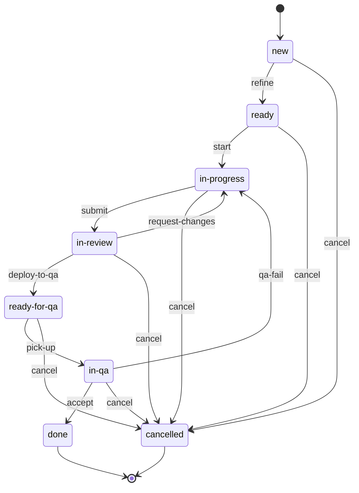
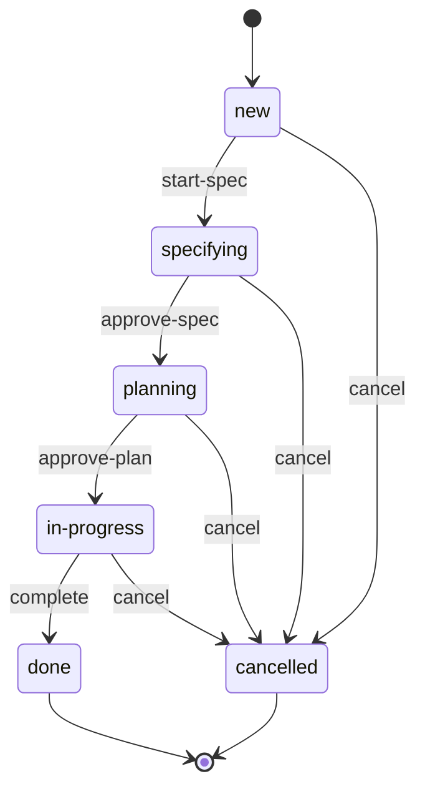
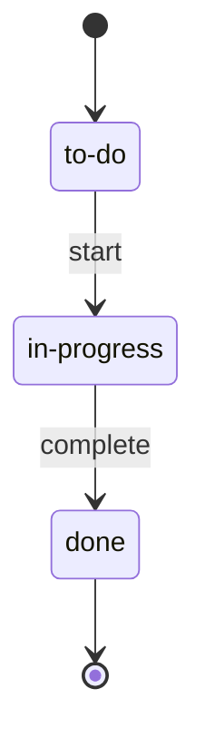

<!-- Generated from contract/*.yaml by scripts/render-docs.mjs. Do not edit by hand: change the YAML, then run `npm run render`. -->

# Quy trình SDLC

Bản đọc của hợp đồng trong `contract/`. Nội dung và lý do của từng quyết định nằm ở [SPEC-sdlc-contract.md](../SPEC-sdlc-contract.md).

## Vai trò

| Role id | Vai trò | Việc chính |
| --- | --- | --- |
| `human` | Bạn: Product Owner, người điều phối, người duyệt duy nhất | Qua 5 cổng duyệt, triage bug, chuyển item sang Done |
| `pm` | Project Manager | Bản tổng hợp mỗi sáng, số liệu tuần cho retro |
| `ba` | Business Analyst | SPEC, user story, acceptance criteria, đề xuất triage bug |
| `ux` | UI/UX designer | Luồng màn hình, wireframe |
| `sa` | Solution Architect | Yêu cầu phi chức năng, plan, ADR, thiết kế DB |
| `fe-dev` | Frontend Developer | Code Next.js theo TDD |
| `be-dev` | Backend Developer | Code NestJS và migration theo TDD |
| `reviewer` | Code Reviewer | Review code, chặn Task trá hình |
| `security` | Security Engineer | Security review, threat model |
| `qa` | Tester/QA Engineer | E2E, regression, báo cáo QA |
| `devops` | DevOps Engineer | Deploy, cắt release, ship, rollback |
| `automation` | CI, webhook, Jira Automation | Chuyển trạng thái theo dữ kiện: CI xanh, merge, deploy xong |

## Work item

### Phân cấp

| Mô hình khái niệm | Trong Jira | Work type | Workflow | Ghi chú |
| --- | --- | --- | --- | --- |
| Project | Space |  |  | Mỗi sản phẩm một space |
| Epic (mục tiêu lớn) | Label hoặc Component |  |  | Chỉ để nhóm, không có workflow |
| Feature | Epic | `epic` | `epic` | Có SPEC và plan, kéo dài 1–3 tuần |
| User Story | Story | `story` | `standard` | Đơn vị để QA và Done; tốt nhất làm xong trong 1–2 ngày |
| Task (con của Story) | Sub-task | `sub-task` | `sub-task` | Chỉ dùng khi một Story phải chia cho nhiều agent |
| Task độc lập | Task | `task` | `standard` | Cùng cấp Story. Việc kỹ thuật không trực tiếp mang giá trị cho người dùng |
| Bug | Bug | `bug` | `standard` | Cùng cấp Story. Link tới Story hoặc Epic liên quan |

**Cách chọn loại:** Người dùng cuối có nhìn thấy hoặc kiểm chứng được kết quả không? Có thì là Story, không thì là Task. Hành vi hiện có sai so với yêu cầu đã có thì là Bug.

### Quy ước

- Mỗi Story, Task, Bug có một nhánh và một PR, chứa mọi phần nó cần: FE, BE, migration, test. Item quay lại sau qa-fail thì được sửa trên nhánh và PR mới, vẫn mang mã item (mục 2.6). Tại mỗi thời điểm, một item có tối đa một PR đang mở.
- Story có cả FE và BE được chia thành Sub-task FE và Sub-task BE. Hai agent commit lên cùng nhánh của Story, BE làm trước; PR chỉ được mở khi mọi Sub-task đã xong.
- Story quá lớn thì tách theo chiều dọc thành nhiều Story nhỏ, mỗi Story vẫn đủ FE và BE.
- Phần kỹ thuật của một tính năng thuộc về chính Story đó, không tách thành Task theo lớp (BE, FE). Ngoại lệ duy nhất là phần nền dùng chung cho nhiều Story, như module auth hay schema của cả Epic: phần này là Task độc lập, làm trước, và các Story khai báo phụ thuộc vào nó.
- PR của một Task mà làm đổi giao diện hoặc API công khai thì reviewer yêu cầu đổi Task thành Story.

### Trường dữ liệu

| Trường | Áp dụng | Giá trị | Ai điền |
| --- | --- | --- | --- |
| Found in | `bug` | Development, Staging, Production | Người báo lỗi |
| Affects Version | `bug` | Bản cũ nhất đang có lỗi | ba đề xuất, bạn duyệt |
| Severity | `bug` | Critical: Mất hoặc sai dữ liệu, lỗ hổng bảo mật, hệ thống hoặc luồng thanh toán ngừng; High: Luồng chính hỏng, không có cách né; Medium: Có cách né; Low: Giao diện, chính tả | ba đề xuất, bạn duyệt |
| Fix Version | `story`, `task`, `bug` | Bug: suy ra từ bảng định tuyến (mục 2.6). Story, Task: gắn khi cắt release | automation, devops |
| Rework count | `story`, `task`, `bug` | Số lần quay lại in-progress. Cách lưu trên Jira (trường số, hay đếm từ lịch sử chuyển trạng thái) do tracker-integration chọn | automation |
| Flagged | `epic`, `story`, `sub-task`, `task`, `bug` | Lý do bị chặn hoặc cần bạn quyết | Bất kỳ ai |
| Resolution | `epic`, `story`, `task`, `bug` | Won't do, Duplicate, Not a bug, Cannot reproduce. Điền khi item chuyển sang cancelled | Bạn |

## Workflow

### `standard`

Áp dụng cho `story`, `task`, `bug`. Bắt đầu ở `new`, kết thúc ở `done`, `cancelled`.

| State | Nghĩa | Cột trên board |
| --- | --- | --- |
| `new` | Mới tạo, chưa đạt DoR | `backlog` |
| `ready` | Đạt DoR, chờ được kéo | `ready` |
| `in-progress` | Đang code và viết test | `in-progress` |
| `in-review` | PR đã mở, CI xanh, đang review | `in-review` |
| `ready-for-qa` | Đã merge và deploy lên môi trường QA | `qa` |
| `in-qa` | QA đang kiểm | `qa` |
| `done` | Đã verify, đạt DoD. Trạng thái kết thúc | `done` |
| `cancelled` | Không làm nữa, có Resolution. Trạng thái kết thúc, ẩn khỏi board |  |

| Transition | Từ → đến | Ai chuyển | Điều kiện | Bằng chứng | Effect |
| --- | --- | --- | --- | --- | --- |
| `refine` | `new` → `ready` | `automation`, `human`: automation chuyển Story/Task thuộc Epic có plan đã duyệt; human chuyển Bug sau triage và Task không thuộc Epic | Item đạt DoR của loại đó (mục 2.5): Story/Task thuộc Epic có plan đã duyệt, Bug đã qua triage | `tracker` |  |
| `start` | `ready` → `in-progress` | `fe-dev`, `be-dev`, `devops` | Agent còn chỗ WIP: tính theo Sub-task nếu Story có Sub-task, nếu không thì theo cả item (mục 2.7); Các item phụ thuộc đã merge vào nhánh gốc; Đã tạo nhánh từ đúng nhánh gốc (mục 2.6), có trên GitHub | `tracker`, `git` |  |
| `submit` | `in-progress` → `in-review` | `automation` | Mọi Sub-task của item đã done; PR vào đúng nhánh gốc đã mở; Mọi check CI của PR xanh | `tracker`, `github-pr`, `ci` |  |
| `request-changes` | `in-review` → `in-progress` | `reviewer`, `security`, `human`, `automation` | Review trên PR yêu cầu sửa, hoặc CI của PR đỏ | `github-pr` | `increment-rework` |
| `deploy-to-qa` | `in-review` → `ready-for-qa` | `automation` | Bạn đã approve PR ở cổng ③ merge-approval; PR đã merge vào nhánh gốc; Deploy lên môi trường QA của item (mục 2.6) thành công | `github-pr`, `deploy` |  |
| `pick-up` | `ready-for-qa` → `in-qa` | `qa` | Không có | Không có |  |
| `qa-fail` | `in-qa` → `in-progress` | `qa` | Báo cáo QA mới nhất của item có kết quả FAIL | `tracker` (`qa-report`) | `increment-rework` |
| `accept` | `in-qa` → `done` | `human` | Báo cáo QA mới nhất của item có kết quả PASS; Item đạt DoD của loại đó (mục 2.5) | `tracker` (`qa-report`), `human` |  |
| `cancel` | `new`, `ready`, `in-progress`, `in-review`, `ready-for-qa`, `in-qa` → `cancelled` | `human` | Item có Resolution: Won't do, Duplicate, Not a bug hoặc Cannot reproduce | `tracker` |  |

### `epic`

Áp dụng cho `epic`. Bắt đầu ở `new`, kết thúc ở `done`, `cancelled`.

| Transition | Từ → đến | Ai chuyển | Điều kiện | Bằng chứng | Effect |
| --- | --- | --- | --- | --- | --- |
| `start-spec` | `new` → `specifying` | `human` | Còn chỗ WIP cho Epic ở specifying hoặc planning (mục 2.7) | `tracker` |  |
| `approve-spec` | `specifying` → `planning` | `human` | Bạn duyệt SPEC của Epic ở cổng ① spec-approval | `human` (`spec`) |  |
| `approve-plan` | `planning` → `in-progress` | `human` | Bạn duyệt plan của Epic ở cổng ② plan-approval; Các Story/Task con theo plan đã được tạo trên Jira | `human` (`plan`), `tracker` | `refine-children` |
| `complete` | `in-progress` → `done` | `human` | Mọi item con đã Done hoặc Cancelled; Mọi item con đã Done nằm trong một bản đã lên Production | `tracker` |  |
| `cancel` | `new`, `specifying`, `planning`, `in-progress` → `cancelled` | `human` | Item có Resolution: Won't do, Duplicate, Not a bug hoặc Cannot reproduce | `tracker` |  |

### `sub-task`

Áp dụng cho `sub-task`. Bắt đầu ở `to-do`, kết thúc ở `done`.

| Transition | Từ → đến | Ai chuyển | Điều kiện | Bằng chứng | Effect |
| --- | --- | --- | --- | --- | --- |
| `start` | `to-do` → `in-progress` | `fe-dev`, `be-dev` | Agent còn chỗ WIP: tính theo Sub-task nếu Story có Sub-task, nếu không thì theo cả item (mục 2.7) | `tracker` |  |
| `complete` | `in-progress` → `done` | `fe-dev`, `be-dev` | Phần việc của Sub-task đã được commit lên nhánh của Story | `git` |  |

## DoR và DoD

### DoR

Điều kiện để item vào `ready`.

| Loại | DoR |
| --- | --- |
| `story` | Có câu user story; Có acceptance criteria dạng Given/When/Then, mỗi tiêu chí kiểm thử được; Thuộc Epic có plan đã duyệt; Đã xác định item phụ thuộc; Vừa cỡ: mỗi Sub-task, hoặc cả Story nếu không có Sub-task, khoảng 5 file code trở xuống, không tính file test; Có hợp đồng API trong plan nếu Story có cả FE và BE; Có thiết kế màn hình nếu đụng tới giao diện |
| `task` | Có mục tiêu và checklist kỹ thuật kiểm tra được; Thuộc Epic có plan đã duyệt, hoặc được bạn duyệt trực tiếp |
| `bug` | Có bước tái hiện, kết quả thực tế và kết quả mong đợi; Đã điền Found in, Affects Version, Severity, Fix Version; Có bằng chứng (log, ảnh) |

### DoD

Điều kiện để item vào `done`. Phần chung cho `story`, `task`, `bug`:

- PR đã merge vào đúng nhánh gốc, mọi check CI xanh
- Không còn finding Critical/High chưa xử lý
- Hành vi mới hoặc thay đổi được phủ bởi unit và integration test viết theo TDD
- Báo cáo QA PASS trên đúng môi trường QA
- Đã cập nhật tài liệu, và ADR nếu có thay đổi kiến trúc
- Bạn đã chấp nhận

Phần riêng của từng loại, cộng thêm phần chung nếu loại đó có trong danh sách trên:

| Loại | DoD |
| --- | --- |
| `epic` | Mọi item con đã Done hoặc Cancelled; Bản chứa các item con đã lên Production |
| `story` | E2E test cho từng acceptance criterion đều pass |
| `task` | Bộ regression pass |
| `bug` | Có test tái hiện lỗi (fail trước khi sửa, pass sau khi sửa), được đưa vào bộ regression |

## Môi trường, nhánh và định tuyến bug

**Việc mới** (`story`, `task`) tách nhánh từ `develop` và được QA trên `development`.

### Định tuyến bug

Theo vị trí của bản cũ nhất đang có lỗi, và Severity:

| Bản cũ nhất đang có lỗi | Severity | Fix Version | Nhánh gốc | QA trên | Ghi chú |
| --- | --- | --- | --- | --- | --- |
| Production | `critical`, `high` | Bản vá của bản đang chạy trên Production (`patch-of-production`) | `main` | `staging`, `production` | Nhánh hotfix/... tách từ main. QA trên Staging, rồi smoke test trên Production |
| Production | `medium`, `low` | Bản kế tiếp (`next-release`) | `develop` | `development` |  |
| Staging, chưa lên Production | `critical`, `high` | Bản đang ở Staging (`current-release`) | `release/*` | `staging` |  |
| Staging, chưa lên Production | `medium`, `low` | Bản kế tiếp (`next-release`) | `develop` | `development` | Ghi known issue vào release note |
| Chỉ có trên develop | `critical`, `high`, `medium`, `low` | Bản kế tiếp (`next-release`) | `develop` | `development` |  |

- Bug được sửa trên nhánh cũ nhất còn cần bản sửa, rồi merge ngược về các nhánh mới hơn.
- Lỗi Critical/High được chen vào luồng ngay; lỗi Medium/Low vào Product Backlog để bạn xếp thứ tự.
- Nhánh release/* và hotfix/* khi kết thúc đều được merge vào main và merge ngược về develop; hotfix làm lúc đang có nhánh release mở thì được merge thêm vào nhánh release đó.
- Lỗi tìm thấy khi QA một item chưa Done thì không tạo Bug: item quay lại in-progress qua qa-fail, và được sửa trên nhánh mới tách từ nhánh gốc cũ, vẫn mang mã item cũ.

### Đánh số phiên bản

Theo SemVer:

- Mỗi bản release: tăng `minor` (v1.4.0 → v1.5.0)
- Hotfix: tăng `patch` (v1.4.0 → v1.4.1)
- Thay đổi phá vỡ tương thích, do bạn quyết: tăng `major`
