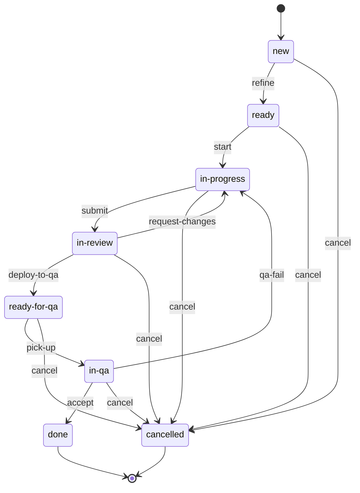
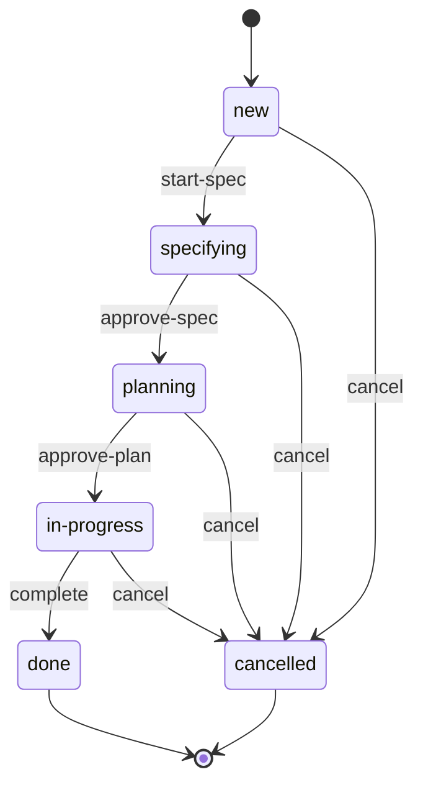
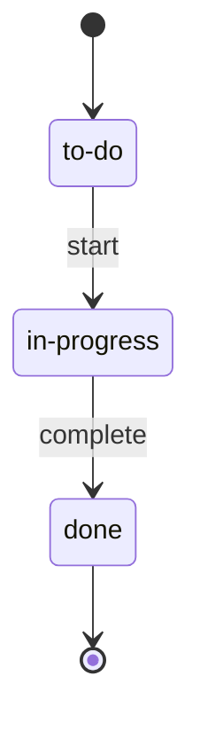

<!-- Generated from contract/*.yaml by scripts/render-docs.mjs. Do not edit by hand: change the YAML, then run `npm run render`. -->

# Quy trình SDLC

Bản đọc của hợp đồng trong `contract/`. Nội dung và lý do của từng quyết định nằm ở [SPEC-sdlc-contract.md](../SPEC-sdlc-contract.md).

## Vai trò

| Role id | Vai trò | Việc chính |
| --- | --- | --- |
| `human` | Bạn: Product Owner, người điều phối, người duyệt duy nhất | Qua 5 cổng duyệt, triage bug, chuyển item sang Done |
| `pm` | Project Manager | Bản tổng hợp mỗi sáng, số liệu tuần cho retro |
| `ba` | Business Analyst | SPEC, user story, acceptance criteria, đề xuất triage bug |
| `ux` | UI/UX designer | Luồng màn hình, wireframe |
| `sa` | Solution Architect | Yêu cầu phi chức năng, plan, ADR, thiết kế DB |
| `fe-dev` | Frontend Developer | Code Next.js theo TDD |
| `be-dev` | Backend Developer | Code NestJS và migration theo TDD |
| `reviewer` | Code Reviewer | Review code, chặn Task trá hình |
| `security` | Security Engineer | Security review, threat model |
| `qa` | Tester/QA Engineer | E2E, regression, báo cáo QA |
| `devops` | DevOps Engineer | Deploy, cắt release, ship, rollback |
| `automation` | CI, webhook, Jira Automation | Chuyển trạng thái theo dữ kiện: CI xanh, merge, deploy xong |

## Workflow

### `standard`

Áp dụng cho `story`, `task`, `bug`. Bắt đầu ở `new`, kết thúc ở `done`, `cancelled`.

| State | Nghĩa | Cột trên board |
| --- | --- | --- |
| `new` | Mới tạo, chưa đạt DoR | `backlog` |
| `ready` | Đạt DoR, chờ được kéo | `ready` |
| `in-progress` | Đang code và viết test | `in-progress` |
| `in-review` | PR đã mở, CI xanh, đang review | `in-review` |
| `ready-for-qa` | Đã merge và deploy lên môi trường QA | `qa` |
| `in-qa` | QA đang kiểm | `qa` |
| `done` | Đã verify, đạt DoD. Trạng thái kết thúc | `done` |
| `cancelled` | Không làm nữa, có Resolution. Trạng thái kết thúc, ẩn khỏi board |  |

| Transition | Từ → đến | Ai chuyển | Điều kiện | Bằng chứng | Effect |
| --- | --- | --- | --- | --- | --- |
| `refine` | `new` → `ready` | `automation`, `human`: automation chuyển Story/Task thuộc Epic có plan đã duyệt; human chuyển Bug sau triage và Task không thuộc Epic | Item đạt DoR của loại đó (mục 2.5): Story/Task thuộc Epic có plan đã duyệt, Bug đã qua triage | `tracker` |  |
| `start` | `ready` → `in-progress` | `fe-dev`, `be-dev`, `devops` | Agent còn chỗ WIP: tính theo Sub-task nếu Story có Sub-task, nếu không thì theo cả item (mục 2.7); Các item phụ thuộc đã merge vào nhánh gốc; Đã tạo nhánh từ đúng nhánh gốc (mục 2.6), có trên GitHub | `tracker`, `git` |  |
| `submit` | `in-progress` → `in-review` | `automation` | Mọi Sub-task của item đã done; PR vào đúng nhánh gốc đã mở; Mọi check CI của PR xanh | `tracker`, `github-pr`, `ci` |  |
| `request-changes` | `in-review` → `in-progress` | `reviewer`, `security`, `human`, `automation` | Review trên PR yêu cầu sửa, hoặc CI của PR đỏ | `github-pr` | `increment-rework` |
| `deploy-to-qa` | `in-review` → `ready-for-qa` | `automation` | Bạn đã approve PR ở cổng ③ merge-approval; PR đã merge vào nhánh gốc; Deploy lên môi trường QA của item (mục 2.6) thành công | `github-pr`, `deploy` |  |
| `pick-up` | `ready-for-qa` → `in-qa` | `qa` | Không có | Không có |  |
| `qa-fail` | `in-qa` → `in-progress` | `qa` | Báo cáo QA mới nhất của item có kết quả FAIL | `tracker` (`qa-report`) | `increment-rework` |
| `accept` | `in-qa` → `done` | `human` | Báo cáo QA mới nhất của item có kết quả PASS; Item đạt DoD của loại đó (mục 2.5) | `tracker` (`qa-report`), `human` |  |
| `cancel` | `new`, `ready`, `in-progress`, `in-review`, `ready-for-qa`, `in-qa` → `cancelled` | `human` | Item có Resolution: Won't do, Duplicate, Not a bug hoặc Cannot reproduce | `tracker` |  |

### `epic`

Áp dụng cho `epic`. Bắt đầu ở `new`, kết thúc ở `done`, `cancelled`.

| Transition | Từ → đến | Ai chuyển | Điều kiện | Bằng chứng | Effect |
| --- | --- | --- | --- | --- | --- |
| `start-spec` | `new` → `specifying` | `human` | Còn chỗ WIP cho Epic ở specifying hoặc planning (mục 2.7) | `tracker` |  |
| `approve-spec` | `specifying` → `planning` | `human` | Bạn duyệt SPEC của Epic ở cổng ① spec-approval | `human` (`spec`) |  |
| `approve-plan` | `planning` → `in-progress` | `human` | Bạn duyệt plan của Epic ở cổng ② plan-approval; Các Story/Task con theo plan đã được tạo trên Jira | `human` (`plan`), `tracker` | `refine-children` |
| `complete` | `in-progress` → `done` | `human` | Mọi item con đã Done hoặc Cancelled; Mọi item con đã Done nằm trong một bản đã lên Production | `tracker` |  |
| `cancel` | `new`, `specifying`, `planning`, `in-progress` → `cancelled` | `human` | Item có Resolution: Won't do, Duplicate, Not a bug hoặc Cannot reproduce | `tracker` |  |

### `sub-task`

Áp dụng cho `sub-task`. Bắt đầu ở `to-do`, kết thúc ở `done`.

| Transition | Từ → đến | Ai chuyển | Điều kiện | Bằng chứng | Effect |
| --- | --- | --- | --- | --- | --- |
| `start` | `to-do` → `in-progress` | `fe-dev`, `be-dev` | Agent còn chỗ WIP: tính theo Sub-task nếu Story có Sub-task, nếu không thì theo cả item (mục 2.7) | `tracker` |  |
| `complete` | `in-progress` → `done` | `fe-dev`, `be-dev` | Phần việc của Sub-task đã được commit lên nhánh của Story | `git` |  |
