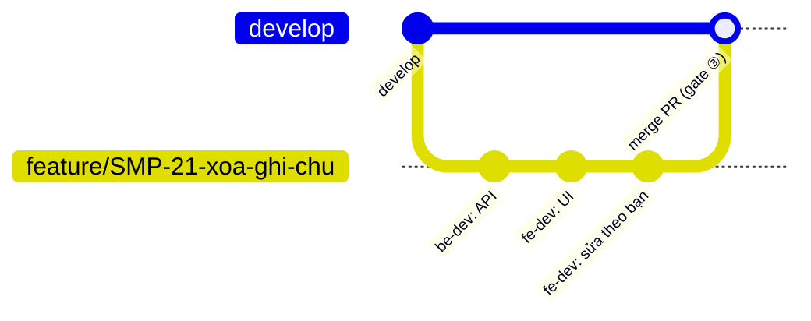
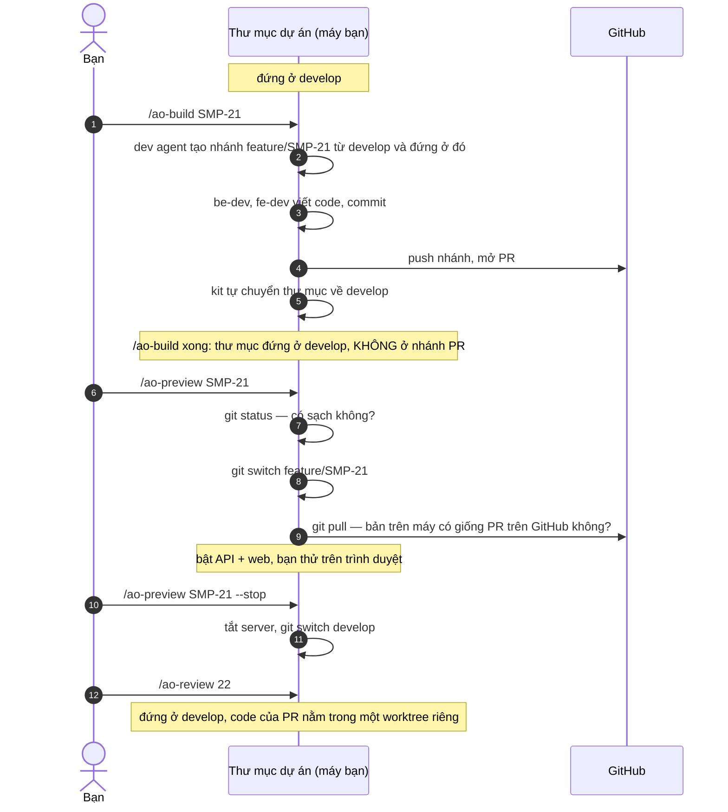

# Git khi dùng kit: thư mục dự án đứng ở nhánh nào, lúc nào

Phiên 27 · Lượt 109, 2026-11-11. File này giải thích chậm cho bước xem trước (A4) mà mình đề xuất. Hãy mở file bằng VS Code preview hoặc trên GitHub để xem sơ đồ.

## Bốn từ cần thống nhất

| Từ | Nghĩa |
|---|---|
| **Thư mục dự án** | Thư mục repo trên máy bạn. Git gọi nó là *working tree*. Ở các lượt trước mình gọi nó là "checkout": đó là cách nói thông dụng nhưng không chính xác, nên từ đây mình dùng "thư mục dự án". |
| **Đứng ở nhánh X** | Thư mục dự án đang hiện các file của nhánh X. Mỗi lúc thư mục chỉ đứng ở **một** nhánh. Lệnh chuyển nhánh là `git switch X`; lệnh cũ cùng tác dụng là `git checkout X`. |
| **Sạch** | `git status` in ra `working tree clean`, tức không có file nào sửa dở mà chưa commit. Thư mục không sạch thì chuyển nhánh có thể bị từ chối, hoặc mang theo phần sửa dở sang nhánh kia. |
| **Hai bản của một nhánh** | Mỗi nhánh có một bản trên máy bạn và một bản trên GitHub (`origin/...`). `git push` đưa commit từ máy lên GitHub; `git pull` kéo commit từ GitHub về máy. |

## Gitflow của một tính năng

Đây là lịch sử commit. Dev agent làm trên nhánh tính năng, và nhánh đó vào `develop` khi bạn duyệt PR ở gate ③.

Bạn hiểu đúng một điều: **người đang làm tính năng A phải đứng ở nhánh của A.** Ở kit này, người làm là **dev agent**, không phải bạn. Bạn là người xem và duyệt, giống một reviewer trong team người.

## Thư mục dự án đứng ở đâu, theo từng lệnh

## Trả lời từng câu hỏi

**"Đang làm tính năng A thì phải đứng ở `feat/A` chứ?"**
Đúng, nhưng chỉ trong lúc `/ao-build` chạy (bước 2–4). Khi `/ao-build` xong, kit tự đưa thư mục về `develop` (bước 5; `homeBranch` trong `scripts/ao-step.mjs:86`).

**"Vì sao kit phải đưa thư mục về `develop`?"**
Lệnh kế tiếp là `/ao-review`, và agent review đọc luật làm việc của nó (`.claude/`, `CLAUDE.md`, hook) từ thư mục dự án. Nếu thư mục còn đứng ở nhánh PR, bộ luật đó lấy từ PR: code chưa ai review, do một agent khác viết, có thể sửa luật của chính agent đang review nó. Vì vậy, giữa các lệnh, kit luôn "đỗ" thư mục ở `develop`, nhánh đã được duyệt. `/ao-review` và `/ao-fix` cũng từ chối chạy nếu thư mục không đứng ở nhánh được bảo vệ (`checkoutStop`, `scripts/ao-step.mjs:79`).

**"Kiểm sạch nghĩa là gì?"**
Là chạy `git status` (bước 7) để chắc không có file nào sửa dở. Nếu có, chuyển nhánh sẽ mang phần sửa dở sang nhánh PR, hoặc bị git từ chối.

**"Chuyển sang nhánh PR là sao, chẳng phải đang đứng ở đó rồi à?"**
Không. Sau bước 5, thư mục đứng ở `develop`. Muốn thấy code của tính năng thì phải chuyển sang nhánh của PR (bước 8). Đây cũng chính là việc một reviewer người làm khi muốn chạy thử PR của đồng nghiệp: `gh pr checkout 22`.

**"Kéo code mới về là code nào?"**
Là những commit có trên GitHub (`origin/feature/SMP-21`) mà bản trên máy chưa có.

Nói thật: với kit hiện tại, bước này thường không kéo về gì. Agent commit ngay trong thư mục này rồi mới push, nên bản trên máy đã giống GitHub. `git pull` ở bước 9 chỉ là một lần kiểm rẻ, phòng khi nhánh trên GitHub có commit từ nơi khác, ví dụ bạn bấm "Commit suggestion" trên GitHub, hoặc lệnh build từng chạy trên một máy khác.

## Tóm tắt

- **Dev agent làm** → thư mục đứng ở nhánh tính năng.
- **Giữa các lệnh** → kit đưa thư mục về `develop`, để agent không nhận luật từ code chưa review.
- **Bạn xem trước** → chuyển sang nhánh PR, thử, rồi về lại `develop`.

## Đã làm (2026-11-11)

Phần 2 của `human-loop` làm đúng các bước trong sơ đồ, thêm ba điều:
- `/ao-preview` chạy `npm ci --ignore-scripts` khi `package-lock.json` của nhánh PR khác bản đã cài lần trước, rồi bật các app khai trong `.ai-orchestrator/preview.yaml`.
- Ngoài `--stop`, mọi lệnh có chạy agent (`/ao-fix`, `/ao-review`, `/ao-build`…) cũng tự tắt app và đưa thư mục về `develop` trước khi chạy.
- Kit không xem trước PR sửa đường dẫn được bảo vệ (`.ai-orchestrator/`, `.claude/`…), vì trong lúc xem trước mọi lệnh `/ao-*` chạy kit của nhánh PR.

Kết quả chạy thật trên `ao-sample` nằm ở `tasks/verification.md`, mục Checkpoint 3.
