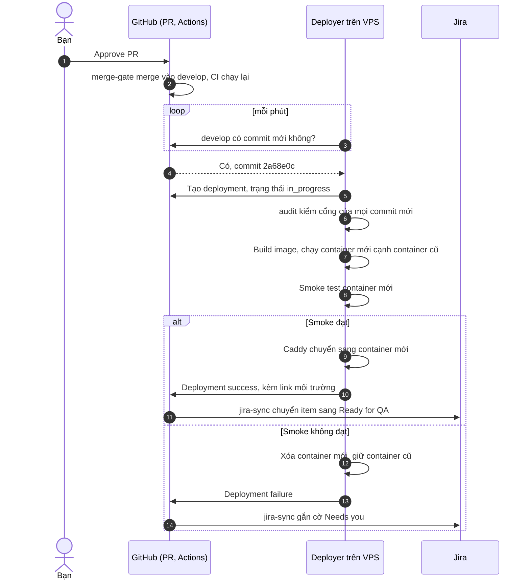
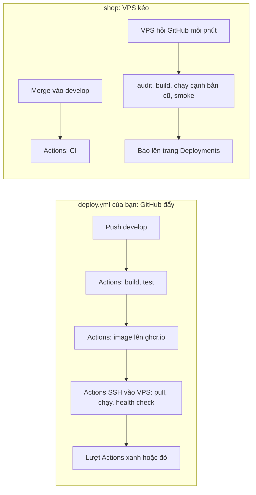
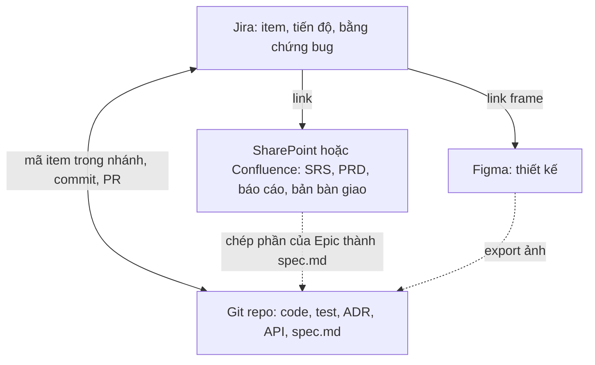

# Kit trong dự án thực tế: stack, deploy và nơi lưu tài liệu

Phiên 34 · Lượt 1, ngày 2026-11-19. Câu trả lời dựa trên:
- mã kit ở nhánh `task/after-pilot3` (`bba3a7c`);
- `SPEC.md`, các `SPEC-*.md`, `tasks/followups-truoc-c1.md`, `tasks/handoff-2026-11-16-followups.md`;
- repo `agent-skills` ở commit mà kit ghim (`aeac41d`, 2026-10-13);
- trang https://skills.addy.ie/loops/ và https://github.com/addyosmani/agent-skills, đọc ngày 2026-11-19;
- deployment thật của `TungPH7/shop` trên GitHub.

Nhãn: **[Suy luận]** là suy ra từ mã hay tài liệu, chưa chạy thử. **[Ước]** là con số ước.

**Tên thư mục `kit-va-du-an-thuc-te/`:** năm câu hỏi cùng xoay quanh một ý: đem kit ra dùng ở dự án thật (của cộng đồng, của công ty, dự án đang chạy) thì vướng gì. Các câu hỏi sau về chủ đề này cũng để ở đây.

## Yêu cầu của bạn (nguyên văn)

> Thảo luận, trao đổi kỹ về các mục dưới đây về D:\Document\1Khoahoc\4LapTrinh\AI-for-coding\ai-orchestrator kit:
>
> (năm câu hỏi, chép nguyên văn ở đầu từng mục dưới đây)
>
> Yêu cầu:
> Hãy giải thích những thắc mắc này của tôi, tách ra từng câu hỏi để trả lời súc tích, đủ, không lan man. Viết vào 1 file trong 1 thư mục trong D:\Document\1Khoahoc\4LapTrinh\AI-for-coding\ai-orchestrator\misc\thao-luan nhé (đề xuất giúp tôi tên thư mục) nhé. Ghi nguyên văn câu hỏi của tôi.

Bạn nhắn thêm trong lúc mình làm:

> bạn tham khảo thêm các file SPEC-*.md, D:\Document\1Khoahoc\4LapTrinh\AI-for-coding\ai-orchestrator\tasks\followups-truoc-c1.md, D:\Document\1Khoahoc\4LapTrinh\AI-for-coding\ai-orchestrator\tasks\handoff-2026-11-16-followups.md để có thêm thông tin nhé

## Tóm tắt

1. **Đúng, kit gắn chặt với bốn thứ:** GitHub, Jira Cloud, một máy Linux có Docker, và Claude Code.
   - EC2 dùng được, vì nó cũng là một máy Linux.
   - GitLab thì không: phải viết lại lớp GitHub.
   - agent-skills là "kiến thức nghề", dùng ở đâu cũng được. Kit là "dây chuyền" dựng trên 14 skill của nó.
   - agent-skills cố ý không có quản lý task và phân công tự động: phần đó để người dùng tự dựng.
2. **Kit dùng được cho brownfield** (đã chạy thật trên `ao-brown`), nhưng repo phải theo stack của kit. Không theo thì phần lớn kit không dùng được.
3. **Deploy của `shop`:** VPS tự kéo bản mới mỗi phút, GitHub không đẩy sang. Kết quả deploy hiện ở trang Deployments của repo, không ở tab Actions.
4. **VPS có bản kit riêng,** vì bộ kiểm cổng không được lấy từ chính commit mà nó đang kiểm.
5. **Không có một chỗ cho mọi tài liệu.** Tài liệu đổi cùng code để trong repo. Tài liệu khách ký, hay người ngoài nhóm dev đọc, để ở SharePoint hoặc Confluence. Thiết kế để ở Figma, bằng chứng bug ở Jira. Jira nối mọi thứ bằng link.

## Câu 1. Kit có gắn chặt với stack không, so với agent-skills

> 1. Tôi thấy repo kit này khá là cụ thể ràng buộc chặt với các workflow, rule mà bạn và tôi đã build từ đầu tới giờ phải không nhỉ? nếu public cho cộng đồng thì họ cũng phải tuân theo stack của kit như là Jira, Github, VPS,... còn nếu dùng Gitlab hay EC2 thì không được nhỉ? So sánh với D:\Document\1Khoahoc\4LapTrinh\AI-for-coding\agent-skills giúp tôi về ưu/nhược điểm của mỗi tool, ao kit này cũng build dựa trên D:\Document\1Khoahoc\4LapTrinh\AI-for-coding\agent-skills. Vì sao D:\Document\1Khoahoc\4LapTrinh\AI-for-coding\agent-skills lại được nhiều người dùng, có phải D:\Document\1Khoahoc\4LapTrinh\AI-for-coding\agent-skills là phần core, các dev khác dùng khung này để build các ai orchestrator phù hợp với dự án của họ? Tham khảo, đọc https://skills.addy.ie/loops/ và https://github.com/addyosmani/agent-skills, tôi thấy repo agent-skills thiếu cách quản lý task và tự động phân công nhỉ? Phải gõ / command thủ công? Nếu muốn phát triển 1 dự án lớn nhiều epic và task mà ngồi gõ / thì không biết khi nào mới xong nhỉ?

### 1.1 Kit gắn với những gì

Đúng. Kit được build cho đúng một bộ công cụ, và gắn với nó ở nhiều lớp:

| Gắn với | Ở đâu trong kit | Đổi sang thứ khác thì |
|---|---|---|
| GitHub | 6 workflow GitHub Actions; 4 GitHub App (`ao-dev`, `ao-review`, `ao-merge`, `ao-deploy`); hook `gh-guard`; API của PR, review, check, deployment. 82 trên 142 file code trong `lib/` và `scripts/` có nhắc tới GitHub | Phải viết lại lớp này |
| Jira Cloud | `tracker/jira.yaml` (status, transition, group), client Jira, Rovo MCP, hook `jira-guard`, `jira-sync`, 2 service account. 57 trên 142 file | Viết thêm một bản ánh xạ và một client cho tracker mới |
| Một máy Linux có Docker | Deployer chạy bằng systemd timer, build image bằng Docker, Caddy giữ HTTPS, backup | Máy Linux nào cũng được |
| Claude Code | 10 agent, hook, skill, lệnh `/ao-*` | Không dùng được với Codex hay Cursor |
| Stack của app | JS/TS (npm, pnpm) và Java Maven. Gradle "chỉ làm khi có dự án cần" (`SPEC-project-scaffold-3.md`) | Thêm profile mới |

Phần không gắn với công cụ nào:
- hợp đồng quy trình `contract/`: trạng thái, vai trò, gate ①–⑤, cách định tuyến Bug;
- prompt của agent, template và skill.

Đây là phần lõi có thể đem đi.

**Dùng EC2:** được. [Suy luận] Deployer chỉ cần Ubuntu, systemd, Docker, cổng 80/443 và một bản ghi DNS wildcard. Một máy EC2 chạy Ubuntu là một VPS. Cần thêm:
- Elastic IP, để IP không đổi khi tắt và bật máy;
- Security Group mở cổng 80, 443 và SSH.

Không dùng được nếu dự án deploy lên dịch vụ có sẵn như ECS, Kubernetes, Lambda hay Vercel. Deployer không chạy ở đó, nên phải viết một đích deploy mới.

**Dùng GitLab:** không được. GitLab có đủ thứ tương ứng: GitLab CI, bot user, merge request approval, protected branch, API Environments và Deployments. Vì vậy chuyển được, nhưng đó là viết lại lớp lớn nhất của kit. [Ước] 2–3 module.

**Nếu public cho cộng đồng,** có hai cách:
1. Ghi rõ yêu cầu ngay đầu README: "GitHub + Jira Cloud + máy Linux có Docker + Claude Code". Nhiều công cụ có chủ kiến (opinionated) làm vậy. Đây là cách rẻ nhất.
2. Tách kit thành lõi cộng các "cổng nối" (adapter) cho Git host, tracker và đích deploy.
   - Hợp đồng đã tách khỏi Jira bằng `tracker/jira.yaml`.
   - GitHub thì nằm rải khắp code, chưa có một chỗ ánh xạ.
   - Chỉ đáng làm khi có người dùng thật cần GitLab hay Linear.

Mình khuyên cách 1 cho tới khi xong C2 (bộ điều phối).

### 1.2 So sánh với agent-skills

agent-skills là một thư viện gồm 25 skill, khoảng 10 lệnh và 5 persona review. Mỗi skill dạy agent làm tốt một bước: viết spec, chia task, TDD, review… Kit lấy 14 skill trong đó, ghim theo commit `aeac41d` (`agents/roster.yaml`), rồi xây phần điều phối và cổng kiểm lên trên. Đây là quyết định "xương sống skill" ngày 2026-10-26 trong `SPEC.md`.

| | agent-skills | AO kit |
|---|---|---|
| Là gì | Kiến thức nghề: cách làm tốt từng bước | Dây chuyền: ai làm bước nào, khi nào được sang bước sau, tới tận Production |
| Cài | Một lệnh, vài giây, không cần tài khoản | Jira space, 4 GitHub App, VPS, secret. Ba tài liệu cài dài khoảng 2.200 dòng |
| Dùng với | Hơn 70 loại agent, mọi stack, mọi Git host, mọi tracker | Claude Code, GitHub, Jira Cloud, máy Linux, JS/TS hoặc Java Maven |
| Trạng thái công việc | File Markdown trong repo (`tasks/plan.md`, `tasks/todo.md`), chỉ một người xem | Trên Jira và GitHub: cả nhóm xem, còn nguyên khi đổi phiên |
| Phân công | Bạn tự chọn lệnh. Một agent làm, persona chỉ để review | 10 vai trò, mỗi agent chỉ được ghi đúng file của mình. `ao-step` chọn agent theo item |
| Cổng kiểm | Skill khuyên agent kiểm, nhưng agent vẫn có thể bỏ qua | Máy chặn thật: `merge-gate`, `audit`, deployer. Agent không lách được |
| Sau khi merge | Checklist `/ship`, không có deploy | Deploy ba môi trường, QA có bằng chứng, release, hotfix, rollback, backup |
| Chi phí token | Thấp, tùy bạn dùng bao nhiêu | Cao: Epic `SHOP-7` tốn khoảng 604 USD cho 28 AC, tức 21,6 USD mỗi AC |
| Người bảo trì | Cộng đồng lớn: 119 nghìn sao, 12,4 nghìn fork, 866 commit | Bạn và Claude |
| Hợp với | Một dev hay một nhóm muốn agent làm đúng nghề mà giữ nguyên quy trình đang có | Nhóm muốn agent chạy cả SDLC theo quy trình chặt, chấp nhận chi phí và stack cố định |

### 1.3 Vì sao agent-skills được nhiều người dùng

1. **Giải một vấn đề ai cũng gặp:** agent hay bỏ bước, như không viết test, không có spec, tự nhận "xong". Mỗi skill có các bước, điểm kiểm, và bằng chứng phải đưa ra.
2. **Dùng ở đâu cũng được:** không bắt đổi công cụ, stack hay quy trình của công ty.
3. **Cài một lệnh là thấy lợi ngay,** không phải dựng gì.
4. **Nhỏ và rời:** lấy một skill cũng được, đọc hiểu và sửa dễ.
5. **Tác giả có tiếng:** Addy Osmani ở Google. Nội dung dựa trên cách làm của Google (Hyrum's Law, test pyramid, trunk-based).

### 1.4 agent-skills có phải phần lõi để người khác dựng orchestrator không

Đúng một nửa. Nó là lớp "kiến thức nghề", không phải lớp "điều phối".
- Phần đông dùng thẳng: gõ lệnh trong phiên của mình.
- Một số dựng lên trên nó, như kit này.

Trang loops nói rõ điều đó. Một "vòng" (loop) ghép từ năm mảnh cộng một chỗ lưu trạng thái, và agent-skills chỉ cung cấp một mảnh là Skills. Trang ghi rằng vòng chạy không người trông (`/loop`, `/goal`) không thuộc bộ agent-skills. Kit đã dựng gần đủ các mảnh còn lại cho stack của mình:

| Mảnh của một vòng (theo trang loops) | agent-skills có | Kit có |
|---|---|---|
| Skills: cách làm, và thế nào là "xong" | Có | 14 skill của agent-skills, thêm 13 skill `/ao-*` |
| Subagents: agent viết tách khỏi agent kiểm | 5 persona review | 10 vai trò; `reviewer` và `security` tách khỏi dev |
| Worktrees: chạy song song không đụng nhau | Không | Làn (lane) trên worktree, phần tối thiểu của C2 |
| Connectors: tác động lên công cụ thật | Không | Rovo MCP, 4 GitHub App |
| State: nhớ việc đã xong qua các lượt | File Markdown | Jira, GitHub, `.ai/runs/` |
| Automations: tự chạy theo lịch hay sự kiện | Không | Một phần: deployer chạy mỗi phút, `jira-sync` và `merge-gate` chạy theo sự kiện. Tự gọi agent cho bước kế tiếp thì chưa có (C2, Cấp 2) |

### 1.5 Thiếu quản lý task và phân công, phải gõ lệnh tay

Đúng, và đó là chủ ý. agent-skills có `/plan` để chia task vào file Markdown, và `/build auto`: bạn duyệt plan một lần, rồi agent làm hết các task của plan đó. Nó không có tracker, không giao việc cho nhiều agent, không có hàng đợi giữa các Epic.

Dự án lớn nhiều Epic mà phải gõ lệnh thì sao:
1. **Gõ lệnh không phải chỗ chậm.** Với agent-skills, một Epic cần khoảng 5 lệnh: `/spec`, `/plan`, `/build auto`, `/review`, `/ship`. 20 Epic là 100 lệnh, gõ mất vài phút.
2. **Chỗ chậm là bạn đọc và duyệt.** Trang loops gọi đây là "orchestration tax": sức chú ý của bạn là cái trần, không phải công cụ.
3. **Kit hiện nay (Cấp 1) cũng gõ tay,** và nhiều lệnh hơn: mỗi Story có `/ao-build`, `/ao-review`, `/ao-qa`. Bù lại:
   - `/ao-status` báo lệnh kế tiếp của từng item;
   - trạng thái nằm trên Jira;
   - chạy được tới 3 làn cùng lúc (`SHOP-7` đã chạy `lanes_max: 3`).
4. **Tự động thật nằm ở lộ trình:**
   - C1 đưa thứ tự chạy vào contract, để bộ điều phối đọc dữ liệu thay vì danh sách viết cứng;
   - C2 có bộ điều phối tự đọc board rồi mở lượt chạy, và WIP theo số chỗ;
   - Cấp 2 (`orchestrator-cli`) tự gọi bước kế tiếp, chỉ dừng ở cổng cần bạn.
5. **Nhưng Pilot 3 cho thấy nút thắt hiện nay là tiền, không phải số lệnh.** Pilot 3 tốn 719 USD: build 44%, review 34%, QA 11%. Tự động hóa trước khi làm quy trình rẻ hơn (ba mức theo rủi ro của C1) chỉ làm tiền đi nhanh hơn. Vì vậy thứ tự C1 rồi mới C2 là đúng.

## Câu 2. Greenfield hay brownfield

> 2. repo ao kit này phù hợp với dự án greenfield hơn brownfield phải không? brownfield thì cần setup Github, Jira, VPS, đúng với convention và rule của kit phải không? Nếu brownfield không theo stack của kit thì không dùng được nhỉ?

**Trả lời ngắn:** kit dùng được cho brownfield, nhưng repo đó phải theo stack của kit. Nhiều dự án brownfield ở công ty không theo, và khi đó phần lớn kit không dùng được.

**Kit đã có đường cho brownfield** (`docs/getting-started.md` phần 4, làm thật trên `ao-brown`):
- `ao-kit init` không đụng code của app. Lệnh chỉ chép kit và in danh sách `Missing:`.
- CI lần đầu chỉ quét commit chép kit, không quét code cũ.
- Coverage chỉ tính các dòng mới đổi, nên code cũ chưa có test không chặn PR.

**Repo phải có, hoặc phải chuyển sang:**
1. Code trên GitHub.
2. Một space Jira Cloud theo workflow của kit. Space đang dùng workflow khác thì phải đổi, hoặc mở space mới.
3. Nhánh theo GitFlow của kit (`develop`, `release/*`, `main`), và nhánh mặc định đổi sang `develop`.
4. Quy ước commit `type(scope): subject (<KEY>)`, từ commit kế tiếp.
5. Stack JS/TS (npm, pnpm) hoặc Java Maven, có lệnh lint, typecheck, test có coverage, build.
6. Dockerfile cho từng app, `deploy.yaml` và Playwright.
7. Deploy bằng deployer trên VPS của kit.

**Greenfield dễ hơn,** vì ngay từ đầu đã theo đủ bảy điều trên, và có khung dựng sẵn từ template (`ao-kit init`, `ao-kit add`).

**Brownfield không theo stack thì:**

| Dự án đang có | Dùng được kit không |
|---|---|
| GitLab, Bitbucket | Không |
| Jira Server hay Data Center, Azure Boards | Không |
| Gradle (như `logistics-backend` của bạn), .NET, Python, Go | Chưa. Phải thêm profile; .NET đã nằm trong D1, "chờ nhu cầu" |
| Đã có CI/CD riêng (như `deploy.yml` của bạn), hay deploy lên Kubernetes | Phần trong, từ spec tới merge, có thể dùng. Phần ngoài (deploy, QA trên môi trường, release) thì không, vì nó dựa vào deployer. [Suy luận] Kit chưa có chế độ tắt deployer |
| Một sản phẩm trải trên nhiều repo | Vướng: hợp đồng giả định mỗi item một PR trong một repo (`kit-voi-stack-khac-va-nhieu-repo.md`; D1 `multi-repo`, chờ nhu cầu) |

Brownfield còn rủi ro riêng, kể cả khi đúng stack: code cũ không ai giải thích cho agent, và có phụ thuộc ngầm. Trang loops cũng xếp "brownfield có phụ thuộc ẩn" vào loại việc phải có người trông.

## Câu 3. Luồng deploy của `shop`

> 3. Luồng deploy của repo 'shop' hiện tại như nào (giải thích chậm và dễ hiểu nhé có mermaid càng tốt)? Dự án tôi làm thường sẽ có pipeline CI/CD dùng Github Actions theo kiểu sau D:\Document\work\projects\FIS\rd-logistics\logistics-backend\.github\workflows\deploy.yml, sau khi VPS deploy thành công thì Github xanh, nên có thể vào phần pipeline đang chạy để check xem web đã deploy thành công chưa, rất là tiện.

**Trả lời ngắn:** ở `shop`, GitHub không đẩy code sang VPS. VPS tự hỏi GitHub mỗi phút "có commit mới không?", tự kiểm, tự build, tự chạy, rồi báo kết quả lại lên GitHub.

### 3.1 Từng bước, khi một PR được merge vào `develop`

1. Bạn approve PR. `merge-gate` (chạy trên GitHub Actions) merge PR vào `develop`.
2. CI chạy lại trên commit mới của `develop`: `policy`, `build-test`, `secrets`, `sast`. Đây là chỗ GitHub "xanh" đầu tiên. Nhưng nó chỉ nói code build và test được, chưa nói đã deploy.
3. Trên VPS, chương trình deployer thức dậy mỗi phút. Nó dùng App `ao-deploy` để hỏi GitHub: `develop` có commit mới không. App này chỉ đọc được code, và chỉ ghi được trạng thái deploy.
4. Có commit mới thì nó tạo một "deployment" trên GitHub, ở trạng thái đang chạy.
5. Nó kiểm cổng bằng `audit` cho **mọi** commit mới, không chỉ commit cuối: có qua PR không, CI có xanh không, có báo cáo review không, bạn đã approve chưa. Không qua thì nó dừng, báo `error`, và item trên Jira mang cờ Needs you.
6. Qua thì nó lấy code về (một bản mirror của repo trên VPS), và build image cho ba app `user`, `admin`, `api` ngay trên VPS.
7. Nó chạy container mới bên cạnh container cũ, rồi smoke test: trang `/en` của `user`, trang `/` của `admin`, `/actuator/health` của `api`.
8. Smoke đạt thì Caddy chuyển người dùng sang container mới, và container cũ dừng. Không đạt thì container mới bị xóa, còn container cũ vẫn phục vụ, nên web không gián đoạn.
9. Nó báo kết quả lên GitHub: `success` kèm link của môi trường, hoặc `failure`.
10. GitHub phát sự kiện đó cho workflow `jira-sync`, và `jira-sync` chuyển item sang Ready for QA, hoặc gắn cờ khi lỗi.

Staging và Production đi cùng đường, chỉ khác nhánh: `release/*` lên Staging, còn Production chỉ nhận bản sau gate ⑤ và chạy đúng image đã qua Staging.

### 3.2 Xem deploy xong chưa ở đâu

Deploy không chạy trên GitHub Actions, nên tab Actions không có lượt "Deploy". Bạn xem ở ba chỗ:
1. Trang repo `TungPH7/shop`, cột bên phải, mục **Deployments**. Hoặc mở thẳng `https://github.com/TungPH7/shop/deployments`.
2. Mỗi dòng ở đó là một lần deploy: môi trường (development, staging, production), commit, dấu xanh hay đỏ, và nút **View deployment** để mở web.
3. Trên item Jira: trạng thái sang Ready for QA, và panel Deployments của item (GitHub for Jira đọc từ GitHub).

Ví dụ thật: lần deploy mới nhất của `shop` là commit `2a68e0c`, lên development lúc 13:42 ngày 19/11 (giờ Việt Nam).

### 3.3 So với `deploy.yml` của bạn

- **Cách của bạn: GitHub đẩy.** GitHub Actions build, đẩy image lên ghcr.io, rồi SSH vào VPS để chạy container.
- **Cách của kit: VPS kéo.** VPS tự hỏi GitHub và tự làm mọi bước.

| | `deploy.yml` của bạn | `shop` (kit) |
|---|---|---|
| Ai giữ chìa khóa vào VPS | GitHub, trong secret `VPS_SSH_PRIVATE_KEY` | Không ai. VPS chỉ giữ key của App `ao-deploy`, quyền đọc |
| Xem kết quả | Tab Actions, ngay trong lượt chạy | Trang Deployments |
| Kiểm trước khi deploy | Build và test | `audit`: PR, CI, review, approve của bạn, cho mọi commit |
| Khi bản mới lỗi | Bản cũ đã bị dừng trước, nên web sập tới khi sửa xong | Bản cũ vẫn chạy; có thêm `/ao-rollback` |
| Production | Workflow chỉ làm cho `develop` | Chạy đúng image đã qua Staging |
| Phút Actions | Tốn cho build image và chờ health (tới 3 phút) | Deploy không tốn phút nào |
| Độ trễ | Ngay sau push | Tối đa khoảng một phút |
| Độ phức tạp | Một file YAML, dễ hiểu | Một chương trình deployer, cài VPS theo `docs/vps-setup.md` |

**Vì sao kit chọn cách kéo** (`SPEC-release-workflow.md`, mục 1 và 2.3): agent push code hằng ngày, nên GitHub không được giữ chìa vào VPS, và phải có một chỗ kiểm cuối cùng mà agent không sửa được (câu sau). Hết phút Actions ngày 2026-11-13 cũng cho thấy deploy không tốn phút là có ích. Với dự án do người làm, cách đẩy của bạn đơn giản và đủ dùng.

**Ba điểm nên sửa trong `deploy.yml` của bạn,** không liên quan tới kit:
1. Bước "Run tests" có `continue-on-error: true`, nên test đỏ vẫn deploy.
2. `docker stop` bản cũ chạy trước khi bản mới lên. Web gián đoạn trong lúc Spring Boot khởi động. Nếu health check fail sau 3 phút thì web sập luôn, vì không còn bản cũ để quay về.
3. Secret của repo dùng được trong workflow của mọi nhánh. Ai push được một nhánh có workflow sửa đổi là đọc được key SSH vào VPS. Nên chuyển các secret `VPS_*` vào một Environment chỉ cho nhánh `develop`.

**Muốn `shop` cũng có dấu xanh ngay trên GitHub:** cách rẻ nhất là cho deployer ghi thêm một commit status, ví dụ `ao-deploy/development`, lên commit vừa deploy. Khi đó danh sách commit của `develop` có dấu ✓ hay ✗ cạnh từng commit, giống CI.
- Cần thêm quyền "Commit statuses: ghi" cho App `ao-deploy`.
- `audit` đọc kết quả CI qua commit status, nên phải bỏ qua status mới này.
- [Ước] 1–2 giờ. Bạn muốn thì mình ghi vào followup.

## Câu 3 (thứ hai). Vì sao chép kit lên VPS

> 3. Hình như ao kit cần được chép lên VPS nữa à? Sao lại chép lên VPS nhỉ? VPS dùng repo dự án để chạy và trong repo dự án đã có '.ai-orchestrator' rồi mà nhỉ?

**Trả lời ngắn:** đúng, VPS có một bản kit riêng ở `/opt/ao/kit`. Lý do chính: bộ kiểm cổng không được lấy từ chính commit mà nó đang kiểm, cũng như thí sinh không được tự mang đáp án vào phòng thi.

1. Deployer và `audit` là code của kit. Code đó phải nằm sẵn trên VPS để chạy mỗi phút.
2. VPS có kéo repo dự án về (bản mirror), nhưng chỉ để build image.
3. Nếu deployer chạy `.ai-orchestrator/` của commit đang deploy, thì một commit lọt qua (push thẳng không qua PR, hay agent sửa kit trên nhánh) có thể sửa luôn bộ kiểm để chính nó qua cổng.
4. Bản kit trên VPS do root giữ; user chạy deployer chỉ đọc được. Bản đó chỉ đổi khi bạn đồng ý: Claude chép lên bằng `scp` (`docs/vps-setup.md`, mục 12).
5. Một VPS chạy nhiều dự án (`ao-pilot`, `ao-sample`, `shop`), và mỗi dự án có thể mang một bản kit khác nhau. Deployer cần một bản riêng, thống nhất.
6. Từ commit của dự án, deployer chỉ đọc file dữ liệu `.ai-orchestrator/deploy.yaml`: app, cổng, đường health, tên biến. Nó kiểm file này bằng schema của bản kit trên VPS, và schema đó không cho khai volume, `privileged` hay cổng ra ngoài.

**Cái giá:** sửa deployer hay `audit` ở repo kit thì phải nhớ chép bản mới lên VPS. Chưa chép thì VPS vẫn chạy bản cũ.

`deploy.yml` của bạn có vấn đề ngược lại: lệnh deploy nằm ngay trong repo, nên ai sửa được workflow là đổi được cách deploy.

## Câu 4. Nơi lưu code, tài liệu, tài nguyên

> 4. Thảo luận về nơi lưu trữ code, tài liệu, tài nguyên của dự án:
> Code dự án thì lưu ở Github repo dự án rồi, điều tôi quan tâm hơn đó là các tài liệu và asset của các role khác như SA, PM, BA, QA. Tài liệu SA lưu ở Github repo dự án (đi cùng code) có phải best practice không? Tài liệu BA như SRS, PRD,... lưu ở Github repo dự án có ổn không? Thường thì tài liệu của BA viết bằng docx và lưu ở một nơi khác Github repo dự án như Sharepoint mà nhỉ? Như nào mới là best practice? QA thì có ảnh, video evidence của bug và bộ test case. ảnh, video evidence của bug đính kèm ở item Jira như hiện tại là best practice rồi phải không? Còn bộ test case thì sao? nên viết ở định dạng nào? (tôi thấy tester thường viết và lưu ở excel, có thể là excel của  Microsoft, hoặc google sheet,..) Lưu ở đâu? Có nên lưu ở 1 nền tảng lưu trữ tài liệu như Sharepoint, google Drive chung chỗ với tài liệu BA không? Các nguồn lưu trữ tôi thấy gồm: nơi lưu code (thường Git repo như Github, Gitlab,...), tài liệu của dự án, của PM, BA (thường lưu ở sharepoint), thiết kế của UI/UX Designer (thường lưu ở Figma)

**Trả lời ngắn:** không có một chỗ cho mọi thứ. Chọn bản gốc cho từng loại theo hai câu hỏi: ai là người sửa chính, và nó có đổi cùng code không. Rồi để Jira nối mọi thứ bằng link.

Kit đã chốt một phần ngày 2026-10-26 (`SPEC.md`, mục "Quyết định đã chốt" và giả định 4):
- tài liệu chữ (spec, plan, ADR, báo cáo) nằm trong Git;
- bằng chứng nặng (video, trace, báo cáo HTML) là artifact của GitHub Actions;
- ảnh lỗi đính kèm Jira;
- tài liệu gửi khách để trên Google Drive.

Quyết định đó viết cho Cấp 1, khi chỉ có bạn và agent. Dưới đây mở rộng nó cho một nhóm có đủ vai trò.

**Bốn nguyên tắc:**
1. Mỗi tài liệu có đúng một bản gốc. Chỗ khác chỉ giữ link hoặc bản xuất ra, không sửa tay ở hai nơi.
2. Thứ đổi cùng code (kiến trúc, API, quyết định kỹ thuật, test tự động) để trong repo và sửa trong cùng PR với code. Cách này gọi là docs-as-code.
3. Thứ khách ký, hay người ngoài nhóm dev sửa và comment (SRS, báo cáo, biên bản), để ở SharePoint, Confluence hoặc Google Drive.
4. Agent đọc tốt chữ thuần (Markdown), còn file Word thì đọc kém và không so sánh được giữa hai phiên bản. Thứ gì agent phải đọc mỗi lượt thì cần có bản Markdown trong repo.

### 4.1 Từng câu hỏi

**Tài liệu SA trong repo có phải best practice không?** Có, với tài liệu kỹ thuật đổi theo code: ADR, sơ đồ kiến trúc vẽ bằng Mermaid hay PlantUML, OpenAPI, schema database.
- Chúng được review cùng PR, nên không bị cũ so với code. `shop` đang làm vậy, ở `docs/adr/`.
- Khi khách cần tài liệu kiến trúc (SAD) dạng Word, xuất nó từ repo (ví dụ bằng `pandoc`) rồi đưa lên SharePoint. Không sửa tay bản Word.

**Tài liệu BA (SRS, PRD) trong repo có ổn không?** Tùy người đọc.
- **Dự án outsource có khách ký duyệt:** SRS dạng docx trên SharePoint là đúng. Khách không dùng GitHub, và cần track changes, comment, chữ ký. Đây là bản gốc của yêu cầu.
- **Mỗi Epic có thêm một `spec.md` trong repo,** là bản làm việc của dev và agent. Nó lấy từ phần SRS tương ứng, và ghi link tới SRS kèm số phiên bản. [Suy luận] Kit chưa có bước nhập SRS: hiện `ba` viết `spec.md` từ mô tả của Epic và từ buổi phỏng vấn ở `/ao-intake`.
- **Yêu cầu đổi sau khi khách ký thì đi một chiều:** sửa SRS trước (Change Request), rồi mới sửa `spec.md`. Không để hai bản cùng được sửa tự do.
- **Sản phẩm nội bộ, không có khách ký:** PRD viết thẳng bằng Markdown trong repo (hoặc Confluence) là đủ.

**Ảnh, video bằng chứng bug đính kèm Jira có phải best practice không?** Có. Bằng chứng đi cùng Bug, dev và PM thấy ngay, và lịch sử còn nguyên. Kit đang tự gắn ảnh và trace của `qa` lên item. Cần để ý hai điều:
- **Dung lượng:** Jira Free chỉ có 2 GB cho cả site, Standard có 250 GB. Video dài thì nén, hoặc để trên Drive hay SharePoint rồi dán link vào Bug.
- **Dữ liệu thật:** ảnh có email, số điện thoại của người dùng thì che trước khi gắn.

**Bộ test case viết ở định dạng nào, lưu ở đâu?** Có ba cách, tốt dần:

| Cách | Hợp khi | Điểm yếu |
|---|---|---|
| Excel, Google Sheets | Nhóm nhỏ, hoặc khách muốn nhận file | Không nối với Story hay Bug. Nhiều người cùng sửa thì lệch bản. Khó xem lịch sử chạy qua từng release |
| Công cụ quản lý test nối với Jira: Xray, Zephyr (app trên Jira, trả phí), Qase, TestRail | Nhóm QA làm test tay nhiều, cần báo cáo độ phủ theo release | Tốn tiền, thêm một công cụ |
| AC dạng Given/When/Then cộng test E2E trong repo | Dự án có agent, test tự động là chính | Chỉ phủ phần tự động hóa được |

Với dự án dùng kit, mình đề xuất:
1. **Test tự động:** AC trong `spec.md` chính là test case. Mỗi AC có một test E2E trong repo, và báo cáo QA trên Jira ghi AC nào đạt, bằng test nào, ảnh nào. Kit đang làm đúng như vậy.
2. **Test tay** (UAT, những gì khó tự động): một file CSV hay Markdown trong repo nếu agent cùng bảo trì; một công cụ quản lý test nếu nhóm QA lớn.
3. **Khách đòi file Excel:** xuất từ nguồn ở trên ra Excel, rồi đặt trên SharePoint cạnh SRS như một sản phẩm bàn giao. Excel là bản xuất, không phải bản gốc.

Vậy có nên lưu test case ở SharePoint chung chỗ với tài liệu BA không? Bản bàn giao cho khách thì có. Bản gốc dùng để chạy test thì nên ở nơi chạy test (repo hoặc công cụ test), vì để ở SharePoint thì nó nhanh cũ.

**Thiết kế UI/UX:** Figma là bản gốc, và Story trên Jira có link tới frame Figma. Kit thêm một bước cho agent: `ux` export ảnh vào `docs/specs/<EPIC>/design/` và viết `design.md`, kèm tên phiên bản Figma đã duyệt. Nhờ vậy agent đọc thiết kế ngay trong repo mà không cần vào Figma.

### 4.2 Bản đồ

| Vai trò | Tài liệu | Bản gốc ở | Định dạng | Nối vào Jira bằng |
|---|---|---|---|---|
| Dev | Code, test tự động | Repo | Code | Mã item trong nhánh, commit, PR |
| SA | ADR, kiến trúc, API, schema | Repo (`docs/`) | Markdown, Mermaid, OpenAPI | Link trong Epic |
| SA | Tài liệu kiến trúc nộp khách | SharePoint, xuất từ repo | docx, pdf | Link |
| BA | SRS, PRD, BRD khách ký | SharePoint hoặc Confluence | docx | Link trong Epic |
| BA | Story và AC; spec của Epic | Jira; `spec.md` trong repo | Markdown | Chính item |
| PM | Kế hoạch, báo cáo, biên bản họp | SharePoint hoặc Confluence | docx, xlsx | Link |
| PM | Tiến độ, release | Jira | | Chính Jira |
| UX | Thiết kế | Figma; ảnh export trong repo cho agent | Figma, png | Link frame trong Story |
| QA | Bằng chứng bug | Đính kèm Bug trên Jira | png, mp4, trace | Chính item |
| QA | Test case tự động | Repo (AC cộng E2E) | Markdown, code | Báo cáo QA trên item |
| QA | Test case tay | Công cụ test hoặc repo; Excel chỉ là bản xuất | CSV, Markdown, hoặc trong công cụ | Link |

Nếu nhóm dùng hệ Atlassian thì Confluence nối với Jira sẵn. Nếu công ty dùng Microsoft 365 thì dùng SharePoint, và dán link vào Epic.
