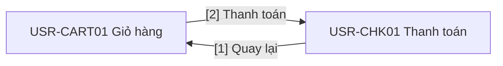

# Design: Giỏ hàng

> **Epic:** SHOP-120 · **Jira:** https://example.atlassian.net/browse/SHOP-120 · **Spec:** docs/specs/SHOP-120/spec.md · **Status:** Draft
>
> **Figma version:** none
>
> **Claude Design version:** 1795459699-c1d6

## Screens

| Code | Name | Route | User story | Kind | App |
|---|---|---|---|---|---|
| USR-CART01 | Giỏ hàng | /cart | Là khách, tôi muốn xem giỏ hàng trước khi trả | Claude Design | user |
| USR-CHK01 | Thanh toán | /checkout | Là khách, tôi muốn trả tiền cho giỏ hàng | ASCII | user |

## Flow



## Screen Details

### USR-CART01 · Giỏ hàng


```yaml
screen: USR-CART01
route: /cart
claude-design: https://claude.ai/artifact/4MHNq6Tk2x3o31S4RVXD5V
prototype: design/USR-CART01.html
blocks:
  1:
    name: Danh sách sản phẩm
    type: list
    content: Ảnh, tên, giá và số lượng của từng sản phẩm
  2:
    name: Nút Thanh toán
    type: button
    behavior: Sang USR-CHK01
    ac: [AC1]
```

### USR-CHK01 · Thanh toán

```text
USR-CHK01 · Thanh toán · desktop
+------------------------------+
| [1] Quay lại                 |
| [2] Tổng tiền                |
| [3] Đặt hàng                 |
+------------------------------+
```

```yaml
screen: USR-CHK01
route: /checkout
blocks:
  1:
    name: Quay lại
    type: link
    behavior: Về USR-CART01
  2:
    name: Tổng tiền
    type: text
  3:
    name: Đặt hàng
    type: button
    ac: [AC2]
```

## Design System

| Loại | Tên | Giá trị | Có hay mới |
|---|---|---|---|
| Màu | brand | #1f5f4a, nút chính và liên kết | mới |
| Bo góc | radius-md | 10px, nút | mới |

## Open Questions

- Q1 Chữ của nút Thanh toán khi giỏ rỗng là gì? Đề xuất: ẩn nút và hiện "Giỏ hàng trống".
