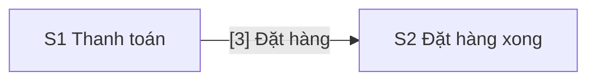

# Design: Thanh toán

> **Epic:** DEMO-30 · **Jira:** https://example.atlassian.net/browse/DEMO-30 · **Spec:** docs/specs/DEMO-30/spec.md · **Status:** Draft
>
> **Figma version:** Checkout v3, duyệt ngày 2026-11-04

## Screens
| Code | Name | Route | User story | Kind |
|---|---|---|---|---|
| S1 | Thanh toán | /checkout | Là khách, tôi muốn thấy số tiền đã giảm trước khi trả | Figma |
| S2 | Đặt hàng xong | /orders/done | Là khách, tôi muốn biết đơn đã được tạo | ASCII |

## Flow


## Screen Details

### S1 · Thanh toán


```yaml
screen: S1
route: /checkout
figma: https://www.figma.com/design/AbCdEf123/Shop?node-id=12-345
blocks:
  1:
    name: Liên kết Quay lại giỏ hàng
    type: link
    figma: "12:350"
  2:
    name: Dòng Giảm giá
    type: text
    ac: [AC1]
  3:
    name: Nút Đặt hàng
    type: button
    behavior: Tạo đơn rồi sang S2
    figma: "12:372"
```

### S2 · Đặt hàng xong

```text
S2 · Đặt hàng xong · desktop
+------------------------------+
| [1] Mã đơn hàng              |
+------------------------------+
```

```yaml
screen: S2
route: /orders/done
blocks:
  1:
    name: Mã đơn hàng
    type: text
```

## Open Questions
Không có.
