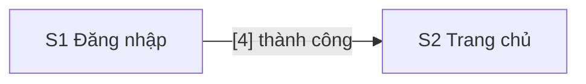

# Design: Đăng nhập

> **Epic:** DEMO-10 · **Jira:** https://example.atlassian.net/browse/DEMO-10 · **Spec:** docs/specs/DEMO-10/spec.md · **Status:** Draft
>
> **Figma version:** none

## Screens
| Code | Name | Route | User story | Kind |
|---|---|---|---|---|
| S1 | Đăng nhập | /login | Là người dùng, tôi muốn đăng nhập để xem đơn hàng | ASCII |
| S2 | Trang chủ | / | Là người dùng, tôi muốn thấy trang chủ sau khi đăng nhập | ASCII |

## Flow


## Screen Details

### S1 · Đăng nhập

```text
S1 · Đăng nhập · desktop
+----------------------------------------+
| [1] Logo                               |
+----------------------------------------+
| [2] Email      [__________________]    |
| [3] Mật khẩu   [__________________]    |
| [4] (Đăng nhập)   [ ] Ghi nhớ          |
| [5] Thông báo lỗi                      |
+----------------------------------------+
```

```yaml
screen: S1
route: /login
blocks:
  1: { name: Logo, type: image }
  2:
    name: Ô Email
    type: input
    ac: [AC1]
  3:
    name: Ô Mật khẩu
    type: input
  4:
    name: Nút Đăng nhập
    type: button
    behavior: Thành công thì sang S2; sai thì hiện [5]
    ac: [AC1, AC2]
  5:
    name: Thông báo lỗi
    type: text
    ac: [AC2]
```

### S2 · Trang chủ

```text
S2 · Trang chủ · desktop
+----------------------+
| [1] Lời chào 👋      |
+----------------------+
```

```yaml
screen: S2
route: /
blocks:
  1:
    name: Lời chào
    type: text
```

## Open Questions
Không có.
